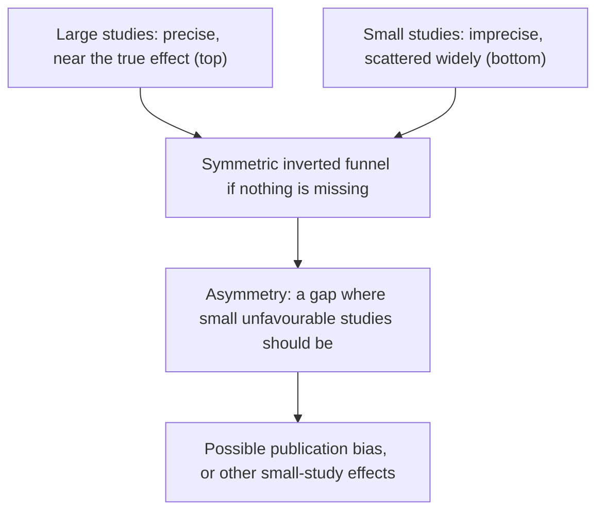

# Funnel plots

**Prerequisites:** [Kaplan-Meier curves](08-kaplan-meier-curves.md), [Meta-analysis](../03-study-designs/15-meta-analysis.md) and [Distributions](../02-statistics/03-distributions.md).

@@IMG@@

If a meta-analysis is missing studies because unfavourable results went unpublished, the pooled result will be biased. A **funnel plot** is a simple graphical check for this problem, and for other "small-study effects". It is widely used, and also widely over-interpreted, so it is worth knowing both what it shows and what it cannot.

## The idea

Small studies are imprecise: their results scatter widely around the true effect. Large studies are precise: their results cluster closely around it. If you plot each study's **effect estimate** (horizontal axis) against a measure of its **precision** or size (vertical axis, often the standard error with the most precise studies at the top), the points should form an inverted funnel: narrow at the top, wide at the bottom, and **symmetric** around the pooled effect.

The technique was proposed by Richard Light and David Pillemer in their 1984 book *Summing Up: The Science of Reviewing Research*.

## Asymmetry

If small studies with unfavourable or null results have gone unpublished, the bottom of the funnel will be **lopsided**: small studies will appear only on the side favouring the intervention. The pooled estimate will then be biased toward benefit.

In 1997, Matthias Egger, George Davey Smith, Martin Schneider and Christoph Minder proposed a regression test for funnel plot asymmetry in the *BMJ*, now known as **Egger's test**. They showed that asymmetry predicted discordance between meta-analyses and later large trials, including the case of intravenous magnesium after heart attack ([meta-analysis](../03-study-designs/15-meta-analysis.md)).

## Asymmetry is not proof of publication bias

Funnel asymmetry has several possible causes, as Jonathan Sterne and colleagues set out in a widely cited 2011 *BMJ* guide:

- **Publication bias** and selective outcome reporting.
- **Poor methodological quality** in small studies, which tend to exaggerate effects.
- **True heterogeneity**: small studies may genuinely differ (for example, enrolling higher-risk patients in whom the treatment works better).
- **Artefacts** of the effect measure: for odds ratios, the estimate and its standard error are mathematically correlated.
- **Chance**, especially with few studies.

For this reason the term **small-study effects** is preferred: asymmetry shows that small studies differ from large ones, and publication bias is only one explanation.

## Limits

- With fewer than about **10 studies**, funnel plots and asymmetry tests have little power and are generally not recommended (the Cochrane Handbook gives this guidance).
- **Visual judgement is unreliable**: studies have shown that researchers looking at the same funnel plots often disagree about whether they are asymmetric.
- Symmetry does not prove the absence of bias: if publication bias removed studies evenly, or if all studies were biased in the same direction, the funnel could still look symmetric.

## Related methods

- **Contour-enhanced funnel plots** shade regions of statistical significance, helping to show whether "missing" studies would have been non-significant (suggesting publication bias) or not.
- **Trim-and-fill** imputes hypothetical missing studies to estimate an adjusted effect. It rests on strong assumptions and should be treated as a sensitivity analysis.
- **Selection models** and **PET-PEESE** methods attempt to correct for publication bias statistically, with varying success.
- The most direct remedy is to **find the missing data**: trial registries, regulatory documents and clinical study reports ([trial registries](../06-research-integrity/02-trial-registries.md), [Tamiflu case study](../10-case-studies/08-tamiflu-and-hidden-trial-data.md)).

## Key ideas

- A funnel plot graphs effect size against precision; without bias it looks like a symmetric inverted funnel.
- Asymmetry suggests small-study effects, of which publication bias is one cause.
- Egger's test is a regression test for asymmetry.
- With fewer than about 10 studies, funnel plots are unreliable.
- Finding the missing data is better than statistically guessing at it.

## Where this leads

- Next: [Discussion, limitations and spin](10-discussion-limitations-and-spin.md)
- Related: [Publication bias](../06-research-integrity/06-publication-bias.md)
