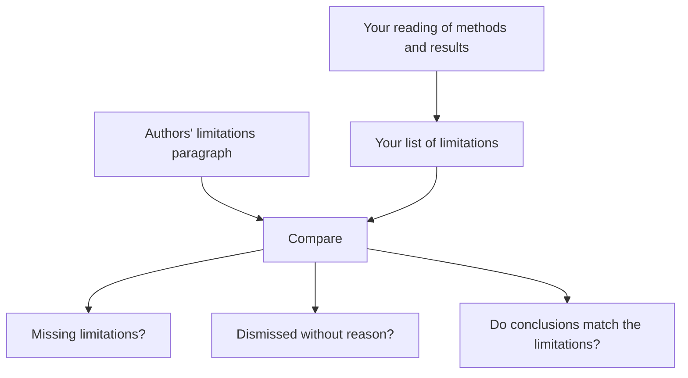

# Discussion, limitations and spin

**Prerequisites:** [Funnel plots](09-funnel-plots.md) and [Title and abstract](02-title-and-abstract.md).

@@IMG@@

The discussion is where the authors interpret their results: what they mean, how they fit with other evidence, what the limitations are and what should happen next. It is the most subjective part of a paper. By the time you reach it, you should already have your own view of the results, so that you can judge the authors' interpretation rather than adopt it.

## What a good discussion contains

1. **A summary of the main finding**, consistent with the primary outcome.
2. **Comparison with other studies**, ideally with a systematic review, explaining agreements and disagreements.
3. **Strengths and limitations**, specific and honest.
4. **Interpretation and implications**, proportionate to the evidence.
5. **Unanswered questions** and suggestions for future research.

## Reading the limitations paragraph

Most papers include a limitations paragraph. It is valuable, but read it critically:

- **Generic limitations** ("as with all observational studies, residual confounding cannot be excluded") are often included and then ignored. Ask: *how much* could residual confounding matter here, and in which direction?
- **Missing limitations**: compare with your own list from reading the methods. Did the authors mention the 25% dropout? The switched outcome? The industry funding?
- **Limitations followed by dismissal**: "Although X is a limitation, we believe it is unlikely to have affected our results." Is that belief justified?
- **Limitations that should change the conclusion**: if the limitations are serious, the conclusions should be tentative. Often they are not.

## Spin

**Spin** is reporting that distorts the interpretation of results, making them look more favourable or more certain than they are. It is usually not lying; the numbers may all be correct. It works through emphasis, selection and language. Common forms include:

- **Focusing on secondary outcomes or subgroups** when the primary result was null.
- **"Trend" language**: describing p = 0.09 as "a trend toward benefit", while a p = 0.09 result in the unwelcome direction would be called "no difference".
- **Overgeneralisation**: extending results to populations, doses or durations not studied.
- **Causal language** for associations.
- **Clinical recommendations** not supported by the data: an observational study concluding that doctors should change practice.
- **Ignoring harms** or describing them as "well tolerated" without data.
- **Inappropriate claims of equivalence**: treating a non-significant difference as proof that two treatments are equal.

Isabelle Boutron, Philippe Ravaud and colleagues have studied spin extensively. Their 2010 *JAMA* study found spin common in the reports of trials with non-significant primary outcomes, and a 2014 trial they ran with clinicians, published in the *Journal of Clinical Oncology*, found that abstracts with spin led readers to rate experimental treatments as more beneficial.

## Spin can go both ways

Spin is not only for exaggerating benefits. Authors can also spin results to **minimise harms**, to defend an established practice, to discredit a rival hypothesis, or to support a policy position. A paper finding an inconvenient association might bury it under qualifications; a paper with a welcome null result might overstate its precision. Apply the same scrutiny whichever direction the spin runs ([why reading research is hard](../01-foundations/06-why-reading-research-is-hard.md)).

## "More research is needed"

Many discussions end by calling for more research. Sometimes this is right: the evidence is genuinely uncertain. Sometimes it is a reflex, or a way of avoiding a clear conclusion that the evidence already supports. Ask whether another study would actually change anything, and what it would need to look like.

## Comparing with other evidence

The most useful part of a discussion is often its comparison with previous work. Good discussions explain why this study's results might differ from others (different populations, designs, doses, follow-up). Bad discussions cite only agreeing studies. Check whether a systematic review on the question exists, and whether this study's result is consistent with it ([single studies and the weight of evidence](../09-from-lab-to-headline/06-single-studies-and-the-weight-of-evidence.md)).

## Key ideas

- The discussion is interpretation; form your own view before reading it.
- Compare the authors' limitations with your own list; watch for generic or dismissed limitations.
- Spin distorts through emphasis, selection and language, not usually false numbers.
- Spin can exaggerate benefits, minimise harms or defend any position; scrutinise symmetrically.
- Check the discussion's account of other evidence against a systematic review.

## Where this leads

- Next: [Supplementary material and data](11-supplementary-material-and-data.md)
