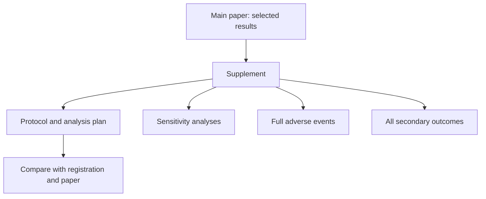

# Supplementary material and data

**Prerequisites:** [Discussion, limitations and spin](10-discussion-limitations-and-spin.md).

@@IMG@@

Journals limit the length of papers, so much of the detail ends up in **supplementary material** (also called supplementary appendices, online supplements or extended data). Most readers never open it. Yet it often contains the information that matters most for judging a study: the full protocol, the statistical analysis plan, sensitivity analyses, complete adverse event tables and results for every outcome.

## What is usually in the supplement

- **The protocol** and **statistical analysis plan (SAP)**, sometimes with a history of amendments. Major journals such as the *New England Journal of Medicine* and *The Lancet* commonly publish trial protocols alongside papers.
- **Additional methods**: detailed definitions, questionnaires, laboratory techniques, code lists for database studies.
- **Extra tables and figures**: full baseline characteristics, secondary and exploratory outcomes, subgroup analyses.
- **Sensitivity analyses**: results under different assumptions, models or definitions.
- **Complete adverse event data**.
- **Lists of investigators and sites**.
- **Data and code**, or links to repositories.

## Why it matters

### Checking for changes

Comparing the **protocol** (and its amendments) with the paper is the most direct way to detect [outcome switching](../06-research-integrity/03-outcome-switching.md) and changed analyses. When the protocol's primary outcome or analysis differs from the paper's, the paper should say so and explain why. Often it does not.

### Robustness

Sensitivity analyses show whether the main result holds under different reasonable assumptions. If the headline result disappears when, say, missing data are handled differently, that is crucial information, and it is often only in the supplement.

### Harms

Main papers sometimes summarise harms briefly ("the drug was well tolerated") while the supplement contains the full tables. Read them.

### Inconvenient results

Results that did not fit the story, such as non-significant secondary outcomes or unfavourable subgroups, are more likely to be relegated to the supplement.

## Beyond the supplement: the hidden record

For drug trials, even the supplement is a summary. More complete records exist:

- **Clinical study reports (CSRs)**: detailed reports submitted to regulators, often thousands of pages long. In the [Tamiflu](../10-case-studies/08-tamiflu-and-hidden-trial-data.md) saga, Cochrane researchers spent years obtaining CSRs from the manufacturer, Roche, and found information missing from published papers.
- **Regulatory reviews**: the US FDA publishes reviews of approved drugs, and the European Medicines Agency has published clinical data under its transparency policy since 2016. Erick Turner and colleagues used FDA reviews in their 2008 *New England Journal of Medicine* study showing selective publication of antidepressant trials ([publication bias](../06-research-integrity/06-publication-bias.md)).
- **Trial registry results**: ClinicalTrials.gov and the EU Clinical Trials Register include summary results for many trials, sometimes for trials never published in journals ([trial registries](../06-research-integrity/02-trial-registries.md)).
- **Individual participant data**: some sponsors and repositories, such as Vivli and the Yale University Open Data Access (YODA) Project, allow qualified researchers to request patient-level data.

## Data availability statements

Many journals now require a **data availability statement**. Statements such as "data are available from the corresponding author on reasonable request" are common, but studies that tried requesting data have often had low success rates. A 2018 study by Florian Naudet and colleagues in the *BMJ* requested individual patient data from trials published in the *BMJ* and *PLOS Medicine*, journals with strong data-sharing policies, and obtained data for fewer than half the eligible trials. Deposited data in public repositories is more reliable.

## A practical approach

For papers that matter to you:

1. Open the supplement and find the protocol and analysis plan.
2. Check the registered and protocol primary outcomes against the paper.
3. Read the sensitivity analyses.
4. Look at the full adverse event tables.
5. Check whether data and code are available.

## Key ideas

- Supplements often contain the protocol, analysis plan, sensitivity analyses and full harms data.
- Comparing protocol and paper reveals outcome switching and changed analyses.
- Clinical study reports and regulatory reviews hold more complete records than journal articles.
- "Available on request" often means unavailable in practice.
- For important papers, always open the supplement.

## Where this leads

- Next: [Reporting checklists](12-reporting-checklists.md)
