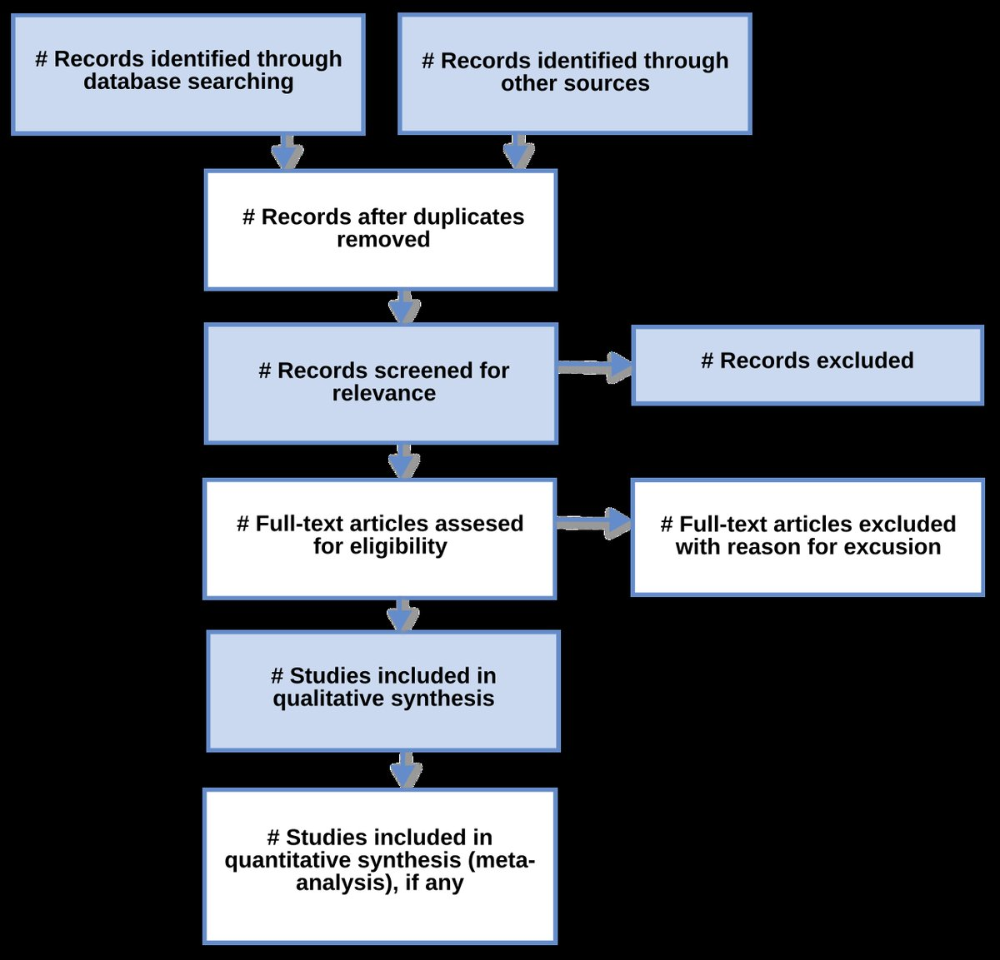
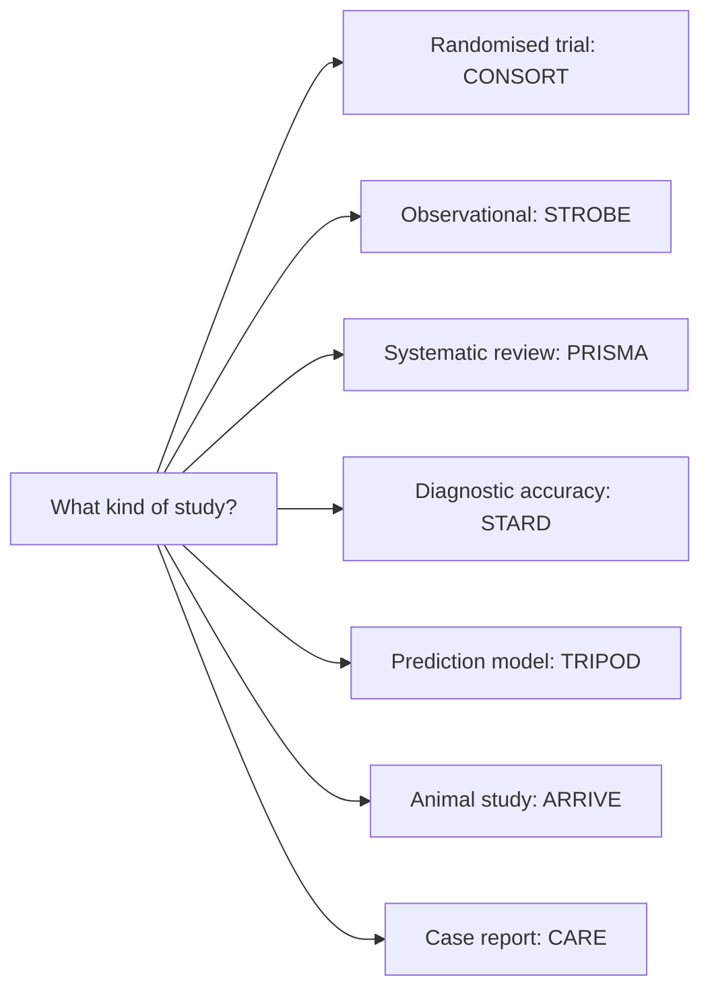

# Reporting checklists

**Prerequisites:** [Supplementary material and data](11-supplementary-material-and-data.md).

*PRISMA flow diagram for reporting how studies were identified and selected in a systematic review. Credit: Atizinha. License: [CC BY-SA 4.0](https://creativecommons.org/licenses/by-sa/4.0). Source: [File:PRISMA flow diagram.svg](https://commons.wikimedia.org/wiki/File:PRISMA_flow_diagram.svg).*

Many papers fail to report the details needed to judge them. **Reporting guidelines** are checklists, developed by groups of methodologists, editors and researchers, that specify what a paper of a given type should include. Most major medical journals require or recommend them. For readers, they double as ready-made appraisal checklists: if a paper omits an item, you know what to look for.

## Why they exist

In the 1990s, studies of published trials found that basic information, such as how randomisation was done or whether allocation was concealed, was often missing. Kenneth Schulz and colleagues showed in 1995 that trials with unclear or inadequate concealment reported larger effects ([allocation concealment](../03-study-designs/08-blinding-placebos-and-allocation-concealment.md)). In response, a group of trialists and editors published the first **CONSORT** statement in 1996. Many other guidelines followed. The **EQUATOR Network** (Enhancing the QUAlity and Transparency Of health Research), launched in 2008, maintains a searchable library of hundreds of reporting guidelines.

## The main guidelines

| Guideline | For | Notes |
|---|---|---|
| **CONSORT** | Randomised trials | First published 1996; revised 2001, 2010 and 2025. CONSORT 2025 has a 30-item checklist and a participant flow diagram, with a new section on open science. Extensions cover cluster, non-inferiority, harms, abstracts and more. |
| **SPIRIT** | Trial protocols | SPIRIT 2025 was published alongside CONSORT 2025. |
| **STROBE** | Observational studies (cohort, case-control, cross-sectional) | Published 2007; 22 items. Extensions include RECORD for routinely collected data. |
| **PRISMA** | Systematic reviews and meta-analyses | First published 2009; PRISMA 2020 is the current version, with a 27-item checklist and a flow diagram. |
| **STARD** | Diagnostic accuracy studies | STARD 2015. |
| **TRIPOD** | Prediction models | TRIPOD+AI (2024) covers models using machine learning. |
| **CARE** | Case reports | Published 2013. |
| **ARRIVE** | Animal research | ARRIVE 2.0 published 2020. |
| **CHEERS** | Health economic evaluations | CHEERS 2022. |
| **COREQ** / **SRQR** | Qualitative research | |

## What CONSORT asks for

The CONSORT checklist gives a feel for what all these guidelines cover. It asks trial reports to describe, among other things:

- the trial design and any changes after it started;
- eligibility criteria, settings and locations;
- the interventions in enough detail to replicate them;
- pre-specified primary and secondary outcomes, and any changes;
- how the sample size was determined;
- how the random sequence was generated, how allocation was concealed, and who was blinded;
- the statistical methods;
- a **flow diagram** of participants through each stage;
- baseline data for each group;
- numbers analysed, outcomes with effect sizes and confidence intervals;
- harms;
- limitations, generalisability and interpretation;
- registration, protocol access and funding.

## Using checklists as a reader

You do not need to tick every item. Use the checklist to direct attention:

- **Is randomisation and concealment described?** If not, be cautious.
- **Is there a flow diagram?** If not, you cannot tell who was analysed.
- **Is the primary outcome stated, and does it match the registration?**
- **For observational studies, does the paper explain how confounders were chosen and how missing data were handled?** (STROBE items.)
- **For reviews, is there a PRISMA flow diagram and a registered protocol?**

## Limits

Reporting guidelines improve **reporting**, not necessarily **conduct**. A well-reported trial can still be a bad trial; the checklist just makes its weaknesses visible. Endorsement by a journal does not guarantee adherence: studies assessing published trials have repeatedly found incomplete adherence to CONSORT even in endorsing journals, though reporting has improved since the 1990s. Finally, checklists can be completed in a box-ticking way. Check that the information is actually there, not just that the item number is cited.

## Risk-of-bias tools

Distinct from reporting guidelines are **risk-of-bias tools**, which judge how well a study was *conducted*: the Cochrane **RoB 2** tool for randomised trials, **ROBINS-I** for non-randomised studies of interventions, and **QUADAS-2** for diagnostic accuracy studies. Systematic reviews use these to rate each included study ([systematic reviews](../03-study-designs/14-systematic-reviews.md)).

## Key ideas

- Reporting guidelines specify what papers of each type should include.
- CONSORT (trials), STROBE (observational), PRISMA (reviews) and STARD (diagnostics) are the most important.
- The EQUATOR Network hosts hundreds of guidelines.
- Readers can use them as checklists for what to look for.
- Good reporting is not the same as good conduct; risk-of-bias tools assess conduct.

## Where this leads

- Next section: [Research integrity](../06-research-integrity/README.md), starting with [preregistration](../06-research-integrity/01-preregistration.md)
