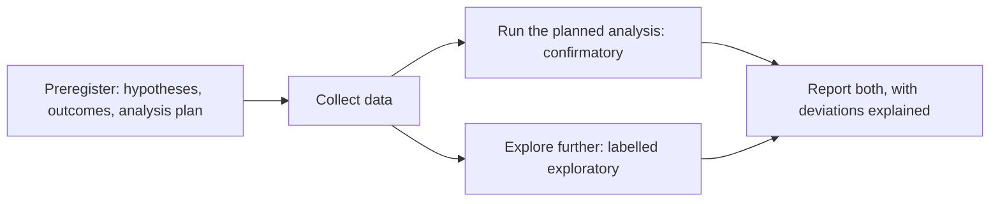

# Preregistration

**Prerequisites:** [[reporting-checklists|Reporting checklists]], [[multiple-comparisons|Multiple comparisons]] and [[falsifiability-and-theories|Falsifiability]].

@@IMG@@

A statistical test means what it claims to mean only if the hypothesis and analysis were chosen **before** seeing the data. **Preregistration** is the practice of publicly recording a study's hypotheses, design, primary outcomes and analysis plan in advance, in a time-stamped, unchangeable form. It is the single most important reform of the last few decades for separating genuine tests from post-hoc storytelling.

## The problem it solves

Once researchers have seen their data, many choices become tempting: which outcome to emphasise, which covariates to include, which participants to exclude, which subgroup to highlight, whether to transform a variable. Each choice may be defensible, but making them *after* seeing the results means the analysis is shaped by the data. The p-values that result no longer have their nominal meaning ([[p-hacking|p-hacking]], [[harking|HARKing]]). Andrew Gelman and Eric Loken call this the **garden of forking paths**: even researchers who run only one analysis may have chosen it because of the data.

Preregistration fixes the path in advance. It distinguishes:

- **Confirmatory** analyses: planned in advance, which can be interpreted as genuine tests;
- **Exploratory** analyses: decided after seeing data, which are hypothesis-generating.

Both are legitimate. The problem is presenting exploratory results as confirmatory.

## What a preregistration contains

Typically:

- the research question and hypotheses;
- the design and the population;
- the primary and secondary outcomes, and how they will be measured;
- the planned sample size and its justification;
- the statistical analysis plan, including handling of outliers, missing data and covariates;
- inclusion and exclusion rules.

## Where it happens

- **Clinical trials** are registered in trial registries such as ClinicalTrials.gov, now largely mandatory ([[trial-registries|trial registries]]).
- **Systematic reviews** register protocols in PROSPERO ([[systematic-reviews|systematic reviews]]).
- **Other research**, especially in psychology and social science, uses platforms such as the Open Science Framework (OSF) Registries and AsPredicted. Brian Nosek and colleagues described the case for expanding preregistration across science in a 2018 paper in *PNAS*, "The preregistration revolution".

## Registered reports

A stronger form is the **registered report**: researchers submit their introduction, methods and analysis plan to a journal **before** collecting data. If reviewers approve the plan, the journal commits in principle to publishing the results **whatever they turn out to be**. This removes the incentive to produce positive findings. The format was launched at the journal *Cortex* in 2013, championed by Chris Chambers, and has since been adopted by hundreds of journals. A 2021 study by Anne Scheel, Mitchell Schijen and Daniël Lakens in *Advances in Methods and Practices in Psychological Science* found that 44% of registered reports in psychology supported their first hypothesis, compared with 96% of a comparison sample of standard papers.

## Does it work?

Evidence suggests preregistration changes results substantially. Robert Kaplan and Veronica Irvin examined large cardiovascular trials funded by the US National Heart, Lung, and Blood Institute and reported in *PLOS One* in 2015 that 17 of 30 trials published before 2000 (57%) showed a significant benefit on their primary outcome, compared with 2 of 25 (8%) published after 2000, when prospective registration on ClinicalTrials.gov had become required. They stressed that this was an association, not proof, but the pattern is consistent with registration reducing flexible reporting.

## Limits and criticisms

- **Registration is not compliance.** Many studies deviate from their registrations without saying so ([[outcome-switching|outcome switching]]). Registration only helps if someone checks.
- **Vague registrations** leave room for flexibility. A registration that says "we will measure depression" without specifying the scale and time point constrains little.
- **Exploration is valuable**, and some researchers worry that preregistration culture devalues it. The answer most proponents give is to label exploration clearly, not to stop it.
- **Not all research fits.** Qualitative research, some observational analyses of existing data, and fast-moving outbreak research fit the model less neatly, though adapted forms exist.

## For readers

- Look for a registration number or link, and check the date: was it registered **before** data collection (prospective) or after (retrospective)?
- Compare the registered primary outcome and analysis with what was reported.
- Treat unregistered or retrospectively registered studies, especially with surprising results, as more exploratory.

## Key ideas

- Preregistration records hypotheses, outcomes and analysis plans before data are seen.
- It distinguishes confirmatory tests from exploratory analyses.
- Registered reports commit journals to publish regardless of results.
- Evidence suggests registration reduces the share of positive findings.
- Registration only helps if deviations are reported and checked.

## Where this leads

- Next: [[trial-registries|Trial registries]]
