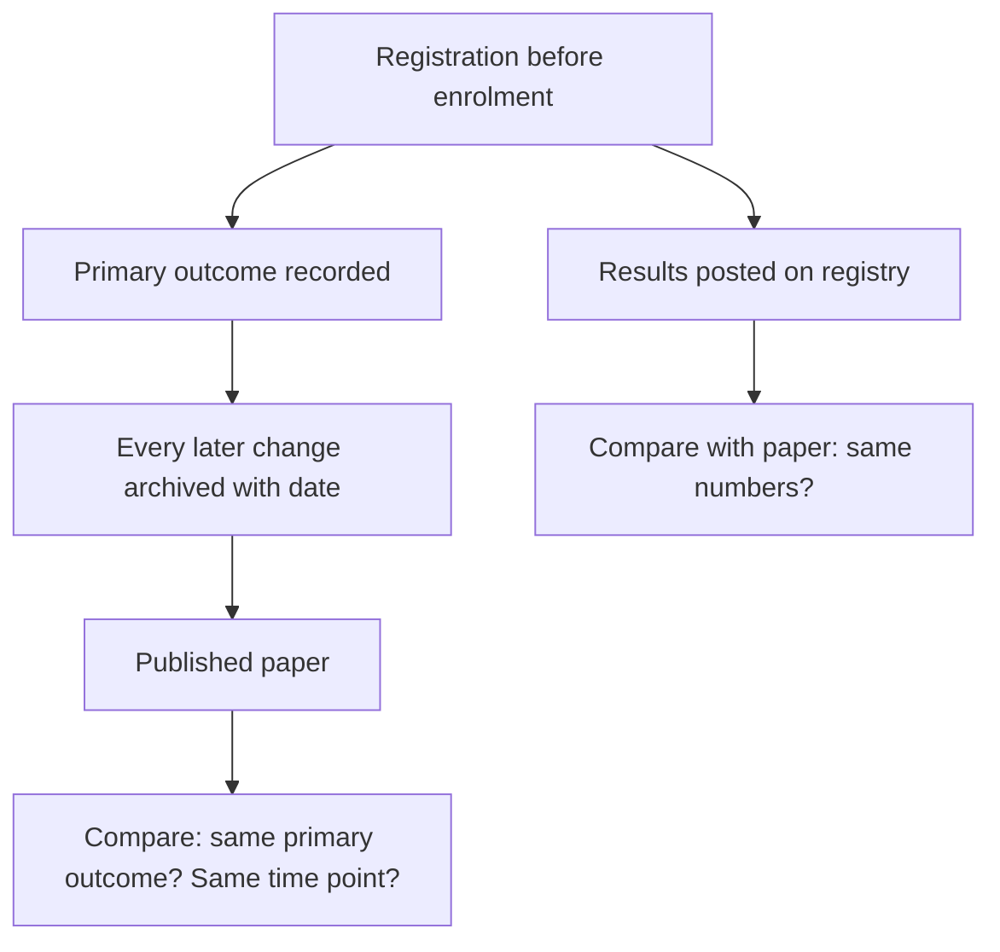

# Trial registries

**Prerequisites:** [[preregistration|Preregistration]].

@@IMG@@

A **trial registry** is a public database in which clinical trials are recorded, ideally before the first participant is enrolled. Registries make it possible to know that a trial exists even if it is never published, to compare what was planned with what was reported, and increasingly to see summary results. They are among the most useful tools available to anyone reading clinical research.

## Why registries were created

For decades there was no reliable way to know how many trials of a drug had been run. Unfavourable trials could simply vanish. The statistician R. J. Simes argued in 1986 for an international registry of trials to counter publication bias. Iain Chalmers and others campaigned for years. Several scandals involving unpublished data, including concerns about the safety of antidepressants in young people that came to light around 2003–2004, added urgency.

## Key milestones

- **2000**: the US National Library of Medicine launched **ClinicalTrials.gov**, following the FDA Modernization Act of 1997.
- **2004**: the **International Committee of Medical Journal Editors (ICMJE)** announced that its member journals would consider publishing trials only if they had been registered in a public registry before enrolment began, for trials starting after 1 July 2005.
- **2006**: the World Health Organization launched the **International Clinical Trials Registry Platform (ICTRP)**, a portal searching many national and regional registries.
- **2007**: the US **Food and Drug Administration Amendments Act (FDAAA)** required registration of many drug and device trials and, for applicable trials, posting of summary results on ClinicalTrials.gov, generally within a year of completion. A **Final Rule** clarifying these requirements took effect in 2017.
- **Europe**: the EU Clinical Trials Register, and since 2022–2023 the Clinical Trials Information System (CTIS) under the EU Clinical Trials Regulation.
- **Other registries** include the ISRCTN registry (UK-based), the Australian New Zealand Clinical Trials Registry, and the Chinese Clinical Trial Registry. Health Canada maintains a database of clinical trials it has authorised, and Canadian trials are commonly registered on ClinicalTrials.gov.

## What a registry entry contains

A ClinicalTrials.gov record (identified by an **NCT number**, such as NCT01234567) includes:

- the trial's title, sponsor, design and phase;
- eligibility criteria and target enrolment;
- **primary and secondary outcomes**, with time frames;
- locations and dates;
- a **history of changes**: every edit is archived, so you can see what the record said at any date;
- for many completed trials, **results**: participant flow, baseline characteristics, outcomes and adverse events.

## How to use a registry as a reader

1. **Find the registration number** in the paper's abstract or methods, then look it up.
2. **Check the registration date** against the trial start date. Registration after enrolment began ("retrospective registration") weakens its value.
3. **Use the history of changes** to see what the primary outcome was at the start. Changes made after the trial was underway, especially near its end, are a warning sign.
4. **Compare outcomes** with the paper: same primary outcome? Same time point? Any registered outcomes missing from the paper? ([[outcome-switching|outcome switching]])
5. **Check posted results** if available, and compare them with the publication.
6. **Search for unpublished trials** of the same intervention. Many completed trials never appear in journals.

## Compliance problems

Registration and results reporting are far from universal. Ben Goldacre and colleagues' **FDAAA TrialsTracker** project, described in *The Lancet* in 2020, monitored trials covered by the US law and found that many sponsors had not posted results on time, despite the legal requirement. Their **EU Trials Tracker** found similar gaps in Europe. Academic sponsors have often performed worse than large pharmaceutical companies on results reporting. Enforcement through fines, though authorised, has been rare.

## Key ideas

- Trial registries record trials before enrolment, making unpublished trials visible.
- ClinicalTrials.gov launched in 2000; ICMJE journals required registration for trials starting after 1 July 2005; US law required results posting from 2007.
- Registry records archive every change, letting readers check for outcome switching.
- Look up the registration number and compare outcomes, dates and results with the paper.
- Compliance with registration and results reporting remains incomplete.

## Where this leads

- Next: [[outcome-switching|Outcome switching]]
