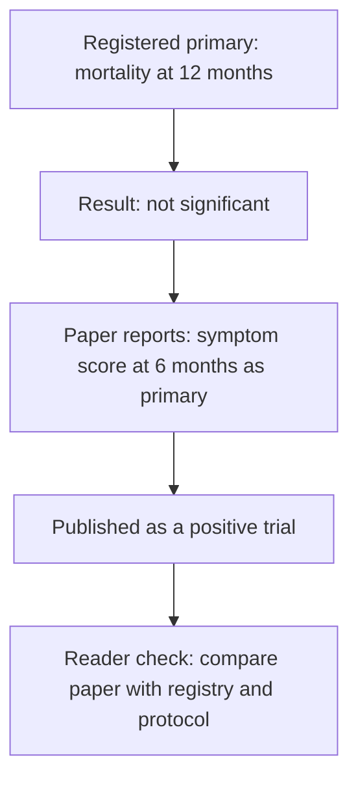

# Outcome switching

**Prerequisites:** [Trial registries](02-trial-registries.md) and [Multiple comparisons](../02-statistics/16-multiple-comparisons.md).

@@IMG@@

**Outcome switching** (or **selective outcome reporting**) happens when the outcomes reported in a paper differ from those pre-specified in the protocol or registry, without clear acknowledgement. A disappointing primary outcome is demoted or dropped, and a secondary outcome that looked better is promoted. Because trials measure many outcomes, this can turn a failed trial into an apparent success.

## Forms it takes

- **Primary outcome changed**: a different outcome is presented as primary.
- **Primary outcome demoted**: the original primary is reported as secondary or buried in a supplement.
- **Pre-specified outcomes omitted** entirely.
- **New outcomes added** without saying they were not pre-specified.
- **Time point changed**: the outcome is the same but measured at 6 months instead of the registered 12.
- **Definition or analysis changed**: a different scale, threshold or statistical model.

## How common is it?

Several studies have documented it:

- In 2004, An-Wen Chan and colleagues compared protocols of trials approved by ethics committees in Copenhagen and Frederiksberg with their publications, in *JAMA*. They found that a large majority of trials had at least one efficacy outcome that was incompletely reported, and that statistically significant outcomes were more likely to be fully reported than non-significant ones. Many trials changed their primary outcome between protocol and publication.
- The **COMPare** project, led by Ben Goldacre at the University of Oxford, checked every trial published in five leading medical journals (*NEJM*, *JAMA*, *The Lancet*, *Annals of Internal Medicine* and *BMJ*) over six weeks in 2015–2016 against its registry or protocol. Of 67 trials assessed, 58 had discrepancies that warranted a correction letter. The team sent letters to the journals. As reported in *Trials* in 2019, only 23 of 58 letters were published; *Annals* and the *BMJ* published all theirs, *The Lancet* most, and *NEJM* and *JAMA* none. Some journal editors and trialists disputed COMPare's methods and judgements, and the exchange is itself a useful case study in how hard it is to correct the record.
- A 2015 systematic review by Jones and colleagues in *BMC Medicine* found discrepancies between registered and published primary outcomes in a substantial share of trials across many studies.

## A notorious example: Study 329

GlaxoSmithKline's **Study 329**, a trial of the antidepressant paroxetine in adolescents, published in 2001, reported that the drug was "generally well tolerated and effective". The protocol had specified two primary and six secondary outcomes; none of the eight showed a significant benefit, and the published paper highlighted outcomes that had not been pre-specified as primary. A reanalysis using the original data, published by Joanna Le Noury and colleagues in the *BMJ* in 2015, concluded that paroxetine was not effective for adolescent depression and was associated with increased harms. See the [Study 329 case study](../10-case-studies/06-paroxetine-study-329.md).

## Legitimate changes

Not every change is misconduct. Outcomes can legitimately change before the data are unblinded: a measurement tool proves unworkable, recruitment is slower than expected, or new evidence emerges. The test is **transparency and timing**:

- Was the change made **before** anyone saw unblinded results?
- Is it **reported and explained** in the paper?
- Is the **original outcome still reported**?

## How to check

1. Find the registration number and look up the record, using the change history to see the original primary outcome.
2. Find the protocol (often in the supplement) and its amendments.
3. Compare primary and secondary outcomes, time points and analyses with the paper.
4. Check whether all pre-specified outcomes are reported somewhere.
5. If there are discrepancies, check whether the paper acknowledges them.

## Key ideas

- Outcome switching reports outcomes different from those pre-specified, without acknowledgement.
- It takes many forms: changed, demoted, omitted or added outcomes; changed time points or analyses.
- Studies by Chan and by COMPare found it common, even in top journals.
- Changes are legitimate only if made before unblinding, reported and explained.
- Readers can check by comparing papers with registries and protocols.

## Where this leads

- Next: [P-hacking and researcher degrees of freedom](04-p-hacking.md)
- Case study: [Paroxetine Study 329](../10-case-studies/06-paroxetine-study-329.md)
