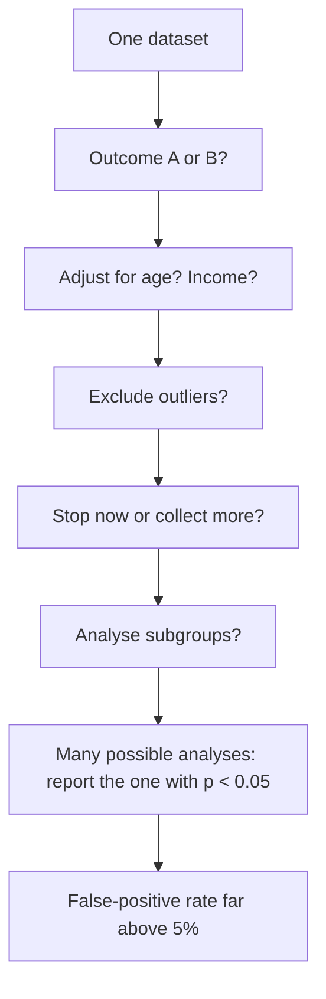

# P-hacking and researcher degrees of freedom

**Prerequisites:** [[outcome-switching|Outcome switching]] and [[misreading-p-values|Misreading p-values]].

@@IMG@@

**P-hacking** means analysing data in multiple ways and selectively reporting the analyses that produce statistically significant results. It is usually not deliberate fraud. Most researchers who p-hack believe they are finding the "right" analysis. But the effect is the same: false positives become far more common than the nominal 5%.

## Researcher degrees of freedom

Every analysis involves choices, which Joseph Simmons, Leif Nelson and Uri Simonsohn called **researcher degrees of freedom** in an influential 2011 paper in *Psychological Science*, "False-positive psychology: undisclosed flexibility in data collection and analysis allows presenting anything as significant". Examples include:

- which of several **outcome measures** to report;
- whether to **combine or split** measures;
- which **covariates** to adjust for;
- how to handle **outliers** and which participants to **exclude**;
- whether to **transform** variables (log, ranks);
- which **subgroups** to analyse;
- **when to stop** collecting data.

Using computer simulations, Simmons and colleagues showed that combining just a few such choices could raise the false-positive rate from 5% to over 60%. To make the point vividly, they reported a real experiment in which, using flexible analysis, they "showed" that listening to the Beatles song "When I'm Sixty-Four" made participants younger: an obviously impossible result produced with standard, apparently defensible methods.

## Optional stopping

A particularly subtle form is **optional stopping**: checking results as data come in and stopping when p < 0.05. Because p-values fluctuate as data accumulate, repeatedly checking and stopping at the first significant result inflates false positives. Properly designed trials with planned interim analyses use **sequential methods** (such as the O'Brien-Fleming boundaries) that adjust significance thresholds for repeated looks.

## Evidence that p-hacking happens

- **Surveys**: a 2012 survey of about 2,000 US psychologists by Leslie John, George Loewenstein and Drazen Prelec in *Psychological Science* found that substantial proportions admitted to practices such as failing to report all dependent measures and deciding whether to collect more data after looking at results.
- **P-value distributions**: analyses of published p-values in several fields have found more results just below 0.05 than would be expected without selective reporting. The interpretation of these "bumps" is debated, since several mechanisms can produce them.
- **P-curve**: Simonsohn, Nelson and Simmons developed **p-curve analysis** (2014), which examines the distribution of significant p-values in a set of studies. If an effect is real, significant p-values should cluster near zero; if results are produced by p-hacking, they cluster just below 0.05.

## The garden of forking paths

Andrew Gelman and Eric Loken pointed out in 2013 that p-hacking does not require running many analyses. If the choice of analysis *would have been different* had the data been different, the p-value is already compromised, even if only one analysis was run. They called this the **garden of forking paths**. It explains how honest researchers who never "fish" can still produce unreliable results.

## Defences

For researchers:

- [[preregistration|Preregistration]] and registered reports fix choices in advance.
- **Multiverse** or **specification curve** analyses run all reasonable analyses and report the whole distribution of results, showing whether the conclusion depends on particular choices.
- **Blind analysis**: analysts make choices on data with labels hidden.
- **Sharing data and code** lets others check robustness ([[open-science|open science]]).

For readers, warning signs include:

- p-values clustered just below 0.05 across a paper;
- unusual outcome definitions, cut-offs or transformations without justification;
- covariate sets that differ between analyses;
- results that hold only in one subgroup or one model;
- no preregistration, or deviations from it;
- surprising findings from small samples.

## A balanced view

P-hacking is a statistical problem more than a moral one. Many researchers trained to "explore the data" were never taught that flexible analysis invalidates p-values. Since 2011 there has been a large shift in awareness, especially in psychology. The appropriate response to a possibly p-hacked result is not to call the authors frauds but to treat the result as exploratory until replicated.

## Key ideas

- P-hacking is selectively reporting analyses that produce significant results.
- Researcher degrees of freedom (outcomes, covariates, exclusions, stopping) can inflate false positives far beyond 5%.
- Optional stopping and the garden of forking paths are subtle forms.
- Preregistration, multiverse analyses and data sharing are defences.
- Treat possibly p-hacked findings as exploratory, not fraudulent.

## Where this leads

- Next: [[harking|HARKing]]
