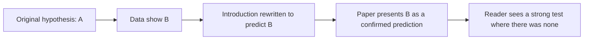

# HARKing

**Prerequisites:** [[p-hacking|P-hacking and researcher degrees of freedom]] and [[falsifiability-and-theories|Falsifiability]].

@@IMG@@

**HARKing** stands for **Hypothesizing After the Results are Known**. It means presenting a hypothesis that was formed after seeing the data as if it had been the plan all along. The social psychologist Norbert Kerr named and analysed the practice in a 1998 paper in *Personality and Social Psychology Review*.

## How it works

A researcher runs a study expecting result A, but finds result B. Instead of reporting "we expected A, found B, and B is a new observation that needs testing", the paper's introduction is rewritten to predict B, and the result is presented as a successful test.

The data and analysis might be impeccable. The problem is the story. HARKing converts an exploratory finding, which should be treated as a hypothesis to be tested, into an apparent confirmation.

## Why it matters

### It misrepresents the evidence

A prediction that was made in advance and succeeded is a **risky test**: it could have failed ([[falsifiability-and-theories|falsifiability]]). A "prediction" made after the fact could not have failed. HARKing makes weak evidence look strong.

### It hides failed hypotheses

The original hypothesis A, which the data contradicted, disappears from the record. Other researchers do not learn that A failed, and may test it again.

### It distorts theory

Because HARKed hypotheses always "succeed", theories built on them look better supported than they are. Kerr argued that HARKing could translate chance findings into theory and make theories harder to falsify.

### It combines with p-hacking

If a dataset is searched for any significant result and a hypothesis is then written to fit it, the combination of [[multiple-comparisons|multiple comparisons]] and HARKing makes false positives very likely.

## Varieties

The psychologist Mark Rubin, in a 2017 paper in the *Review of General Psychology*, distinguished several forms:

- **CHARKing**: constructing a hypothesis after the results.
- **RHARKing**: retrieving a hypothesis from the literature after the results, and presenting it as the motivation.
- **SHARKing**: suppressing hypotheses that failed.

Not all are equally problematic, but all present a misleading account of how the research unfolded.

## Is it always wrong?

Unexpected results can be important discoveries. The issue is not discovering something unexpected but **misreporting how it was discovered**. The honest version reads: "Contrary to our hypothesis, we found B. This was not predicted and should be tested in future studies." Some writers argue that a degree of post-hoc theorising is inevitable and useful, provided readers know it happened.

## How to spot it

HARKing is hard to detect from a paper alone, because by definition the paper presents a coherent story. Clues include:

- **No preregistration**, or a preregistration whose hypotheses differ from those in the paper.
- **Grant applications, conference abstracts or earlier papers** by the same group that predicted something different.
- **Unusually specific predictions** that match the results perfectly, including interactions and subgroups that would be odd to predict in advance.
- **Introductions that cite a mechanism** that seems tailored to the exact finding.

[[preregistration|Preregistration]] is the main safeguard, because it creates a time-stamped record of what was predicted.

## The broader lesson

HARKing illustrates why the **process** of research matters, not just the final paper. Two papers with identical data, analyses and text can deserve very different weight depending on whether the hypothesis came before or after the data. As a reader you usually cannot see the process directly, which is why transparency mechanisms such as registration, protocols and open materials are so valuable.

## Key ideas

- HARKing presents a hypothesis formed after seeing the results as if it were planned.
- It turns exploratory findings into apparent confirmations and hides failed hypotheses.
- Combined with p-hacking, it makes false positives likely.
- Unexpected findings are valuable when honestly labelled as such.
- Preregistration is the main safeguard.

## Where this leads

- Next: [[publication-bias|Publication bias]]
