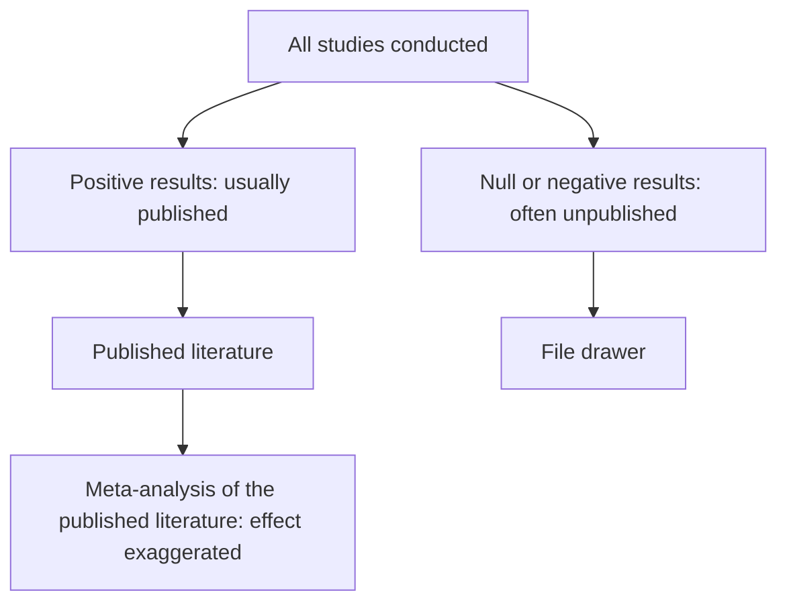

# Publication bias

**Prerequisites:** [HARKing](05-harking.md) and [Funnel plots](../05-anatomy-of-a-paper/09-funnel-plots.md).

*A filing cabinet; unpublished null results end up in the 'file drawer'. Credit: Watty62. License: [CC BY-SA 4.0](https://creativecommons.org/licenses/by-sa/4.0). Source: [File:Card Filing Cabinet.jpg](https://commons.wikimedia.org/wiki/File:Card_Filing_Cabinet.jpg).*

**Publication bias** occurs when whether a study is published depends on what it found. Studies with positive, statistically significant or exciting results are more likely to be published, published quickly and published in prominent journals than studies with null or unfavourable results. The published literature then gives a distorted picture, even if every individual paper is accurate.

## The file drawer

The psychologist Robert Rosenthal called this the **file drawer problem** in a 1979 paper in *Psychological Bulletin*: for every published study, there may be others sitting unpublished in file drawers because they found nothing. Rosenthal proposed a "fail-safe N", the number of unpublished null studies needed to overturn a meta-analytic result, though statisticians now regard that particular calculation as unreliable.

## Classic evidence

### Antidepressants

The clearest demonstration came from Erick Turner and colleagues in the *New England Journal of Medicine* in 2008. They obtained US Food and Drug Administration reviews of 74 registered trials of 12 antidepressants and compared them with the published literature. The FDA judged 38 trials positive; 37 of them were published. Of the 36 trials the FDA judged negative or questionable, 22 were not published and 11 were published in a way that, in the authors' view, conveyed a positive outcome. As a result, the published literature suggested that 94% of trials were positive, while the FDA analysis showed 51%. The apparent effect size in the published literature was inflated by 32% on average.

### Cohort studies of trials

Studies following cohorts of research projects approved by ethics committees, such as those by Kay Dickersin and colleagues in the 1990s, found that trials with significant results were more likely to be published, and published sooner, than those without. A Cochrane methodology review by Sally Hopewell and colleagues (2009) confirmed that trials with positive findings were published more often and more quickly.

### Other fields

Publication bias has been documented in psychology, economics, ecology, education and other fields. In psychology, a 2010 analysis by Daniele Fanelli in *PLOS One* found that the share of papers reporting support for their tested hypothesis was higher in psychology and psychiatry than in the physical sciences.

## Related biases

- **Time-lag bias**: negative results take longer to be published.
- **Outcome reporting bias**: within published trials, unfavourable outcomes are omitted ([outcome switching](03-outcome-switching.md)).
- **Location bias**: positive results appear in higher-impact, more widely indexed journals.
- **Language bias**: positive results from non-English-speaking countries may be more likely to be published in English.
- **Citation bias**: positive studies are cited more often, so they are easier to find.

## Who causes it?

Responsibility is shared. **Researchers** may not bother writing up null results, or may believe journals will reject them. **Sponsors** may decline to publish unfavourable trials. **Journals** have historically preferred novel, positive results. Studies submitting identical manuscripts with positive or negative results have found evidence of reviewer bias, though evidence suggests that much of the problem lies with non-submission rather than rejection.

## Consequences

- **Overestimated effects** in meta-analyses and guidelines.
- **Hidden harms**, if trials showing adverse effects are not published.
- **Wasted resources and ethical harms**: participants who volunteered for unpublished trials contributed to knowledge that was never shared, and others may be enrolled in repeats of trials that already failed.

## Remedies

- **Trial registration** makes unpublished trials visible ([trial registries](02-trial-registries.md)).
- **Mandatory results reporting**, as under the US FDAAA and EU rules.
- **Registered reports**, which commit journals to publication before results are known ([preregistration](01-preregistration.md)).
- **Journals for null results** and data repositories.
- **AllTrials**, a campaign launched in 2013 by Ben Goldacre, the BMJ, Sense about Science and others, calling for all past and present trials to be registered and their results reported.
- **Regulatory data**: using FDA and EMA documents and clinical study reports in systematic reviews.

## Key ideas

- Publication bias makes the published literature unrepresentative of all research done.
- Turner's 2008 study showed antidepressant trials looked 94% positive in journals but 51% positive in FDA records.
- It inflates effects in meta-analyses and can hide harms.
- Responsibility lies with researchers, sponsors and journals.
- Registration, results reporting, registered reports and regulatory data are the main remedies.

## Where this leads

- Next: [The replication crisis](07-the-replication-crisis.md)
- Related: [Funnel plots](../05-anatomy-of-a-paper/09-funnel-plots.md), [Tamiflu](../10-case-studies/08-tamiflu-and-hidden-trial-data.md)
