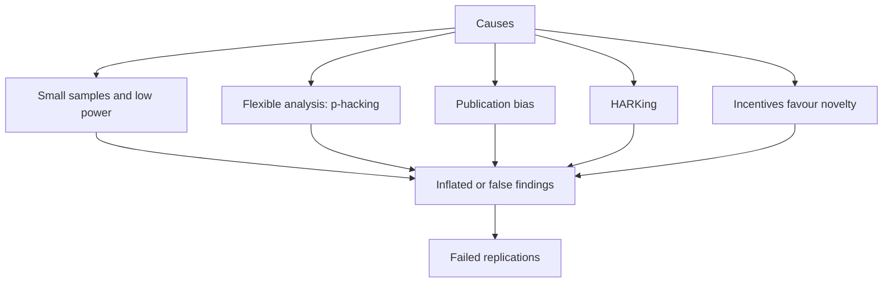

# The replication crisis

**Prerequisites:** [[publication-bias|Publication bias]], [[p-hacking|P-hacking]] and [[statistical-power|Statistical power]].

@@IMG@@

Since about 2011, a series of large projects has tried to repeat published findings, and many have failed. The **replication crisis** (or reproducibility crisis) refers to the realisation that a substantial share of published results in several fields do not hold up when tested again. It began most visibly in social psychology but has spread to many disciplines, and it has driven a wave of reforms.

## Terms

Usage varies, but a common distinction is:

- **Reproducibility**: getting the same results from the same data and code.
- **Replicability**: getting consistent results from a new study collecting new data.
- **Robustness**: getting consistent results from the same data with different reasonable analyses.

A 2019 report from the US National Academies of Sciences, Engineering, and Medicine, *Reproducibility and Replicability in Science*, adopted definitions along these lines.

## Warning signs before the crisis

- In 2005 John Ioannidis argued in *PLOS Medicine* that "most published research findings are false" in fields with small studies, small effects, many tested relationships and flexible designs ([[base-rates-and-bayes-theorem|base rates]]).
- In 2011 Daryl Bem published experiments in the *Journal of Personality and Social Psychology* claiming evidence for precognition, using standard methods. Many researchers saw this as showing that standard methods could support almost anything.
- In 2011 Joseph Simmons, Leif Nelson and Uri Simonsohn showed how flexible analysis could produce false positives ([[p-hacking|p-hacking]]).
- In 2011 the Dutch social psychologist Diederik Stapel was found to have fabricated data in dozens of papers ([[fraud-and-misconduct|fraud and misconduct]]).

## The big replication projects

- **Open Science Collaboration (2015)**: a team of 270 authors led by Brian Nosek tried to replicate 100 studies from three leading psychology journals, published in *Science*. Of the originals, 97% had reported significant results; 36% of replications did. The mean effect size in replications was about half the original.
- **Many Labs** projects coordinated replications of the same studies across dozens of labs, finding that some effects replicated robustly and others did not.
- **Social Sciences Replication Project (2018)**: Colin Camerer and colleagues replicated 21 experimental social science studies published in *Nature* and *Science* between 2010 and 2015, reporting in *Nature Human Behaviour* that 13 replicated by their main criterion, with effect sizes about half the originals on average.
- **Cancer biology**: in 2012 C. Glenn Begley and Lee Ellis reported in *Nature* that scientists at the biotechnology company Amgen had been able to confirm findings in only 6 of 53 "landmark" preclinical cancer studies. A year earlier, Florian Prinz and colleagues at Bayer had reported similar difficulties. The **Reproducibility Project: Cancer Biology**, completed in 2021, found that many planned replications could not even be attempted because of missing methodological details, and that replicated effects were on average much smaller than the originals.
- **Economics**: a 2016 project by Camerer and colleagues replicated 18 laboratory experiments in economics and found about two-thirds replicated.

## A case: power posing

In 2010 Dana Carney, Amy Cuddy and Andy Yap reported in *Psychological Science* that holding "power poses" for two minutes increased feelings of power, risk-taking and testosterone, and decreased cortisol. Cuddy's 2012 TED talk became one of the most watched ever. A 2015 replication by Eva Ranehill and colleagues with 200 participants found no effects on hormones or risk-taking, though participants reported feeling more powerful. In 2016 Carney, the first author, posted a statement saying she did not believe that power pose effects are real. Cuddy has continued to defend the effect on felt power. See the [[power-posing|power posing case study]].

## Is it a crisis everywhere?

Replication rates vary greatly between fields, designs and types of claim. Large, pre-registered clinical trials of drugs with strong mechanisms tend to be more reproducible than small, novel psychology experiments. Some researchers argue that "crisis" overstates the problem, that failed replications can reflect real differences in context, and that replication studies themselves can be underpowered or flawed. Others argue that the problem is under-recognised in fields that have not yet tested themselves. The reasonable conclusion is that **replicability is an empirical property that varies, and should be checked rather than assumed**.

## Reforms

- [[preregistration|Preregistration]] and registered reports.
- Larger samples and **power analysis**.
- **Data and code sharing** ([[open-science|open science]]).
- **Replication studies** published and valued.
- Stricter or abandoned **significance thresholds**.
- **Multi-lab collaborations** such as the Psychological Science Accelerator.

## For readers

- Ask whether a finding has been **independently replicated**, ideally in a pre-registered study.
- Discount **surprising, counterintuitive findings from small studies**, especially those that became famous through TED talks, books or headlines.
- Expect effect sizes in early studies to **shrink** later.

## Key ideas

- Large projects have found that many published findings, especially in psychology and preclinical biology, do not replicate.
- Causes include low power, flexible analysis, publication bias, HARKing and incentives.
- Replicated effects are typically much smaller than originals.
- Replicability varies by field and should be checked, not assumed.
- Reforms include preregistration, larger samples, open data and valuing replication.

## Where this leads

- Next: [[fraud-and-misconduct|Fraud and misconduct]]
- Case study: [[power-posing|Power posing]]
