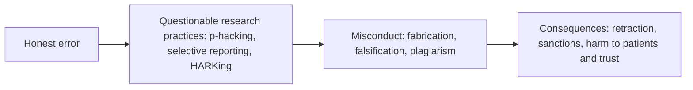

# Fraud and misconduct

**Prerequisites:** [The replication crisis](07-the-replication-crisis.md).

@@IMG@@

Most bad science is honest error, poor design or wishful analysis. But some is deliberate. **Research misconduct** is usually defined, following the US Office of Research Integrity, as **fabrication, falsification or plagiarism** (often abbreviated FFP) in proposing, performing, reviewing or reporting research. It is rarer than the problems in earlier lessons, but its cases have had enormous consequences.

## Definitions

- **Fabrication**: making up data or results.
- **Falsification**: manipulating research materials, equipment or processes, or changing or omitting data, so that the research is not accurately represented.
- **Plagiarism**: using another person's ideas, processes, results or words without credit.

Beyond FFP, **questionable research practices** (QRPs), such as p-hacking, selective reporting, HARKing, inappropriate authorship and undisclosed conflicts of interest, occupy a grey zone between honest error and misconduct.

## How common is it?

Hard to say, since successful fraud is by definition undetected. In a 2009 meta-analysis of surveys in *PLOS One*, Daniele Fanelli estimated that about 2% of scientists admitted having fabricated, falsified or modified data or results at least once, and about 14% said they knew of colleagues who had. Admission rates for questionable practices were much higher. In a 2012 study in *PNAS*, Ferric Fang, R. Grant Steen and Arturo Casadevall examined 2,047 retracted biomedical and life-science articles and found that 67.4% were retracted because of misconduct (fraud or suspected fraud, duplicate publication or plagiarism), and only about 21% because of error.

## Notable cases

- **Andrew Wakefield** (1998): the *Lancet* paper suggesting a link between MMR vaccine, bowel disease and autism was retracted in 2010 after the UK General Medical Council found serious professional misconduct; Wakefield was struck off the medical register. In 2011 the journalist Brian Deer reported in the *BMJ* that the children's histories had been misrepresented, and the *BMJ*'s editors described the paper as fraudulent. See the [Wakefield case study](../10-case-studies/07-wakefield-1998.md).
- **Diederik Stapel** (2011): a prominent Dutch social psychologist found by university investigations to have fabricated data in dozens of papers; more than 50 were retracted.
- **Yoshitaka Fujii**: a Japanese anaesthesiologist whose fabrication led to more than 180 retractions, among the largest totals for any researcher. John Carlisle's 2012 statistical analysis of baseline data in his trials helped expose him.
- **Hwang Woo-suk** (2005–2006): a South Korean scientist whose claims to have created human embryonic stem cells by cloning, published in *Science*, were found to be fabricated.
- **Surgisphere** (2020): two high-profile COVID-19 papers in *The Lancet* and the *New England Journal of Medicine*, based on data from a company whose database could not be verified, were retracted within weeks. See the [Surgisphere case study](../10-case-studies/10-surgisphere.md).
- **Image manipulation**: in 2016 Elisabeth Bik, Arturo Casadevall and Ferric Fang reported in *mBio* that about 4% of over 20,000 biomedical papers they screened contained problematic duplicated images. In 2022 *Science* reported on allegations of image manipulation in an influential 2006 *Nature* paper on amyloid in Alzheimer's disease; the paper was retracted in 2024.

## How fraud is detected

- **Whistle-blowers**: colleagues, students and technicians.
- **Statistical forensics**: implausible baseline balance, digit distributions or variance patterns (as in Carlisle's analyses), or impossible summary statistics, such as the **GRIM test** developed by Nick Brown and James Heathers to check whether reported means are possible given sample sizes.
- **Image forensics**: spotting duplicated or manipulated images.
- **Data requests and reanalyses**.
- **Failed replications**, which sometimes prompt closer inspection.

Many of these checks are now carried out by independent volunteers ("data sleuths"), often posting on the PubPeer website, where readers can comment on published papers.

## Consequences

Misconduct can lead to retraction, loss of funding and employment, and in rare cases criminal prosecution. Its harms go beyond the individual: patients may be harmed by treatments based on false data, other researchers waste years building on false findings, and public trust erodes. Retraction does not erase a paper's influence; retracted papers continue to be cited ([retractions and corrections](../07-publishing/06-retractions-and-corrections.md)).

## For readers

You usually cannot detect fraud from reading a paper. But you can:

- check whether a paper has been retracted or corrected, using the journal page, PubMed or the Retraction Watch database;
- check PubPeer for comments;
- be wary of results that are too clean, effects that are too large, or data from sources no one else can access;
- give more weight to findings replicated by independent groups.

## Key ideas

- Misconduct is fabrication, falsification or plagiarism; questionable practices are a larger grey zone.
- Surveys suggest about 2% of scientists admit fabrication or falsification; most retractions are due to misconduct.
- Major cases include Wakefield, Stapel, Fujii, Hwang and Surgisphere.
- Fraud is detected by whistle-blowers, statistical and image forensics, and data sleuths.
- Check retraction status and PubPeer, and prefer independently replicated findings.

## Where this leads

- Next: [Open science](09-open-science.md)
- Related: [Retractions and corrections](../07-publishing/06-retractions-and-corrections.md)
