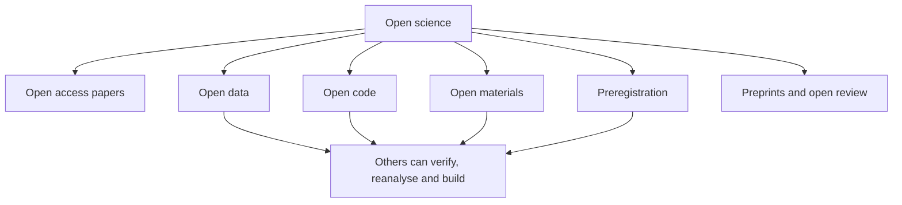

# Open science

**Prerequisites:** [[fraud-and-misconduct|Fraud and misconduct]] and [[preregistration|Preregistration]].

@@IMG@@

**Open science** is a broad movement to make research more transparent, accessible and checkable. It grew partly in response to the problems in this section: publication bias, flexible analysis, irreproducible results and occasional fraud. Its central idea goes back to Merton's norm of "communism", the common ownership of scientific knowledge ([[norms-of-science|the norms of science]]): if others can see your materials, data and code, they can find your mistakes.

## The main components

- **Open access**: papers free to read, rather than behind subscription paywalls.
- **Open data**: the underlying data deposited in public repositories where possible, with appropriate privacy protections for human participants.
- **Open code**: the analysis scripts that produced the results.
- **Open materials**: questionnaires, protocols, stimuli and lab procedures.
- **Preregistration** and **registered reports** ([[preregistration|preregistration]]).
- **Preprints**: sharing papers before peer review ([[preprints|preprints]]).
- **Open peer review**: publishing reviewers' reports, sometimes with names ([[peer-review|peer review]]).

## Why it helps

- **Error detection**: shared data and code let others find mistakes. A well-known example from economics: in 2013 Thomas Herndon, a graduate student, with Michael Ash and Robert Pollin, obtained the spreadsheet behind an influential 2010 paper by Carmen Reinhart and Kenneth Rogoff on government debt and growth, and found a coding error and other choices that changed some of its conclusions. Reinhart and Rogoff acknowledged the spreadsheet error while defending their broader findings.
- **Reanalysis**: independent teams can check whether conclusions depend on particular choices. A 2018 project led by Raphael Silberzahn and colleagues gave the same dataset to 29 teams to test whether football referees give more red cards to dark-skinned players. Estimates varied considerably across teams' reasonable analytic choices, illustrating how much analysis matters.
- **Reducing waste**: shared materials and null results stop others repeating failed studies.
- **Deterring fraud**: fabricating data is harder when raw data must be shared.

## Transparency policies

Journals, funders and institutions have adopted policies such as:

- the **TOP Guidelines** (Transparency and Openness Promotion), published in *Science* in 2015 by Brian Nosek and colleagues, which set levels of transparency standards for journals;
- **open science badges** awarded for open data, open materials and preregistration;
- funder **open access mandates**, such as Plan S in Europe (launched 2018) and requirements by many national funders, including Canada's federal research funding agencies, which have had an open access policy for publications since 2015;
- **data sharing statements** required by the ICMJE for clinical trials since 2018.

## The Center for Open Science and the Open Science Framework

The **Center for Open Science**, founded in 2013 by Brian Nosek and Jeffrey Spies in Charlottesville, Virginia, runs the **Open Science Framework (OSF)**, a free platform for registering studies and sharing data, code and materials. It coordinated the Reproducibility Project: Psychology and the Reproducibility Project: Cancer Biology ([[the-replication-crisis|replication crisis]]).

## Limits and tensions

- **Privacy**: health data cannot always be shared openly. Controlled-access repositories and data-use agreements are compromises.
- **Commercial confidentiality**: companies resist sharing trial data, though regulators have pushed for more ([[supplementary-material-and-data|supplementary material and data]]).
- **Cost and effort**: preparing data for sharing takes time that researchers are not always rewarded for.
- **Open access fees**: many open access journals charge authors **article processing charges**, which can be thousands of dollars, shifting costs and creating incentives exploited by [[predatory-journals|predatory journals]].
- **Misuse**: open data can be reanalysed carelessly or selectively, by any side of a debate. Transparency helps only if reanalyses are themselves transparent.

## For readers

- Prefer studies with **open data and code** or preregistration.
- Check for **data availability statements** and whether data are actually deposited.
- Use open access versions of papers legally ([[finding-and-accessing-papers|finding and accessing papers]]).
- Treat reanalyses with the same scrutiny as original studies.

## Key ideas

- Open science makes papers, data, code, materials and plans available for scrutiny.
- It helps detect errors, enables reanalysis, reduces waste and deters fraud.
- TOP guidelines, badges and funder mandates have spread transparency.
- Privacy, commercial interests, costs and misuse are real tensions.
- Prefer transparent studies, and apply equal scrutiny to reanalyses.

## Where this leads

- Next section: [[sec:07-publishing|Peer review and publishing]], starting with [[how-journals-work|how journals work]]
