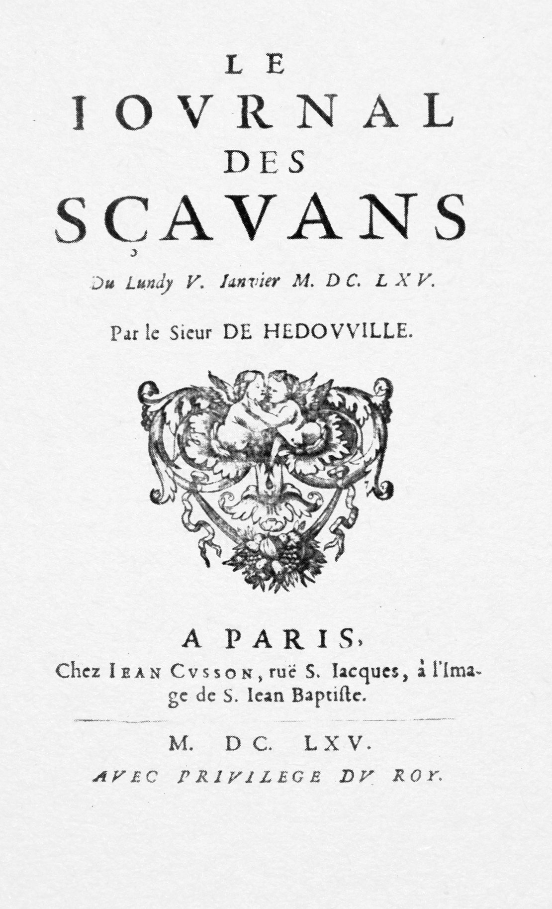
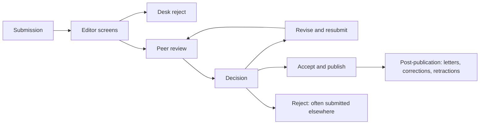

# How journals work

**Prerequisites:** [Open science](../06-research-integrity/09-open-science.md).

*Title page of the Journal des sçavans (1665), one of the first scientific journals. Credit: Unknown authorUnknown author. License: Public domain. Source: [File:1665 journal des scavans title.jpg](https://commons.wikimedia.org/wiki/File:1665_journal_des_scavans_title.jpg).*

Scientific journals are the main channel through which research becomes part of the official record. Understanding how they operate, as businesses, as gatekeepers and as communities, helps you judge what publication in a journal does and does not guarantee.

## A short history

The first scientific journals appeared in 1665: the *Journal des sçavans* in Paris in January, and the *Philosophical Transactions* of the Royal Society of London in March, edited by Henry Oldenburg. They replaced private correspondence between scholars with a public, dated record, establishing who discovered what and when. Medical journals followed; *The Lancet* was founded by Thomas Wakley in 1823, the *New England Journal of Medicine* traces its origins to 1812, and the *BMJ* to 1840.

## The path of a paper

1. **Submission**: authors send a manuscript, usually through an online system, with a cover letter and declarations (funding, conflicts, ethics, registration).
2. **Editorial screening**: an editor decides whether the paper fits the journal and is worth reviewing. Many papers at selective journals are rejected at this stage ("desk rejection").
3. **Peer review**: usually two or three external experts assess the paper ([peer review](02-peer-review.md)).
4. **Decision**: accept, minor revision, major revision or reject.
5. **Revision and re-review**, possibly several rounds.
6. **Acceptance, copy-editing and publication**, often online first.
7. **Post-publication**: letters, comments, corrections, and occasionally retraction ([retractions](06-retractions-and-corrections.md)).

A rejected paper is often submitted to another journal, and eventually most papers are published somewhere. "Published in a peer-reviewed journal" therefore tells you less than it seems.

## Business models

- **Subscription**: libraries and individuals pay to read. Authors usually publish free. Access is restricted ("paywalled").
- **Open access (gold)**: articles are free to read, and costs are often covered by **article processing charges** (APCs) paid by authors, funders or institutions. Some open access journals charge nothing ("diamond" open access), funded by institutions or societies.
- **Hybrid**: subscription journals that make individual articles open for a fee.
- **Green open access**: authors deposit a version (often the accepted manuscript) in a repository such as PubMed Central or an institutional repository.

Commercial publishing is concentrated. A 2015 study in *PLOS One* by Vincent Larivière, Stefanie Haustein and Philippe Mongeon found that five publishers (Reed-Elsevier, Wiley-Blackwell, Springer, Taylor & Francis and, in some fields, the American Chemical Society or Sage) accounted for more than half of all papers published in 2013 in the natural and medical sciences, and the authors described the arrangement as an oligopoly.

## Editors and their incentives

Editors decide what gets reviewed and published. They want papers that are rigorous, but also important, novel and likely to be cited, which raises a journal's [impact factor](03-impact-factors-and-metrics.md). This creates pressure toward striking positive findings, contributing to [publication bias](../06-research-integrity/06-publication-bias.md). Some journals have responded with registered reports and explicit policies welcoming replication and null results.

Medical journals also have commercial relationships. Reprints of articles, especially of industry-funded trials, can be purchased in large quantities by companies for marketing. Richard Smith, a former editor of the *BMJ*, argued in a 2005 *PLOS Medicine* essay titled "Medical journals are an extension of the marketing arm of pharmaceutical companies" that this created conflicts for journals. The **ICMJE** (International Committee of Medical Journal Editors) publishes recommendations on authorship, conflicts of interest, trial registration and data sharing that many journals follow.

## Authorship

Who is listed as an author matters. ICMJE criteria require substantial contributions to the work, drafting or critical revision, approval of the final version and accountability. Problems include:

- **Ghost authorship**: people who wrote the paper (often medical writers paid by a sponsor) are not named.
- **Guest or honorary authorship**: senior figures are named who did little.

Investigations of industry documents released in litigation have described ghostwriting in several drug programmes, including the Vioxx and paroxetine cases ([Vioxx](../10-case-studies/05-vioxx.md), [Study 329](../10-case-studies/06-paroxetine-study-329.md)).

## Key ideas

- Journals began in 1665 and create a public, dated record of research.
- Papers pass through editorial screening, peer review and revision; rejected papers usually end up published elsewhere.
- Business models include subscription, open access with fees, hybrid and green open access.
- Editorial incentives favour striking results; commercial relationships can create conflicts.
- Authorship rules exist to prevent ghost and guest authorship.

## Where this leads

- Next: [Peer review](02-peer-review.md)
