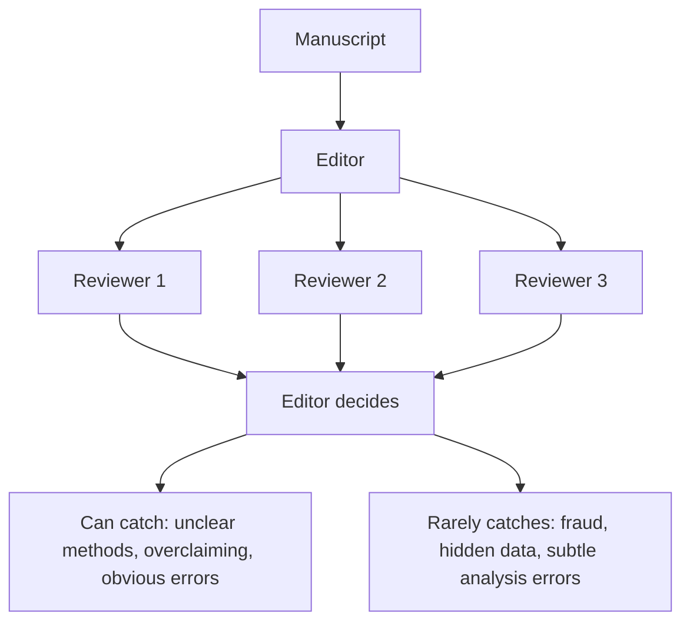

# Peer review

**Prerequisites:** [How journals work](01-how-journals-work.md).

*A reviewer at the US National Institutes of Health evaluating a grant proposal; journal peer review works in a similar way. Credit: Center for Scientific Review [2]. License: Public domain. Source: [File:ScientificReview.jpg](https://commons.wikimedia.org/wiki/File:ScientificReview.jpg).*

**Peer review** is the evaluation of a research paper by other experts before publication. It is often presented as a seal of quality: "peer-reviewed" is used in news stories and arguments as if it meant "true". It is better understood as a useful but limited filter.

## How it works

The editor sends the manuscript to (usually) two to four reviewers with relevant expertise. They comment on the question, methods, analysis, interpretation and presentation, and recommend acceptance, revision or rejection. The editor weighs their reports and decides.

Models differ in who knows whose identity:

- **Single-blind**: reviewers know the authors; authors do not know the reviewers. Long the most common in medicine.
- **Double-blind**: neither knows the other (though authors are often guessable).
- **Open**: identities are known, and sometimes reports are published with the paper. The *BMJ* has used open review for decades, and journals such as *eLife* and some BMC journals publish review reports.
- **Post-publication review**: comments after publication, on journal sites or platforms such as PubPeer.

## History

Systematic external review became standard only gradually. The Royal Society used referees for some papers from the eighteenth century, but many journals relied on editors' judgement until well into the twentieth century. *Nature* did not formally require external peer review for all papers until 1973, and peer review in its modern, routine form spread mainly after the Second World War.

## What peer review does well

- Improves clarity and presentation.
- Catches some methodological problems and overstatement.
- Pushes authors to address alternative explanations and limitations.
- Filters out some low-quality work.

## What it does poorly

### Detecting errors

In a study published in 2008 in the *Journal of the Royal Society of Medicine*, Sara Schroter, Fiona Godlee and colleagues at the *BMJ* sent reviewers papers into which nine major errors had been deliberately inserted. On average, reviewers detected fewer than three of the nine major errors in each paper. Training produced only small improvements.

### Detecting fraud

Reviewers do not usually see raw data and are not equipped to detect fabrication. Most fraudulent papers passed peer review ([fraud and misconduct](../06-research-integrity/08-fraud-and-misconduct.md)).

### Consistency

Reviewers often disagree about the same paper, and agreement between reviewers has been found to be only modestly better than chance in several studies.

### Bias

Studies have found evidence of bias in favour of prestigious institutions and against unconventional ideas. Reviewers may be competitors. A famous 1977 experiment by Michael Mahoney sent versions of the same manuscript, differing only in whether the results supported or contradicted reviewers' presumed views, and found that reviewers rated identical methods more favourably when the results agreed with their views.

### Evidence that it works

A Cochrane methodology review by Tom Jefferson and colleagues (2007) on editorial peer review concluded that there was little empirical evidence to support its use as a mechanism for ensuring quality, though absence of evidence is partly due to how hard it is to study. Richard Smith, former *BMJ* editor, wrote in 2006 that peer review is slow, expensive, largely a lottery, poor at detecting errors and prone to bias, yet that nobody has found a clearly better system.

## Peer review and sting operations

In 2013 the journalist John Bohannon submitted versions of a deliberately flawed paper about a supposed anticancer compound to 304 open-access journals, as reported in *Science*. By the time of publication, 157 had accepted it. Critics noted that he did not test subscription journals, but the sting showed that many outlets calling themselves peer-reviewed did little or no real review ([predatory journals](05-predatory-journals.md)).

## For readers

- Treat "peer-reviewed" as a minimum, not a guarantee.
- Peer review mostly checks whether a paper is plausible and reasonably presented, not whether its data are real or its analysis correct.
- Look for post-publication commentary: letters to the editor, PubPeer, critical blogs, replication attempts.
- If review reports are published, read them; they often flag the key weaknesses.

## Key ideas

- Peer review is expert evaluation before publication, in single-blind, double-blind or open forms.
- It improves papers and filters some weak work.
- It catches only a fraction of major errors and rarely detects fraud.
- Reviewers disagree often and can be biased.
- "Peer-reviewed" is a minimum standard, not proof of correctness.

## Where this leads

- Next: [Impact factors and metrics](03-impact-factors-and-metrics.md)
