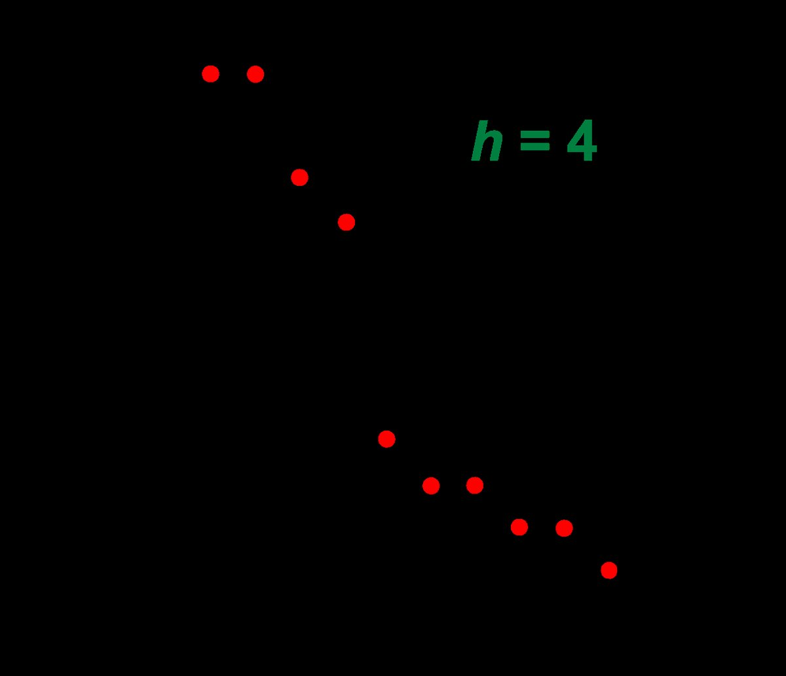
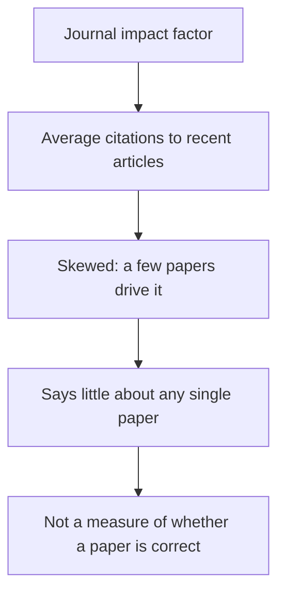

# Impact factors and metrics

**Prerequisites:** [Peer review](02-peer-review.md).

*How an h-index is calculated from a researcher's citation counts. Credit: Jü. License: [CC BY-SA 4.0](https://creativecommons.org/licenses/by-sa/4.0). Source: [File:Hirsch Index Example h=4 V1.svg](https://commons.wikimedia.org/wiki/File:Hirsch_Index_Example_h=4_V1.svg).*

Because there is far too much research for anyone to read, people use shortcuts to judge its importance: which journal it appeared in, how often it has been cited, how much attention it received. These **metrics** shape careers, funding and public perception. They contain real information, but they measure attention and prestige, not truth.

## The journal impact factor

The **journal impact factor** (JIF) was devised by Eugene Garfield, founder of the Institute for Scientific Information, in the 1950s and 1960s, originally to help librarians choose which journals to buy. It is now published annually in Clarivate's *Journal Citation Reports*.

The standard two-year impact factor for a year is:

> citations in that year to items the journal published in the previous two years ÷ number of "citable items" the journal published in those two years

So a JIF of 10 means that, on average, recent articles were cited about ten times per year.

## Problems with the impact factor

- **Skewed citations**: a journal's citations are dominated by a small number of highly cited papers. Most papers in a high-impact journal are cited far less than its impact factor suggests, so the JIF says little about any individual paper.
- **Field differences**: citation habits differ enormously between fields; comparing JIFs across fields is meaningless.
- **Gaming**: journals can raise their JIF by publishing more reviews (which are cited more), by encouraging citations to the journal, or through "citation cartels" between journals.
- **Denominator negotiations**: what counts as a "citable item" (editorials and letters often don't, but can still attract citations) can be manipulated.
- **Retractions**: high-impact journals are not immune to errors and fraud. A 2011 analysis by Ferric Fang and Arturo Casadevall in *Infection and Immunity* found that journals with higher impact factors had higher **retraction indexes**, possibly because of greater pressure, greater scrutiny, or both.

## Reform: DORA and the Leiden Manifesto

In 2012, at a meeting of the American Society for Cell Biology in San Francisco, editors and publishers drafted the **San Francisco Declaration on Research Assessment** (DORA), published in 2013. Its central recommendation is not to use journal-based metrics such as impact factors as a surrogate measure of the quality of individual research articles or in hiring, promotion or funding decisions. Thousands of organisations and individuals have signed. The **Leiden Manifesto** (2015), published in *Nature* by Diana Hicks and colleagues, set out ten principles for responsible use of research metrics.

## Other metrics

- **Citation counts** for individual papers: how often a paper has been cited. Highly cited papers can be influential because they are wrong (cited to be criticised) or because they were first. Retracted papers continue to be cited.
- **The h-index**, proposed by physicist Jorge Hirsch in 2005: a researcher has index h if h of their papers have each been cited at least h times. It favours long careers and certain fields.
- **Altmetrics**: measures of online attention, such as news coverage, social media mentions and policy citations, provided by services such as Altmetric. They measure attention, which is often driven by surprising or controversial claims. A paper with a high Altmetric score may be famous for being wrong.

## Prestige and truth

Prestigious journals have advantages: more editorial resources, more rigorous statistical review at some, and more scrutiny after publication. But they also prefer novel, dramatic findings, which are more likely to be overestimates. Several famous retracted or contested papers, including Wakefield's 1998 MMR paper in *The Lancet*, the Surgisphere papers in *The Lancet* and *NEJM* in 2020, and the 2006 *Nature* amyloid paper retracted in 2024, appeared in the most prestigious journals.

## For readers

- Use journal reputation as a weak signal of editorial standards, not of correctness.
- Judge each paper by its methods, not its venue.
- Treat high citation and attention as reasons to look closely, not reasons to believe.
- Remember that a paper in an obscure journal can be correct and a paper in a famous one can be wrong.

## Key ideas

- The journal impact factor is average recent citations per article, created for librarians.
- It is skewed, field-dependent and gameable, and says little about individual papers.
- DORA and the Leiden Manifesto call for responsible use of metrics.
- Citations, h-indices and altmetrics measure attention and influence, not truth.
- Judge papers by their methods, not by where they were published.

## Where this leads

- Next: [Preprints](04-preprints.md)
