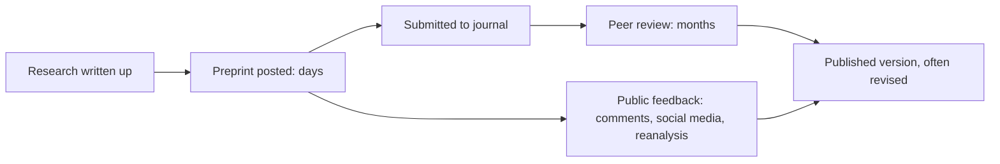

# Preprints

**Prerequisites:** [[impact-factors-and-metrics|Impact factors and metrics]] and [[peer-review|Peer review]].

@@IMG@@

A **preprint** is a version of a research paper shared publicly before peer review, usually on a dedicated server. Preprints let findings circulate in days rather than months. They became central to public discussion during the COVID-19 pandemic, and they require their own reading habits.

## Where preprints come from

Physicists and mathematicians have shared preprints for decades. In 1991 Paul Ginsparg launched what became **arXiv**, a server for physics papers, now hosted by Cornell University and covering physics, mathematics, computer science and more. Biology and medicine adopted preprints much later:

- **bioRxiv**, launched by Cold Spring Harbor Laboratory in 2013, for the life sciences;
- **medRxiv**, launched in 2019 by Cold Spring Harbor Laboratory, Yale University and the *BMJ*, for clinical and health research;
- **SSRN** for social sciences, economics and law; **PsyArXiv** and **SocArXiv** for psychology and sociology; **Research Square** and **Preprints.org**, among others.

Many journals now accept papers that were previously posted as preprints, and some, such as *eLife*, have built their review model around them.

## What preprint servers check

Preprint servers do **basic screening**, not peer review. medRxiv, for instance, screens for plagiarism, non-scientific content and material that could pose a health risk if unreviewed claims were taken as established, and displays a warning that preprints have not been peer-reviewed and should not guide clinical practice or be reported in news media as established information. But a preprint can have serious errors.

## Benefits

- **Speed**: results can inform others immediately, which matters in emergencies.
- **Priority**: researchers establish a dated claim to their findings.
- **Openness**: preprints are free to read.
- **Broader feedback**: many readers, not just two or three reviewers, can comment.
- **Null and negative results** can be shared without waiting for a journal.

## Risks

- **No formal quality check**: errors, overclaiming and occasionally fraud can circulate widely.
- **Media amplification**: striking preprints can make headlines before experts have assessed them.
- **Changes on publication**: the final published version may differ, sometimes substantially, from the preprint.
- **Never published**: some preprints never pass peer review, but continue to be cited.

## Preprints during COVID-19

The pandemic produced an explosion of preprints. Some were crucial: early analyses of transmission, the first results of the RECOVERY trial showing that dexamethasone reduced deaths (announced in June 2020 and posted on medRxiv before journal publication), and genomic surveillance of variants. Others caused confusion. A 2020 preprint posted on bioRxiv claimed "uncanny" similarities between the new coronavirus and HIV; it was withdrawn by its authors within days after scientists pointed out serious flaws, but not before it had spread widely online.

Studies comparing preprints with their published versions found that most core conclusions did not change much, though details often did. A 2022 study by Liam Brierley, Jonathon Coates and colleagues in *PLOS Biology*, for example, compared COVID-19 preprints with their journal versions and found that most did not substantially change their conclusions. That is reassuring on average, but it does not tell you whether any particular preprint is reliable.

## Reading a preprint

Treat a preprint like a paper you are reviewing yourself:

1. **Note that it is a preprint** and check whether a peer-reviewed version has since been published (preprint servers often link to it).
2. **Apply the full checklist**: design, population, outcomes, analysis, conflicts ([[a-step-by-step-checklist|step-by-step checklist]]).
3. **Look for expert commentary**: comments on the server, PubPeer, organised review platforms such as Review Commons or the MIT Press Rapid Reviews project, and responses from other researchers.
4. **Check for updated versions**, which may correct errors.
5. **Be especially cautious with dramatic claims**, which deserve the most scrutiny and are the most likely to be shared.

## Preprints and journalism

Many journalists now report on preprints, ideally flagging that they are not peer-reviewed and seeking independent expert comment. When you see "a new study shows" in the news, check whether it is a preprint. That does not make it wrong, but it means fewer people have checked it.

## Key ideas

- Preprints are papers shared before peer review, on servers such as arXiv, bioRxiv and medRxiv.
- Servers screen for basic problems but do not peer review.
- Preprints speed up science and widen feedback, but can spread errors quickly.
- COVID-19 showed both their value and their risks.
- Read preprints as if reviewing them yourself, and check for later versions.

## Where this leads

- Next: [[predatory-journals|Predatory journals]]
