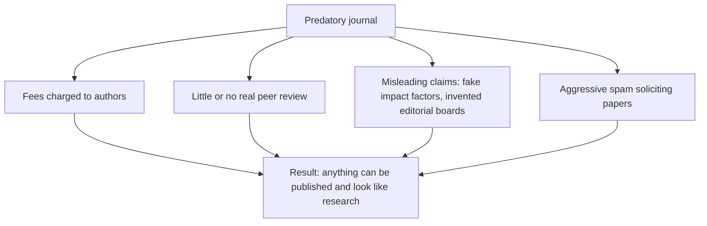

# Predatory journals

**Prerequisites:** [Preprints](04-preprints.md) and [How journals work](01-how-journals-work.md).

*An email spam folder; predatory journals often solicit submissions by mass email. Credit: Dadu. License: [CC0](http://creativecommons.org/publicdomain/zero/1.0/deed.en). Source: [File:Spammed-mail-folder-2024-french.png](https://commons.wikimedia.org/wiki/File:Spammed-mail-folder-2024-french.png).*

**Predatory journals** (also called deceptive or pseudo-journals) charge authors publication fees while providing little or no genuine editorial service or peer review. They exploit the open access business model and researchers' pressure to publish. Their papers can look like legitimate research, appear in search results and be cited in arguments, so readers need to be able to recognise them.

## Origins of the term

The librarian Jeffrey Beall at the University of Colorado Denver coined the term "predatory publishers" and from about 2010 maintained a widely used list of potential predatory publishers and journals, known as **Beall's list**. He took it offline in 2017, citing pressure. Beall's list was influential but also criticised for lack of transparency in its criteria and for including some journals that were merely low-quality or new. Archived copies and successor lists exist, alongside commercial services such as Cabells' list.

## A working definition

In 2019, a group of researchers, publishers and funders convened by Agnes Grudniewicz, David Moher and colleagues at the Ottawa Hospital Research Institute published a consensus definition in *Nature*: "Predatory journals and publishers are entities that prioritize self-interest at the expense of scholarship and are characterized by false or misleading information, deviation from best editorial and publication practices, a lack of transparency, and/or the use of aggressive and indiscriminate solicitation practices."

## Warning signs

- **Spam invitations** to submit, often flattering and only loosely related to your field.
- **Very fast acceptance**, sometimes within days, with superficial or no review.
- **Fees** hidden until after acceptance.
- **Journal names** mimicking well-known journals.
- **Fake or misleading metrics**: "impact factors" from invented companies.
- **Editorial boards** listing people who did not agree to serve, or who do not exist.
- **Very broad scope** ("Journal of Science, Medicine and Engineering").
- **Not indexed** in major databases such as MEDLINE, or in the **Directory of Open Access Journals** (DOAJ), which screens journals for quality.
- **Poor copy-editing**: obvious errors in published articles.
- **Unclear location and contact details** for the publisher.

## Evidence of the problem

- **Stings**: John Bohannon's 2013 *Science* sting sent a deliberately flawed paper to 304 open-access journals; 157 accepted it ([peer review](02-peer-review.md)). Other researchers have had nonsense papers, and papers with fictional authors, accepted.
- **Scale**: a 2015 study by Cenyu Shen and Bo-Christer Björk in *BMC Medicine* estimated that predatory journals published around 420,000 articles in 2014, though such estimates are uncertain.
- **Biomedical content**: a 2017 study by David Moher and colleagues in *Nature* examined nearly 2,000 biomedical articles from suspected predatory journals and found that many failed to report key information, and that a substantial share of the authors came from high-income countries and some were funded by major agencies such as the US National Institutes of Health.

## Grey zones

Not every low-quality journal is predatory, and not every open access journal with fees is low-quality. Many excellent journals charge article processing charges. Some publishers have been accused of predatory practices by some and defended by others. Large **"mega-journals"** that publish many papers with review focused on soundness rather than importance are a legitimate model, though quality varies.

## Paper mills and special issues

Related problems include **paper mills**, organisations that sell fabricated or manipulated papers and authorships, and abuse of **special issues** in otherwise legitimate journals, where guest editors have accepted large numbers of low-quality or fraudulent papers. In 2023 the publisher Wiley announced it was closing several journals from its Hindawi subsidiary after thousands of papers in special issues were retracted following the discovery of compromised peer review.

## For readers

When a cited paper is unfamiliar:

1. Check whether the journal is indexed in MEDLINE/PubMed, Web of Science, Scopus or the DOAJ.
2. Look at the journal's website, editorial board and fees.
3. Search for the journal's name with "predatory".
4. Judge the paper on its methods regardless; predatory venues occasionally contain sound work, and legitimate journals occasionally publish poor work.

Papers in predatory journals are sometimes cited in public debates precisely because they could not pass real review. Be especially cautious when a dramatic claim appears only in such outlets.

## Key ideas

- Predatory journals charge fees while providing little or no real review.
- Beall's list popularised the concept; a 2019 consensus definition emphasises self-interest, misleading information and lack of transparency.
- Warning signs include spam invitations, rapid acceptance, fake metrics and lack of indexing.
- Paper mills and compromised special issues are related threats.
- Check indexing and judge every paper on its methods.

## Where this leads

- Next: [Retractions and corrections](06-retractions-and-corrections.md)
