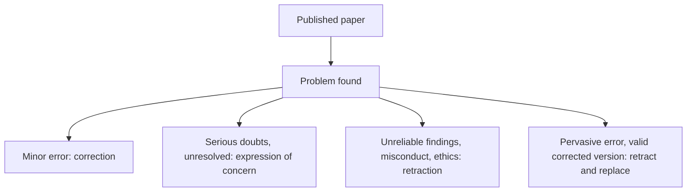

# Retractions and corrections

**Prerequisites:** [[predatory-journals|Predatory journals]] and [[fraud-and-misconduct|Fraud and misconduct]].

@@IMG@@

Published papers are not final. Errors are found, data turn out to be unreliable, and occasionally fraud is uncovered. Journals have several tools for fixing the record: **corrections**, **expressions of concern** and **retractions**. Knowing how to check for them is one of the simplest and most important habits in reading research.

## The tools

- A **correction** (erratum or corrigendum) fixes an error that does not invalidate the paper's main conclusions: a mislabelled figure, a wrong number in a table, an omitted conflict of interest.
- An **expression of concern** is a notice from the editors that they have serious doubts about a paper (for example, about data integrity) while an investigation is ongoing or cannot be completed. The *New England Journal of Medicine* published an expression of concern in December 2005 about the 2000 VIGOR trial of rofecoxib (Vioxx), stating that data on three heart attacks had not been included in the article ([[vioxx|Vioxx case study]]).
- A **retraction** withdraws a paper because its findings are unreliable (owing to misconduct or serious error), because of plagiarism or duplicate publication, or because of ethical problems. The paper usually remains online, clearly marked "RETRACTED", with a notice explaining why.
- **Retraction and replacement** (or "retraction and republication") is used when an error is so pervasive that the paper must be withdrawn, but a corrected version is valid. The PREDIMED trial of a Mediterranean diet was retracted and republished in the *NEJM* in 2018 after problems with randomisation at some sites were identified ([[worked-example-a-randomised-trial|PREDIMED worked example]]).

The **Committee on Publication Ethics (COPE)**, founded in 1997, publishes guidelines on when and how journals should issue these notices.

## How common are retractions?

Retractions are rare relative to the number of papers published, but their number rose sharply from the early 2000s, partly because of more scrutiny and better detection. As discussed in [[fraud-and-misconduct|fraud and misconduct]], Fang, Steen and Casadevall found in 2012 that about two-thirds of retractions in biomedicine were due to misconduct. Large batches of retractions linked to paper mills and compromised peer review have since added thousands more.

## Retraction Watch

**Retraction Watch**, a blog founded in 2010 by the journalists Ivan Oransky and Adam Marcus, reports on retractions and the stories behind them. Its **Retraction Watch Database** catalogues retractions, corrections and expressions of concern across publishers. In September 2023, **Crossref**, the organisation that registers digital object identifiers (DOIs) for scholarly works, acquired the database and made it freely available, so retraction information can flow into reference managers and other tools.

## Zombie papers

Retracted papers continue to be cited, often without acknowledgement of the retraction. Studies of citation patterns have found that many post-retraction citations treat the work as valid. The 1998 Wakefield paper continued to be cited after its 2010 retraction. Retraction notices themselves can be vague ("retracted at the request of the authors") and sometimes take years to appear.

## Why retractions are slow

Investigations are usually carried out by the authors' institutions, which may have conflicts of interest and limited resources. Journals may wait for institutional findings. Legal threats from authors can delay action. The Wakefield paper was published in February 1998, ten of its thirteen authors issued a retraction of the paper's interpretation in March 2004, and the full retraction came in February 2010, after the UK General Medical Council's findings.

By contrast, the Surgisphere papers in 2020 were retracted within weeks, after independent researchers raised questions and the company would not provide data for an independent audit ([[surgisphere|Surgisphere case study]]).

## Checking a paper's status

Before relying on a paper:

1. **Check the journal's page** for notices linked to the article.
2. **Search PubMed**, which links retraction notices and comments to the original record.
3. **Use the Retraction Watch Database** (also accessible via Crossref) or tools built on it, such as plug-ins for reference managers.
4. **Check PubPeer** for post-publication comments.
5. **Check later citations** to see whether the paper has been criticised or failed to replicate.

## A retraction is not the only signal

Many unreliable papers are never retracted: they simply fail to replicate or are superseded. Conversely, a correction does not mean a paper is bad; correcting errors is how science is supposed to work. Researchers who correct their own mistakes deserve credit.

## Key ideas

- Corrections fix minor errors; expressions of concern flag serious unresolved doubts; retractions withdraw unreliable papers.
- COPE guides journal practice; Retraction Watch and its database, now part of Crossref, track retractions.
- Most biomedical retractions involve misconduct.
- Retracted papers continue to be cited as "zombie papers".
- Always check a paper's status before relying on it.

## Where this leads

- Next section: [[sec:08-funding-and-conflicts|Funding and conflicts of interest]], starting with [[who-pays-for-research|who pays for research]]
