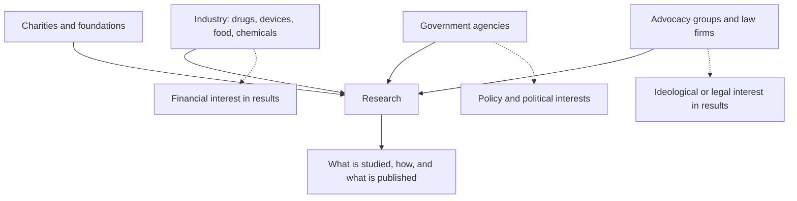

# Who pays for research

**Prerequisites:** [[retractions-and-corrections|Retractions and corrections]] and [[norms-of-science|The norms of science]].

@@IMG@@

Research is expensive. Someone pays for the scientists, the laboratories, the participants and the years of follow-up, and whoever pays has some influence over what gets studied, how and what gets published. Knowing the main funders and their interests is the starting point for thinking about conflicts of interest.

## The main funders

- **Governments**, through agencies such as the US National Institutes of Health (NIH), the Canadian Institutes of Health Research (CIHR), the UK Medical Research Council and National Institute for Health and Care Research (NIHR), and the European Research Council. They fund much basic science and many large public health studies.
- **Industry**: pharmaceutical, biotechnology and medical device companies fund most clinical trials of new products, because regulators require trials before approval. Food, chemical, energy, technology and other industries also fund research relevant to their products.
- **Charities and foundations**: such as the Wellcome Trust, the Bill & Melinda Gates Foundation, the Howard Hughes Medical Institute, cancer and heart charities, and patient advocacy organisations.
- **Universities and hospitals** from their own funds.
- **Advocacy groups, activist organisations and law firms**, which sometimes fund studies relevant to campaigns or litigation ([[activist-and-litigation-funded-research|activist and litigation-funded research]]).

## The scale of industry funding

In biomedical research, industry's share of funding is large. In their 2003 *JAMA* review, Justin Bekelman, Yan Li and Cary Gross reported that industry's share of total US investment in biomedical research and development had grown from about 32% in 1980 to about 62% in 2000, while the federal share fell. Most phase 3 drug trials are sponsored by the company that makes the drug.

This is not inherently sinister. Companies have the products, the money and the regulatory obligation to test them. Much industry-funded research is rigorous, and companies often run larger, better-blinded trials than academic groups. The problem is that companies also have strong financial interests in particular results.

## What funders can influence

A funder can shape research at every stage:

1. **The question**: which products, comparisons and outcomes are studied, and which are not. Many important questions (comparing two cheap generic drugs, testing lifestyle interventions, studying long-term harms) attract little commercial funding.
2. **The design**: choice of comparator (placebo rather than the best existing treatment, or a competitor at the wrong dose), population, duration and outcomes.
3. **The conduct**: who runs the trial, who holds the data, who analyses it.
4. **The analysis**: which analyses are run and emphasised.
5. **The publication**: whether, when and how results are published, and who writes the paper.
6. **The dissemination**: press releases, reprints, conferences and marketing.

Contracts between sponsors and academic investigators have sometimes given sponsors control over data and publication. A 2005 survey of US academic medical centres by Michelle Mello and colleagues in the *New England Journal of Medicine* found wide variation in what contract provisions institutions would accept, including on sponsors' rights to draft manuscripts and to control data.

## Public funders have interests too

Government funding is often treated as neutral, but agencies have priorities, political pressures and institutional commitments. Agencies that recommend a public health measure may have a reputational stake in studies of it. Academic researchers funded by public grants have career interests in positive, novel findings and in their own theories ([[non-financial-conflicts|non-financial conflicts]]). These interests are usually weaker and more diffuse than a company's interest in its product, but they are real.

## Where to find funding information

- The paper's **funding statement** and **role of the funder** statement (did the funder design the study, analyse the data, write the paper?).
- **Conflict of interest declarations** for each author ([[what-a-conflict-of-interest-is|what a conflict of interest is]]).
- **Trial registries**, which list sponsors and collaborators ([[trial-registries|trial registries]]).
- **Payment databases**: in the United States, the federal **Open Payments** database, created under the Physician Payments Sunshine Act (part of the 2010 Affordable Care Act), publishes industry payments to physicians and teaching hospitals.

## Key ideas

- Research is funded by governments, industry, charities, institutions, advocacy groups and law firms.
- Industry funds most late-stage drug trials and a large share of biomedical research.
- Funders can influence the question, design, conduct, analysis, publication and dissemination.
- Public funders and academic researchers also have interests.
- Check funding statements, role-of-funder statements, declarations and registries.

## Where this leads

- Next: [[what-a-conflict-of-interest-is|What a conflict of interest is]]
