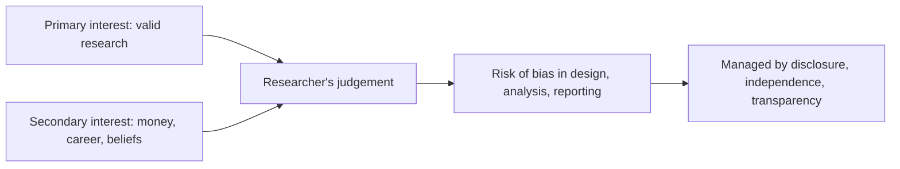

# What a conflict of interest is

**Prerequisites:** [Who pays for research](01-who-pays-for-research.md).

@@IMG@@

A **conflict of interest** (COI) exists when a person's judgement about a primary interest, such as the validity of research or the welfare of patients, risks being unduly influenced by a secondary interest, such as financial gain or professional advancement. That definition, close to the one used by the US Institute of Medicine (now the National Academy of Medicine) in its 2009 report *Conflict of Interest in Medical Research, Education, and Practice*, has an important feature: a conflict of interest is a **situation**, not an act. Having one does not mean anyone has done anything wrong.

## Primary and secondary interests

- **Primary interests** are the purposes the role exists for: producing valid knowledge, caring for patients, educating students.
- **Secondary interests** are other goals that are often legitimate in themselves: income, career advancement, recognition, loyalty to colleagues, personal beliefs.

A conflict arises when the secondary interest creates a **risk** that it will distort judgement about the primary one.

## Types of conflict

### Financial

- **Employment** by a company with an interest in the result.
- **Research funding** from an interested party.
- **Consulting fees, speaker fees and advisory board payments**.
- **Stock ownership, stock options or patents** on the product.
- **Royalties** and **expert witness fees**.
- **Travel, gifts and meals**.

Financial conflicts are the easiest to define and disclose, which is why most policies focus on them.

### Non-financial

- **Intellectual commitment** to a theory or previous findings.
- **Professional and career interests**: the need for publications, grants and promotion.
- **Personal relationships** with authors or rivals.
- **Ideological, political or religious beliefs**.
- **Advocacy roles** in campaigns related to the research.

These are discussed in [non-financial conflicts](06-non-financial-conflicts.md). They are harder to define and disclose but can be just as powerful.

### Institutional

Universities and hospitals can hold equity in spin-off companies, receive industry donations or depend on particular funding streams. Bekelman and colleagues reported in 2003 that roughly two-thirds of academic institutions held equity in start-ups that sponsored research at the same institution.

## Disclosure forms

Most medical journals use the **ICMJE disclosure form**, which asks authors to report, for the past 36 months, any relationships with entities that could be perceived as relevant to the work, including grants, consulting fees, speaker payments, patents, stock and unpaid roles such as advisory board memberships or leadership in advocacy organisations. The form treats perception as part of the test: what matters is whether a reasonable reader would want to know.

## Why conflicts matter even for honest people

Most people believe they are not influenced by gifts or payments, while believing others are. Research in psychology suggests that bias usually works **unconsciously**. A 2001 study by Michael Steinman and colleagues in the *American Journal of Medicine* found that most medical residents thought pharmaceutical promotion did not affect their own prescribing, but fewer believed the same about other residents. Jason Dana and George Loewenstein argued in *JAMA* in 2003 that even small gifts can create feelings of reciprocity and that self-serving bias is largely unintentional, so good intentions do not neutralise it.

## A conflict is not proof of bias

The definition matters because it cuts both ways:

- A conflict means there is a **risk** of bias, which justifies closer scrutiny and transparency.
- A conflict is **not evidence** that a particular study is biased or wrong. A study must be judged on its methods and results.

The next lessons examine what evidence shows about how conflicts actually affect research ([how funding shapes results](03-how-funding-shapes-results.md)), the limits of disclosure ([disclosure and its limits](04-disclosure-and-its-limits.md)), and how to weigh conflicts without falling into ad hominem dismissal ([weighing conflicts](05-weighing-conflicts-without-ad-hominem.md)).

## Key ideas

- A conflict of interest is a situation where a secondary interest risks distorting judgement about a primary interest.
- Conflicts can be financial, non-financial or institutional.
- The ICMJE form asks about a broad range of relationships over 36 months.
- Bias from conflicts is usually unconscious; good intentions do not remove it.
- A conflict justifies scrutiny, not dismissal.

## Where this leads

- Next: [How funding shapes results](03-how-funding-shapes-results.md)
