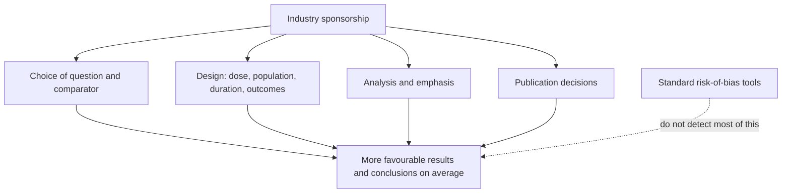

# How funding shapes results

**Prerequisites:** [What a conflict of interest is](02-what-a-conflict-of-interest-is.md) and [Meta-analysis](../03-study-designs/15-meta-analysis.md).

@@IMG@@

Does funding actually change what research finds? This is an empirical question, and it has been studied extensively. The short answer from the best evidence is **yes, on average**, though not always in obvious ways, and not in a way that lets you dismiss any individual study.

## The systematic reviews

### Bekelman, Li and Gross (2003)

In a systematic review in *JAMA*, Justin Bekelman, Yan Li and Cary Gross pooled eight analyses covering 1,140 original studies and found that industry-sponsored studies were significantly more likely to reach conclusions favourable to the sponsor: a pooled odds ratio of 3.60 (95% CI 2.63 to 4.91). They also found that industry sponsorship was associated with restrictions on publication and data sharing, and that about a quarter of investigators had industry affiliations.

### The Cochrane review: Lundh and colleagues (2017)

The most comprehensive evidence is a Cochrane methodology review, "Industry sponsorship and research outcome", by Andreas Lundh, Joel Lexchin, Barbara Mintzes, Jeppe Schroll and Lisa Bero, updated in 2017 to include 75 papers. Compared with studies with other sponsorship, industry-sponsored drug and device studies:

- more often had **favourable efficacy results** (risk ratio 1.27, 95% CI 1.17 to 1.37);
- more often had **favourable conclusions** (risk ratio 1.34, 95% CI 1.19 to 1.51);
- showed **less agreement between results and conclusions** (risk ratio 0.83);
- did **not** differ in harms results, based on few papers;
- did **not** have higher risk of bias by standard measures such as randomisation, allocation concealment and follow-up, and more often had low risk of bias from blinding.

The authors concluded that sponsorship leads to more favourable results and conclusions, and that this "industry bias" cannot be explained by standard risk-of-bias assessments.

## How bias happens without bad methods

That last finding is crucial. Industry-funded trials are often methodologically sound by checklist standards. The bias seems to come through subtler routes:

- **Choice of comparator**: comparing a new drug with placebo when an effective treatment exists, or with a competitor given at too low a dose (less effective) or too high a dose (more side effects).
- **Choice of population**: enrolling patients most likely to respond and least likely to have side effects.
- **Choice of outcomes and duration**: [surrogate endpoints](../09-from-lab-to-headline/02-surrogate-endpoints.md) that respond quickly, short trials that miss later harms.
- **Selective publication** of favourable trials ([publication bias](../06-research-integrity/06-publication-bias.md)) and favourable outcomes ([outcome switching](../06-research-integrity/03-outcome-switching.md)).
- **Framing and spin** in abstracts and conclusions ([spin](../05-anatomy-of-a-paper/10-discussion-limitations-and-spin.md)).
- **Multiple publication** of positive results.

## Specific examples

- **Head-to-head trials**: a 2006 study by Stephan Heres and colleagues in the *American Journal of Psychiatry* examined head-to-head trials of second-generation antipsychotic drugs and found that in most cases the overall result favoured the sponsor's drug, so that different trials appeared to show each drug beating the others, an outcome they described as contradictory.
- **Calcium channel blockers**: a 1998 study by Henry Thomas Stelfox and colleagues in the *New England Journal of Medicine* found that 96% of authors who wrote supportively about these drugs had financial relationships with manufacturers, compared with 37% of critical authors.
- **Passive smoking**: in a 1998 *JAMA* study of 106 review articles, Deborah Barnes and Lisa Bero found that 94% of reviews by authors with tobacco industry affiliations concluded that passive smoking was not harmful, compared with 13% of reviews by authors without such affiliations. Affiliation was the only factor that predicted the conclusion.
- **Sugar-sweetened beverages**: a 2013 systematic review of systematic reviews by Maira Bes-Rastrollo and colleagues in *PLOS Medicine* found that reviews with financial conflicts of interest with the food industry were five times more likely to conclude there was insufficient evidence of an association between sugary drinks and weight gain.

## Beyond pharma

Similar patterns have been reported for research funded by the tobacco, sugar, alcohol, chemical and other industries ([tobacco](../10-case-studies/01-tobacco-industry-research.md), [sugar](../10-case-studies/02-sugar-research-foundation.md)). Fewer studies have examined other kinds of funders, but the mechanisms (choice of question, design, analysis and publication) apply to any funder with a stake in the result ([activist and litigation-funded research](07-activist-and-litigation-funded-research.md)).

## What this does and does not mean

- It means that, **on average**, sponsored research is tilted toward the sponsor's interests, and that standard quality checklists do not catch the tilt.
- It does **not** mean that every industry-funded study is wrong, or that non-industry research is unbiased.
- It means you should check the **design choices** (comparator, population, outcomes, duration) and **publication completeness**, not just the risk-of-bias checklist, when a study has a sponsor with an interest.

## Key ideas

- Systematic reviews consistently find that industry-sponsored studies have more favourable results and conclusions.
- Lundh's Cochrane review: risk ratio 1.27 for favourable results and 1.34 for favourable conclusions.
- Bekelman's review: odds ratio 3.60 for pro-industry conclusions.
- The bias works through question, comparator, population, outcomes, publication and spin, not obviously bad methods.
- Funding is a reason to check design choices closely, not to dismiss results.

## Where this leads

- Next: [Disclosure and its limits](04-disclosure-and-its-limits.md)
