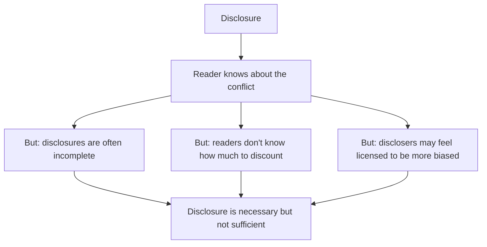

# Disclosure and its limits

**Prerequisites:** [[how-funding-shapes-results|How funding shapes results]].

@@IMG@@

The main way science handles conflicts of interest is **disclosure**: authors declare their financial and other relationships, and readers take them into account. Disclosure is necessary, but research suggests it is far from sufficient, and can sometimes backfire.

## How disclosure became standard

Medical journals began requiring financial disclosure in the 1980s; the *New England Journal of Medicine* introduced a policy in 1984. The ICMJE developed a uniform disclosure form, revised several times ([[what-a-conflict-of-interest-is|what a conflict of interest is]]). Guideline bodies, regulators' advisory committees and universities have their own disclosure rules. In the United States, the Physician Payments Sunshine Act required public reporting of industry payments to physicians, published through the **Open Payments** database from 2014.

## Incomplete disclosure

Disclosures are often incomplete. Studies comparing authors' declared conflicts with public payment databases have repeatedly found undisclosed payments. For example, studies of clinical practice guideline authors and of authors of journal articles have found that a substantial share received industry payments listed in Open Payments that they did not disclose. Reasons include different interpretations of "relevant", forgetfulness and, occasionally, deliberate concealment.

Some of the most serious historical conflicts were not disclosed at all. The 1967 *New England Journal of Medicine* review on dietary fats, sugar and heart disease by Robert McGandy, D. Mark Hegsted and Fredrick Stare did not disclose that the Sugar Research Foundation had funded it, set its objective and seen drafts ([[sugar-research-foundation|sugar case study]]). Disclosure requirements were not then standard.

## The perverse effects of disclosure

In a 2005 paper in the *Journal of Legal Studies*, "The dirt on coming clean: perverse effects of disclosing conflicts of interest", Daylian Cain, George Loewenstein and Don Moore reported experiments in which advisers estimated the value of jars of coins for others and were sometimes paid more if their advice was high. When the conflict was disclosed, advisers gave **more** biased advice, and recipients did not discount it enough. The authors suggested two mechanisms: **strategic exaggeration** (advisers inflating advice to compensate for expected discounting) and **moral licensing** (feeling that disclosure discharges their ethical duty). Later work by the same group found that disclosure can also create pressure on recipients to follow advice so as not to signal distrust.

These are laboratory experiments with small stakes, and their application to research is debated, but they undercut the assumption that disclosure solves the problem.

## How readers respond to disclosure

Several randomised experiments have shown physicians identical abstracts with and without industry funding statements. A 2012 study by Aaron Kesselheim and colleagues in the *New England Journal of Medicine* found that internists rated trials described as industry-funded as less rigorous and were less willing to prescribe the drugs, even when the trials were otherwise identical and well designed. That suggests readers do discount disclosed industry funding, possibly too much for rigorous trials and too little for subtle design bias.

## Beyond disclosure: managing conflicts

Because disclosure is not enough, institutions use other tools:

- **Independence**: independent academic steering committees, independent data monitoring committees and independent statisticians with access to all data.
- **Data access**: requiring that academic authors have full access to the data and final say over publication, a condition many journals require authors to confirm.
- **Recusal**: excluding conflicted people from guideline panels, advisory committees or peer review on relevant topics. The Institute of Medicine's 2011 standards for trustworthy clinical practice guidelines recommended that most panel members, and the chair, be free of conflicts.
- **Limits on payments** and bans on gifts in some institutions.
- **Registration and data sharing**, which reduce the scope for selective reporting regardless of who funds the study ([[open-science|open science]]).

## For readers

- Read the disclosures, but do not stop there.
- Check whether the funder had a role in design, analysis and writing, and whether academic authors had full data access.
- Look for independent replication, especially by unconflicted groups.
- Remember that absence of a declared conflict does not mean absence of interest.

## Key ideas

- Disclosure is the standard response to conflicts of interest and is necessary.
- Disclosures are frequently incomplete, and historical conflicts were often hidden.
- Experiments suggest disclosure can license more bias and that recipients under-discount.
- Physicians do discount disclosed industry funding, sometimes indiscriminately.
- Independence, data access, recusal, registration and data sharing go beyond disclosure.

## Where this leads

- Next: [[weighing-conflicts-without-ad-hominem|Weighing conflicts without ad hominem]]
