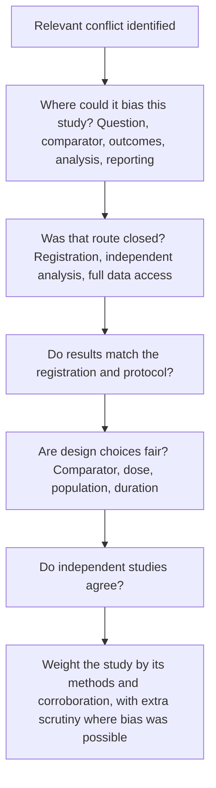

# Weighing conflicts without ad hominem

**Prerequisites:** [Disclosure and its limits](04-disclosure-and-its-limits.md) and [Why reading research is hard](../01-foundations/06-why-reading-research-is-hard.md).

@@IMG@@

Once you know that funding affects results on average, it is tempting to use conflicts as a shortcut: "This study was funded by the manufacturer, so I can ignore it." Or, from the other side: "This critic has ties to activists, so ignore them." Both are versions of the **ad hominem fallacy**: rejecting an argument because of who makes it rather than what it says. This lesson is about using conflict-of-interest information properly.

## Why ad hominem dismissal fails

1. **It throws away evidence.** Much of what we know about drug efficacy comes from industry-funded trials, many of them rigorous. Ignoring them all leaves you with far less information, not better information.
2. **It cannot be applied consistently.** Almost everyone has some interest: researchers in their theories and careers, activists in their causes, regulators in past decisions, journalists in striking stories. If any interest disqualifies, nothing survives.
3. **It invites symmetric abuse.** If you dismiss industry studies on funding grounds, you have no principled reply when others dismiss independent studies on ideological grounds.
4. **Conflicts are probabilistic.** Lundh's Cochrane review found a risk ratio of 1.27 for favourable results ([how funding shapes results](03-how-funding-shapes-results.md)). That is a real tilt, but it means most of the difference between industry and other studies is not explained by sponsorship, and many industry studies report unfavourable results.

## The opposite error

Ignoring conflicts entirely is also a mistake. History is full of research that was distorted by funders with a stake in the answer: tobacco, sugar, Vioxx, paroxetine and others in the [case studies](../10-case-studies/README.md). Conflicts are relevant evidence about the **risk of bias**. The task is to use them to direct scrutiny, not to replace it.

## A practical framework

When a study has a relevant conflict of interest, work through these questions:

1. **Identify the specific route.** How could this funder's interest plausibly have affected *this* study? Through the choice of comparator? The outcomes? The analysis? Non-publication of other studies?
2. **Check whether that route was closed.** Was the trial pre-registered with a clear primary outcome? Was the analysis done by an independent statistician? Did academic authors have full data access? Is the protocol available?
3. **Check the design choices.** Is the comparator appropriate? The dose? The population? Long enough to detect harms?
4. **Check completeness.** Are all registered trials of this product published? Do posted registry results match?
5. **Look for independent corroboration.** Have unconflicted groups, or groups with opposite interests, found similar results?
6. **Then judge the evidence on its merits.**

## Apply it symmetrically

Use the same framework for all interests:

- An industry-funded trial of a company's drug.
- A study funded by a competitor, which may have the opposite interest.
- A study by a scientist whose reputation rests on a theory.
- A study funded by an advocacy group or a law firm ([activist and litigation-funded research](07-activist-and-litigation-funded-research.md)).
- A study by a public agency evaluating its own programme.
- An analysis by a critic who sells books or services related to the claim.

The symmetry test from [why reading research is hard](../01-foundations/06-why-reading-research-is-hard.md) applies: would you scrutinise this conflict as hard if the study's conclusion matched your views?

## Strong evidence survives conflicts

Some findings are so well replicated, by so many groups with different interests and different designs, that funding questions about any single study hardly matter. The link between smoking and lung cancer, for instance, was established by independent researchers despite decades of industry-funded doubt. Conversely, a finding resting on a single conflicted study, with no independent replication, is fragile regardless of who funded it.

## When conflicts should carry more weight

Conflicts should increase your caution more when:

- the conflicted party controlled the data and analysis;
- results are inconsistent with independent studies;
- important design choices favour the sponsor;
- there is evidence of missing studies or outcomes;
- the outcome is subjective or the analysis flexible;
- the stakes for the sponsor are very high.

## Key ideas

- Dismissing research because of its funder is an ad hominem fallacy; ignoring conflicts is also an error.
- Use conflicts to identify where bias could enter, then check whether those routes were closed.
- Apply the same scrutiny to all kinds of interests, including ones aligned with your own views.
- Findings replicated by independent groups with different interests are robust to any single conflict.
- Conflicts deserve more weight when the conflicted party controlled the data or design choices favour it.

## Where this leads

- Next: [Non-financial conflicts](06-non-financial-conflicts.md)
