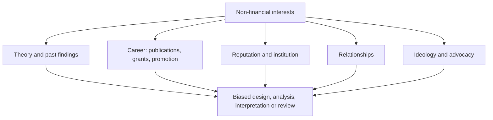

# Non-financial conflicts

**Prerequisites:** [[weighing-conflicts-without-ad-hominem|Weighing conflicts without ad hominem]].

@@IMG@@

Money is the easiest conflict to see and disclose, but it is not the only one. Researchers also have stakes in their theories, careers, reputations, relationships and beliefs. These **non-financial conflicts** can bias research just as much, and they are almost universal.

## Kinds of non-financial interest

- **Intellectual commitment.** Scientists who have built careers on a theory have an interest in its being right. Max Planck's remark, often paraphrased as "science advances one funeral at a time", reflects the observation that established researchers rarely abandon their own theories.
- **Career incentives.** Hiring, promotion and grants reward publications, especially novel, positive results in prestigious journals. That creates pressure toward [[p-hacking|p-hacking]], [[harking|HARKing]] and overstated conclusions ([[the-replication-crisis|the replication crisis]]).
- **Reputation.** A researcher whose finding is challenged may defend it beyond what the evidence supports. Institutions may defend their staff and their brand.
- **Personal relationships.** Peer reviewers and editors may favour friends or students and disfavour rivals.
- **Ideology, politics and religion.** Beliefs about how society should be organised can affect which questions are asked and how results are interpreted, in nutrition, environmental science, social science, drug policy and many other areas.
- **Advocacy roles.** Researchers who lead or advise campaigns have a stake in findings that support them.
- **Clinical commitment.** Doctors who have used a treatment for years may resist evidence that it does not work.

## White hat bias

In a 2010 paper in the *International Journal of Obesity*, Mark Cope and David Allison described **white hat bias**: "bias leading to the distortion of information in the service of what may be perceived to be righteous ends". Examining research on sugar-sweetened beverages and on breastfeeding in relation to obesity, they reported that papers tended to describe the evidence as stronger than it was in the direction seen as virtuous, and that studies showing hoped-for effects were cited more. Their point was that well-meaning researchers can distort evidence for causes they believe in, not only for money. (Allison has himself received industry funding, which critics noted; the argument should be judged on its evidence, as the previous lesson suggests.)

## The debate over disclosure

Should non-financial interests be disclosed? Arguments for:

- They can bias research as much as money.
- Readers deserve to know about an author's advocacy roles.

Arguments against or for caution:

- Everyone has beliefs; requiring disclosure of all of them is impossible.
- Asking about religion or politics could be intrusive or discriminatory.
- Focusing on non-financial conflicts can be used to dilute attention to financial ones.

The current ICMJE form asks about some non-financial relationships, including leadership or fiduciary roles in other boards, societies, committees or advocacy groups, whether paid or unpaid. *PLOS* journals ask authors to declare competing interests that are non-financial, such as political, personal, religious, ideological, academic and intellectual ones. Most journals do not ask about beliefs as such.

## Effects on peer review

Non-financial conflicts are particularly important in [[peer-review|peer review]]. Reviewers may be competitors working on the same question, or authors of the theory a paper challenges. A classic 1977 experiment by Michael Mahoney in *Cognitive Therapy and Research* sent reviewers manuscripts with identical methods but results that either supported or contradicted the reviewers' presumed theoretical views; manuscripts with confirming results were rated more favourably. The study was small, but it illustrates **confirmation bias** in review.

## Protection against non-financial bias

The same tools that protect against financial bias also protect against non-financial bias:

- [[preregistration|Preregistration]] fixes hypotheses and analyses before the data are seen.
- **Blinded analysis** prevents analysts from steering results toward a preferred answer.
- **Adversarial collaboration**: rivals agree on a design in advance, so neither can dismiss the result (an approach championed by Daniel Kahneman).
- **Open data** lets others check the analysis.
- **Replication** by groups with different commitments.

## For readers

Ask about an author's stake in the result, not just their funding: Is this their theory? Do they lead a campaign? Have they publicly committed to a position? Then use the same framework as for financial conflicts: identify the route for bias and check whether it was closed.

## Key ideas

- Non-financial conflicts include theory, career, reputation, relationships, ideology and advocacy.
- White hat bias describes distortion in the service of perceived righteous causes.
- Disclosure of non-financial interests is debated; some forms ask about advocacy and leadership roles.
- Confirmation bias affects peer review as well as research.
- Preregistration, blinded analysis, adversarial collaboration, open data and replication help.

## Where this leads

- Next: [[activist-and-litigation-funded-research|Activist and litigation-funded research]]
