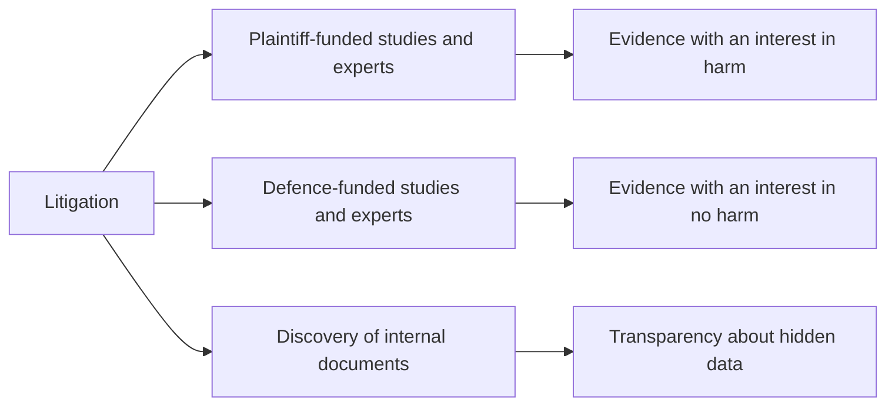

# Activist and litigation-funded research

**Prerequisites:** [Non-financial conflicts](06-non-financial-conflicts.md) and [How funding shapes results](03-how-funding-shapes-results.md).

@@IMG@@

Discussions of conflicts of interest usually focus on industry. But research can also be funded by parties with the opposite interest: advocacy and activist groups, competitors, lawyers suing a company, and campaigns. These funders also want particular answers. A balanced reader applies the same scrutiny to them.

## Litigation-funded research

Lawsuits create demand for evidence. Plaintiffs' lawyers may fund or commission studies to support claims that a product caused harm, and defendants may fund studies to show it did not. Both sides hire expert witnesses, who can earn substantial fees.

### The Wakefield case

The most notorious example is the 1998 *Lancet* paper by Andrew Wakefield and colleagues describing 12 children with bowel symptoms and developmental regression, which suggested a possible link with the MMR vaccine ([case study](../10-case-studies/07-wakefield-1998.md)). Investigative journalist Brian Deer later reported that Wakefield had been paid through the UK Legal Aid Board via a solicitor preparing litigation against vaccine manufacturers, that some of the children were referred through that litigation, and that this was not disclosed to the journal. The UK General Medical Council found Wakefield guilty of serious professional misconduct and struck him off the medical register in 2010, and *The Lancet* fully retracted the paper that year. In 2011 the *BMJ* published Deer's reports and an editorial describing the paper as fraudulent.

Litigation funding does not make research wrong. Expert evidence in litigation has also exposed real harms, and discovery in lawsuits has revealed hidden industry documents ([tobacco](../10-case-studies/01-tobacco-industry-research.md), [Vioxx](../10-case-studies/05-vioxx.md), [Study 329](../10-case-studies/06-paroxetine-study-329.md)). But it creates a strong interest in a particular finding, which should be disclosed and weighed.

## Activist-funded research

Environmental, consumer, public-health and other advocacy groups sometimes fund research supporting their campaigns. Their motives may be sincere and their concerns may be well founded, but they have an interest in particular results, as do companies.

### The Séralini GMO study

In 2012 Gilles-Éric Séralini and colleagues published a two-year study in *Food and Chemical Toxicology* reporting tumours and other harms in rats fed genetically modified maize and the herbicide Roundup. The study was widely criticised for using small groups (10 rats per sex per group) of a rat strain prone to spontaneous tumours, and for its statistics. The journal retracted it in November 2013, saying the results were inconclusive (not that there was fraud); it was republished in 2014 in *Environmental Sciences Europe*. The work was carried out with CRIIGEN, a research group Séralini co-founded that campaigns on GMOs, and was reported to have cost about €3.2 million, funded largely by the Ceres association, whose members included food retailers, and the Charles Léopold Mayer Foundation. Critics also noted that the authors required journalists to sign confidentiality agreements before the release, preventing them from seeking independent comment.

Whatever one thinks of GMOs, the case shows that non-industry funders with a cause can also support research with weak designs and strong conclusions.

## Other examples of interested non-industry funding

- **Competitors** may fund studies that highlight problems with a rival's product.
- **Organic or "natural" product companies** may fund research critical of conventional products, which is also industry funding, just from a different industry.
- **Short sellers** have funded investigations of companies whose stock they bet against; some exposed real fraud, others were contested.
- **Government agencies** may fund evaluations of their own programmes ([who pays for research](01-who-pays-for-research.md)).

## Disclosure of these interests

Many disclosure forms focus on payments from companies and may not clearly capture funding from advocacy organisations, payments as an expert witness, or unpaid campaign roles. The ICMJE form does ask about expert testimony and about unpaid leadership roles in advocacy groups. Readers should check for:

- expert witness work related to the topic;
- funding from advocacy organisations or law firms;
- leadership roles in campaigns;
- the funder's public positions.

## A balanced stance

The framework from [weighing conflicts](05-weighing-conflicts-without-ad-hominem.md) applies equally here. A study funded by an advocacy group or law firm is neither automatically wrong nor automatically independent. Ask how the interest could have biased the question, design, analysis or reporting; whether the study was preregistered and transparent; and whether independent groups have replicated it.

The point is not false balance. Industry funding is much larger in scale and has a well-documented track record of distorting evidence, documented in the Lundh review and the case studies. But "independent of industry" is not the same as "without interests".

## Key ideas

- Litigants, advocacy groups, competitors and campaigns also fund research and have interests in results.
- Wakefield's undisclosed litigation-related funding is a prominent example.
- The Séralini study shows activist-linked research with weak design and strong claims.
- Litigation has also exposed hidden industry data.
- Apply the same scrutiny to all funders, without pretending all interests are equal in scale.

## Where this leads

- Next section: [From lab to headline](../09-from-lab-to-headline/README.md)
