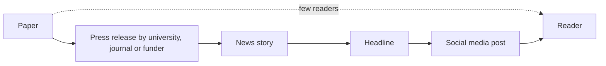

# Press releases and science journalism

**Prerequisites:** [Discussion, limitations and spin](../05-anatomy-of-a-paper/10-discussion-limitations-and-spin.md) and [Correlation and causation](../04-causation/01-correlation-and-causation.md).

*A stack of newspapers. Credit: Daniel R. Blume from Orange County, California, USA. License: [CC BY-SA 2.0](https://creativecommons.org/licenses/by-sa/2.0). Source: [File:A stack of newspapers.jpg](https://commons.wikimedia.org/wiki/File:A_stack_of_newspapers.jpg).*

Most people never read a scientific paper. They learn about research from news stories, social media posts and podcasts, which are often based on press releases written by universities, journals or companies. Each step in that chain is a chance for a finding to become simpler, stronger and more exciting than it really is.

## The chain from paper to headline

At each step, nuance tends to be lost: "associated with" becomes "causes", "in mice" disappears, "may" becomes "does", and caveats are dropped.

## Evidence that press releases drive exaggeration

In a 2014 study in the *BMJ*, Petroc Sumner and colleagues analysed 462 press releases on biomedical and health research issued by 20 leading UK universities in 2011, along with the corresponding papers and 668 news stories. They found that:

- 40% of press releases contained more direct or explicit advice than the paper;
- 33% made causal claims from correlational research;
- 36% made inferences to humans from animal research.

When a press release exaggerated, news stories were much more likely to exaggerate too. When it did not, news stories mostly did not. And exaggeration was not associated with more news coverage. The authors concluded that much exaggeration in health news starts in press releases from academic institutions, which means scientists and press officers can reduce it. A follow-up randomised trial by the same group, published in *BMC Medicine* in 2019, found that aligning press-release claims with the evidence reduced exaggeration in news without reducing coverage.

## Common distortions

- **Correlation reported as causation.** "Coffee drinkers live longer" becomes "Coffee helps you live longer" ([correlation and causation](../04-causation/01-correlation-and-causation.md)).
- **Animal and lab results reported as human results.** "Compound kills cancer cells" may describe a petri dish ([animal and in vitro studies](03-animal-and-in-vitro-studies.md)).
- **Relative risks without absolute risks.** "Doubles your risk" may mean from 1 in 10,000 to 2 in 10,000 ([relative and absolute risk](../02-statistics/12-relative-and-absolute-risk.md)).
- **Surrogate outcomes reported as health outcomes.** "Lowers cholesterol" is not the same as "prevents heart attacks" ([surrogate endpoints](02-surrogate-endpoints.md)).
- **Single studies treated as definitive** ([single studies](06-single-studies-and-the-weight-of-evidence.md)).
- **Conference abstracts and preprints** reported without noting that they have not been peer reviewed ([preprints](../07-publishing/04-preprints.md)).
- **False balance**: presenting a fringe view as equal to a strong consensus ([consensus and dissent](05-consensus-dissent-and-experts.md)).
- **Missing context**: no mention of funding, sample size, or how the result fits with other studies.

## A demonstration: the chocolate hoax

In 2015 journalist John Bohannon, working with a German television documentary team, ran a real but deliberately weak study: a small trial (15 participants in the analysis) of a low-carbohydrate diet with or without a daily chocolate bar, measuring 18 outcomes. With so many outcomes and so few people, something was likely to be "significant" by chance ([multiple comparisons](../02-statistics/16-multiple-comparisons.md)); weight loss happened to be. The result was published in a journal that accepted it without meaningful review, and promoted with a press release. Numerous news outlets in several countries reported that chocolate helps weight loss. Bohannon then revealed the hoax on io9 in May 2015 to show how easily weak research becomes news. Some criticised the ethics of the stunt, but it illustrated many of the failure points in this course.

## What good science journalism looks like

Good science journalism does exist, and many reporters are careful. Signs of a good story:

- It links to or names the paper.
- It says what kind of study it is (trial, cohort, mouse study) and how big.
- It gives absolute numbers.
- It quotes independent experts not involved in the study.
- It mentions funding and limitations.
- It places the study in the context of other evidence.

Organisations such as the UK **Science Media Centre** (founded 2002) gather rapid comments from independent experts for journalists. **HealthNewsReview.org** rated US health news stories against criteria such as costs, benefits, harms and quality of evidence from 2006 until it lost funding in 2018; its criteria remain a useful checklist.

## How to read a science news story

1. Find the original paper or at least the abstract.
2. Identify the study type, population and size.
3. Check whether the headline claim matches the paper's conclusion.
4. Look for absolute numbers.
5. Check whether it was in humans.
6. Look for independent comment.
7. See [the worked news-story example](../11-practice/06-worked-example-a-news-story.md) for a full walk-through.

## Key ideas

- Most people encounter research through press releases and news, which often exaggerate.
- Sumner and colleagues found exaggeration in many university press releases, and it predicted exaggeration in news.
- Typical distortions: causation from correlation, animals to humans, relative risk only, surrogates, single studies.
- The 2015 chocolate hoax showed how a weak study can become global news.
- Good stories name the study, give absolute numbers, quote independent experts and give context.

## Where this leads

- Next: [Surrogate endpoints](02-surrogate-endpoints.md)
