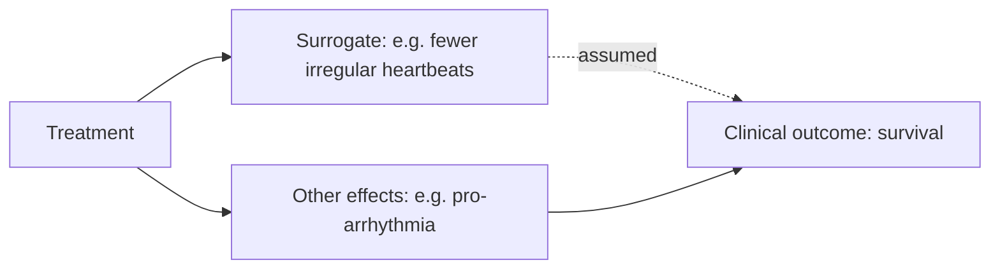

# Surrogate endpoints

**Prerequisites:** [Randomised controlled trials](../03-study-designs/07-randomised-controlled-trials.md) and [Correlation and causation](../04-causation/01-correlation-and-causation.md).

@@IMG@@

What we ultimately care about in medicine are outcomes that matter to patients: living longer, avoiding heart attacks and strokes, feeling better, functioning better. These **clinical** or **patient-important outcomes** can take years and thousands of participants to measure. So trials often measure **surrogate endpoints** instead: laboratory measures or physical signs that are expected to predict clinical outcomes, such as blood pressure, cholesterol, blood sugar, tumour shrinkage, bone density or antibody levels.

## Why surrogates are used

- They change quickly, so trials can be shorter.
- They need fewer participants.
- They make it possible to approve treatments for serious diseases sooner.

Regulators accept some surrogates as the basis for approval. The US FDA has an **accelerated approval** pathway, introduced in 1992, that allows approval based on a surrogate "reasonably likely to predict clinical benefit", with confirmatory trials required afterwards.

## Why surrogates can mislead

A surrogate is valid only if changing it through the treatment changes the clinical outcome. Thomas Fleming and David DeMets explained in a widely cited 1996 paper in the *Annals of Internal Medicine*, "Surrogate end points in clinical trials: are we being misled?", that a surrogate can fail when:

- the surrogate is not on the causal pathway of the disease;
- the disease has several pathways and the treatment affects only the one the surrogate measures;
- the treatment affects the clinical outcome through pathways independent of the surrogate;
- the treatment has unintended harmful effects that the surrogate does not capture.

## Famous failures

### Antiarrhythmic drugs (CAST)

After a heart attack, patients with frequent irregular heartbeats (premature ventricular contractions) had a higher risk of sudden death. Drugs such as encainide and flecainide suppressed these beats, so it seemed obvious they would save lives. The **Cardiac Arrhythmia Suppression Trial** tested this. Its preliminary report in the *New England Journal of Medicine* in 1989 showed that the drugs **increased** mortality: 56 of 730 patients (7.7%) on encainide or flecainide died, compared with 22 of 725 (3.0%) on placebo ([CAST case study](../10-case-studies/03-the-cardiac-arrhythmia-suppression-trial.md)). The surrogate improved; patients died.

### Raising HDL cholesterol

Higher "good" HDL cholesterol is associated with lower heart disease risk in observational studies. But drugs that raise HDL have generally failed to reduce cardiovascular events. In the ILLUMINATE trial, published in the *New England Journal of Medicine* in 2007, the drug torcetrapib raised HDL substantially but increased cardiovascular events and deaths, and development was stopped.

### Blood sugar targets

Lowering blood sugar in type 2 diabetes is generally beneficial, but in the ACCORD trial (published in the *New England Journal of Medicine* in 2008), very intensive targets increased mortality compared with standard targets, and the intensive arm was stopped early.

### Cancer drugs

Many cancer drugs have been approved on surrogates such as tumour response or progression-free survival. Studies have found that, for a substantial share of such approvals, later evidence did not show improvements in overall survival or quality of life. For example, a 2017 *BMJ* study by Courtney Davis and colleagues of cancer drugs approved by the European Medicines Agency in 2009–13 found that most entered the market without evidence of benefit on survival or quality of life, and for many such evidence had not emerged years later.

## Successful surrogates

Some surrogates are well validated:

- **Blood pressure** reduction with several drug classes reliably reduces strokes and heart attacks.
- **LDL cholesterol** reduction with statins reliably reduces cardiovascular events, with benefits proportional to the LDL reduction across many trials.
- **HIV viral load** suppression predicts clinical outcomes.
- In vaccines, specific **antibody levels** (correlates of protection) are accepted for some diseases where they have been validated.

Even a validated surrogate may not transfer to a new drug class with different mechanisms.

## Questions to ask

1. Is the outcome a surrogate or a clinical outcome?
2. Has this surrogate been validated for this type of treatment?
3. Is there evidence from trials of clinical outcomes?
4. Could the treatment have harms the surrogate misses?
5. How do news reports describe it? "Lowers blood sugar" is not "prevents complications".

## Key ideas

- Surrogate endpoints are measures expected to predict clinical outcomes; they make trials faster and smaller.
- A surrogate can improve while patients do worse, as in CAST and the torcetrapib trial.
- Fleming and DeMets explained why surrogates fail: wrong pathway, multiple pathways, off-target effects.
- Some surrogates (blood pressure, LDL with statins, HIV viral load) are well validated.
- Always ask whether a treatment improves outcomes that matter to patients.

## Where this leads

- Next: [Animal and in vitro studies](03-animal-and-in-vitro-studies.md)
