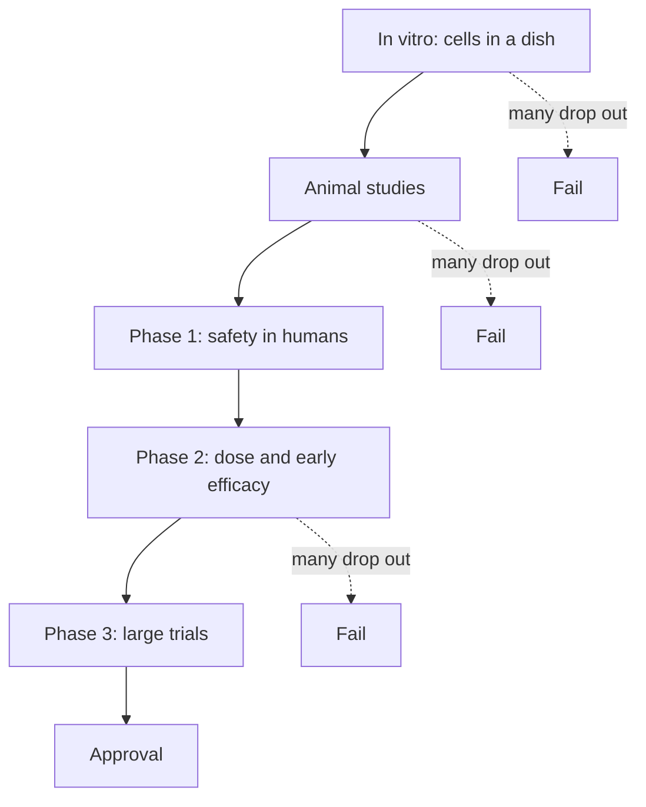

# Animal and in vitro studies

**Prerequisites:** [The evidence hierarchy](../03-study-designs/01-the-evidence-hierarchy.md) and [Surrogate endpoints](02-surrogate-endpoints.md).

@@IMG@@

A large part of biomedical research happens before any human is involved: **in vitro** studies ("in glass") in cells, tissues or test tubes, and **in vivo** studies in animals such as mice, rats, zebrafish or monkeys. These studies are essential for understanding mechanisms and screening candidates, but their results often fail to carry over to people. "Kills cancer cells" or "reverses ageing in mice" is a long way from a treatment.

## What preclinical studies are good for

- **Mechanisms**: how a molecule, gene or pathway works.
- **Screening**: which of thousands of compounds might be worth testing.
- **Toxicology**: identifying possible harms before human exposure, often required by regulators.
- **Plausibility**: providing biological support for associations seen in humans, one of the [Bradford Hill considerations](../04-causation/09-bradford-hill-criteria.md).
- **Questions that cannot ethically be studied in humans**.

## Why results often fail to translate

Reasons include:

- **Biology differs.** Mice are not small humans. Their immune systems, metabolism and lifespans differ. A cell line in a dish lacks the body's tissues, blood supply and immune system.
- **Disease models are imperfect.** Many animal "models" of human diseases (for example, of stroke, Alzheimer's disease or autism) reproduce only some features.
- **Doses and exposure differ.** In vitro studies often use concentrations far higher than could be achieved in a human body.
- **Animals are homogeneous.** Lab animals are usually genetically similar, young, of one sex and kept in controlled conditions; patients are diverse, older and have other diseases.
- **Poor methods.** Many animal studies have not been randomised or blinded and have small samples. Reviews by Malcolm Macleod, Emily Sena and colleagues in stroke and other fields reported that reporting of randomisation and blinding was uncommon and that studies without them reported larger effects.
- **Publication bias.** A 2010 analysis by Sena and colleagues in *PLOS Biology* of animal stroke studies estimated that publication bias may account for about a third of the reported efficacy.

## How often animal findings hold up

In a 2006 *JAMA* study, Daniel Hackam and Donald Redelmeier examined 76 highly cited animal studies published in leading journals. About a third (28 studies, 37%) were replicated in human randomised trials, 14 (18%) were contradicted by human trials, and 34 (45%) had not been tested in humans. They noted that these were the most highly cited, prominent animal studies, so translation for typical studies may be worse.

Drug development statistics tell a similar story. Analyses of clinical development success rates, such as a 2016 report by the Biotechnology Innovation Organization (BIO) and partners, have estimated that only around 10% of drugs entering phase 1 trials go on to be approved, with phase 2 the biggest hurdle, and many of those drugs looked promising in animals.

## Improving preclinical research

- The **ARRIVE guidelines** (Animal Research: Reporting of In Vivo Experiments), first published in 2010 and updated as ARRIVE 2.0 in 2020, set out what animal studies should report, including randomisation, blinding and sample size calculation.
- **Systematic reviews of animal studies** (for example by the CAMARADES collaboration) assess whether the preclinical evidence justifies human trials.
- **Preregistration** of animal studies (for example on preclinicaltrials.eu).
- **Multicentre animal studies**, analogous to multicentre trials.
- Using both sexes and more realistic models.

## Reading claims based on preclinical research

When a headline says a substance "fights cancer", "protects the brain" or "slows ageing", ask:

1. Was this in humans, animals or cells?
2. If cells: at what concentration, compared with what humans could achieve?
3. If animals: which species and model, how many, randomised and blinded?
4. Has anything been tested in humans?
5. What outcome was measured? Often a [surrogate](02-surrogate-endpoints.md) such as a biomarker.

Sumner and colleagues found that about a third of university press releases about animal research made inferences to humans not made in the paper ([press releases](01-press-releases-and-science-journalism.md)). A popular Twitter account, @justsaysinmice, created by James Heathers in 2019, highlighted this by reposting headlines with the words "IN MICE".

## Key ideas

- In vitro and animal studies are essential for mechanisms, screening and safety but often fail to translate.
- Differences in biology, models, doses, diversity and methods all contribute.
- Hackam and Redelmeier found that only about a third of highly cited animal studies were replicated in human trials.
- Most drugs that enter human trials are not approved.
- Always ask whether a finding is in humans, and on what outcome.

## Where this leads

- Next: [Subgroups and secondary analyses](04-subgroups-and-secondary-analyses.md)
