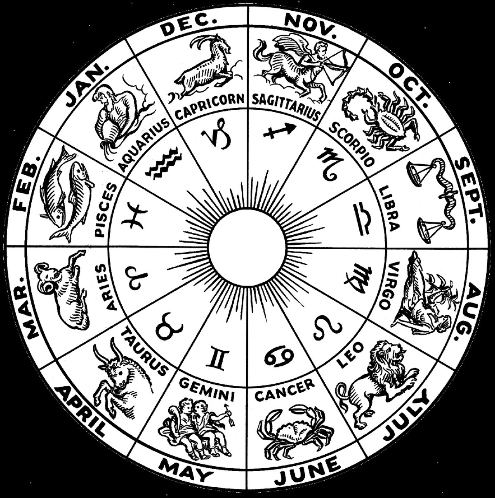
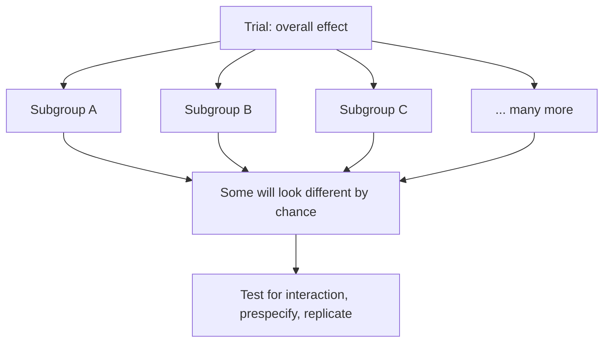

# Subgroups and secondary analyses

**Prerequisites:** [Multiple comparisons](../02-statistics/16-multiple-comparisons.md) and [Forest plots](../05-anatomy-of-a-paper/07-forest-plots.md).

*The signs of the zodiac; the ISIS-2 trial's star-sign subgroups showed how chance subgroup effects arise. Credit: Pearson Scott Foresman. License: Public domain. Source: [File:Zodiac (PSF).png](https://commons.wikimedia.org/wiki/File:Zodiac_(PSF).png).*

A trial finds that a treatment does not work overall, but the paper reports that it works in women, or in people over 65, or in those with a particular gene. Or a trial finds a benefit overall, and someone points out that it was absent in one subgroup. Are these findings real? Usually, they should be treated with great caution.

## What subgroup analyses are

A **subgroup analysis** looks at the treatment effect separately in subsets of participants defined by baseline characteristics: age, sex, disease severity, region, genetic markers and so on. The motivation is reasonable: treatments may genuinely work differently in different people (called **effect modification** or **heterogeneity of treatment effect**).

**Secondary analyses** more broadly include analyses of secondary outcomes, of different time points, and *post hoc* analyses of trial data for new questions.

## Why subgroup findings mislead

- **Multiple comparisons.** With many subgroups, some will show "significant" effects by chance ([multiple comparisons](../02-statistics/16-multiple-comparisons.md)). With 20 independent subgroups and no real differences, you expect about one at p < 0.05.
- **Low power.** Each subgroup is smaller than the trial, so true effects are hard to detect, and absences of effect are uninformative.
- **Wrong test.** Finding p < 0.05 in one subgroup and p > 0.05 in another does not show the effects differ. The correct test is a **test for interaction**, which asks whether the effect differs between subgroups.
- **Post hoc selection.** Subgroups chosen after seeing the data are especially unreliable ([HARKing](../06-research-integrity/05-harking.md)).

## The ISIS-2 star signs

The most famous demonstration comes from the ISIS-2 trial, published in *The Lancet* in 1988, which showed that aspirin reduced deaths after a heart attack. At the editors' request to add subgroup analyses, the investigators analysed the results by astrological star sign. Aspirin appeared to be ineffective, or slightly harmful, for people born under Gemini or Libra, and strongly beneficial for everyone else. Nobody believes star signs modify the effect of aspirin; the point was that subgroup findings arise by chance.

## Credibility criteria

Methodologists have proposed criteria for when a subgroup effect is credible. Influential versions were set out by Xin Sun, Matthias Briel, Stephen Walter and Gordon Guyatt in the *BMJ* in 2010, and developed into the ICEMAN instrument (Schandelmaier and colleagues, *CMAJ*, 2020). They ask whether:

1. The subgroup variable was measured at baseline, not after randomisation.
2. The subgroup analysis was **prespecified**, with the direction of effect predicted.
3. It was one of a small number of subgroup analyses.
4. A **test for interaction** shows a statistically significant difference, ideally strongly so.
5. The effect is consistent across related outcomes and across studies.
6. There is a plausible biological rationale, specified in advance.

Subgroup effects that meet these criteria are rare. Most claimed subgroup effects fail when tested in new trials.

## Reading subgroup forest plots

Many trial papers include a forest plot of the treatment effect across subgroups ([forest plots](../05-anatomy-of-a-paper/07-forest-plots.md)). The right way to read it:

- Expect the subgroup estimates to scatter around the overall effect by chance.
- Look at the **interaction p-value**, not the individual subgroup p-values.
- Assume the overall result applies to each subgroup unless there is strong evidence otherwise.

## Secondary outcomes and post hoc analyses

The same logic applies to secondary outcomes. A trial that fails on its primary outcome but "succeeds" on one of several secondary outcomes has not shown the treatment works. Papers and press releases sometimes emphasise such findings ([spin](../05-anatomy-of-a-paper/10-discussion-limitations-and-spin.md)). Post hoc analyses of trial data can be valuable for generating hypotheses, but they are observational analyses within a trial and need confirmation.

## Key ideas

- Subgroup analyses ask whether treatment effects differ between groups of participants.
- Most subgroup findings are due to chance, low power or post hoc selection.
- The ISIS-2 star sign analysis showed how easily chance subgroup effects appear.
- Credible subgroup effects are prespecified, few, supported by a significant interaction test, consistent and plausible.
- Assume the overall result applies unless evidence for a difference is strong.

## Where this leads

- Next: [Consensus, dissent and experts](05-consensus-dissent-and-experts.md)
