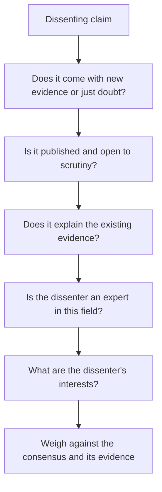

# Consensus, dissent and experts

**Prerequisites:** [How a claim becomes knowledge](../01-foundations/05-how-a-claim-becomes-knowledge.md) and [Weighing conflicts without ad hominem](../08-funding-and-conflicts/05-weighing-conflicts-without-ad-hominem.md).

*Diagram of Helicobacter pylori, shown by Marshall and Warren to cause most peptic ulcers. Credit: Y tambe. License: [CC BY-SA 3.0](http://creativecommons.org/licenses/by-sa/3.0/). Source: [File:Helicobacter pylori diagram.png](https://commons.wikimedia.org/wiki/File:Helicobacter_pylori_diagram.png).*

Most of us cannot evaluate every study on every topic ourselves. We rely on experts, scientific bodies and the overall consensus of researchers. But experts have been wrong, consensus has shifted, and dissenters have sometimes been right. How should a reader weigh consensus against dissent?

## What a scientific consensus is

A **scientific consensus** is the collective judgement of the relevant expert community, based on the totality of evidence. It is not a vote, and it is not the same as the opinion of any one authority. It is usually expressed through:

- systematic reviews and meta-analyses ([systematic reviews](../03-study-designs/14-systematic-reviews.md));
- reports by national academies and expert panels;
- clinical guidelines graded by systems such as [GRADE](../03-study-designs/16-cochrane-and-grade.md);
- statements by scientific societies.

A strong consensus rests on **converging evidence** from many studies, using different methods, by independent groups. That is what makes it robust.

## Why consensus deserves weight

- It aggregates far more evidence and expertise than any individual can.
- It has survived scrutiny by many people with different interests and theories, including rivals who would gain from overturning it.
- Historically, well-established consensus positions (that smoking causes lung cancer, that HIV causes AIDS, that the Earth is warming because of human activity) have been repeatedly confirmed.

## Why consensus can be wrong

Consensus has also been wrong or premature:

- **Peptic ulcers**: the medical consensus held that ulcers were caused mainly by stress and acid. Barry Marshall and Robin Warren showed that most were caused by the bacterium *Helicobacter pylori*, initially to scepticism; they received the 2005 Nobel Prize in Physiology or Medicine.
- **Hormone replacement therapy**: observational studies led to widespread recommendations that HRT would prevent heart disease, which the Women's Health Initiative trial did not support ([HRT case study](../10-case-studies/04-hormone-replacement-therapy-and-the-whi.md)).
- **Dietary fat and sugar**: industry funding influenced the framing of early research on diet and heart disease ([sugar case study](../10-case-studies/02-sugar-research-foundation.md)).
- **Antiarrhythmic drugs**: widespread use based on a surrogate endpoint was overturned by CAST ([CAST](../10-case-studies/03-the-cardiac-arrhythmia-suppression-trial.md)).

Notice that in each case the consensus was overturned by **better evidence**, usually randomised trials or new discoveries, not by rhetoric.

## Telling productive dissent from manufactured doubt

Some dissent is the engine of scientific progress. Some is **manufactured doubt**, created to delay regulation or protect products. Historians Naomi Oreskes and Erik Conway documented in *Merchants of Doubt* (2010) how a small number of scientists, often with industry support, cast doubt on the evidence on tobacco, acid rain, the ozone hole and climate change. The tobacco industry's strategy was summed up in a 1969 Brown & Williamson memo: "Doubt is our product" ([tobacco case study](../10-case-studies/01-tobacco-industry-research.md)).

Signs of productive dissent:

- It presents **new data or analyses**, published and open to scrutiny.
- It explains the existing evidence, not just criticises it.
- It comes from people with relevant expertise.
- It makes testable predictions.
- It engages with criticism and updates.

Signs of manufactured or unproductive doubt:

- It mainly attacks the existing evidence without offering better evidence.
- It demands impossible certainty ("we need more research") indefinitely.
- It relies on cherry-picked studies or on a few contrarian experts, often outside their field.
- It is promoted mainly through media, not journals.
- It is funded by parties with a strong interest in delay.

These are heuristics, not proofs, and should be applied symmetrically, including to dissent you find congenial.

## Experts outside their field

Expertise is specific. A Nobel laureate in chemistry is not thereby an expert on vaccines or nutrition. Credentials matter most when they are relevant to the question.

## False balance

Journalism that presents "both sides" equally can mislead when the evidence is lopsided. A 2004 analysis by Maxwell and Jules Boykoff in *Global Environmental Change* argued that US prestige press coverage of climate change between 1988 and 2002 often gave roughly equal attention to views that humans were and were not contributing to warming, which they called "balance as bias". Reporting the weight of evidence, not just the existence of disagreement, is more accurate.

## Being humble both ways

The right attitude combines respect for consensus with openness to evidence. Consensus is the best current bet, not a certainty. Dissent deserves a hearing when it brings evidence. Neither "the experts say so" nor "experts have been wrong before" settles a question on its own.

## Key ideas

- Scientific consensus is the collective judgement of experts based on converging evidence.
- Consensus deserves weight but has been wrong; it was corrected by better evidence.
- Productive dissent brings new, testable, published evidence; manufactured doubt mainly attacks.
- Expertise is field-specific.
- False balance misrepresents the weight of evidence.

## Where this leads

- Next: [Single studies and the weight of evidence](06-single-studies-and-the-weight-of-evidence.md)
