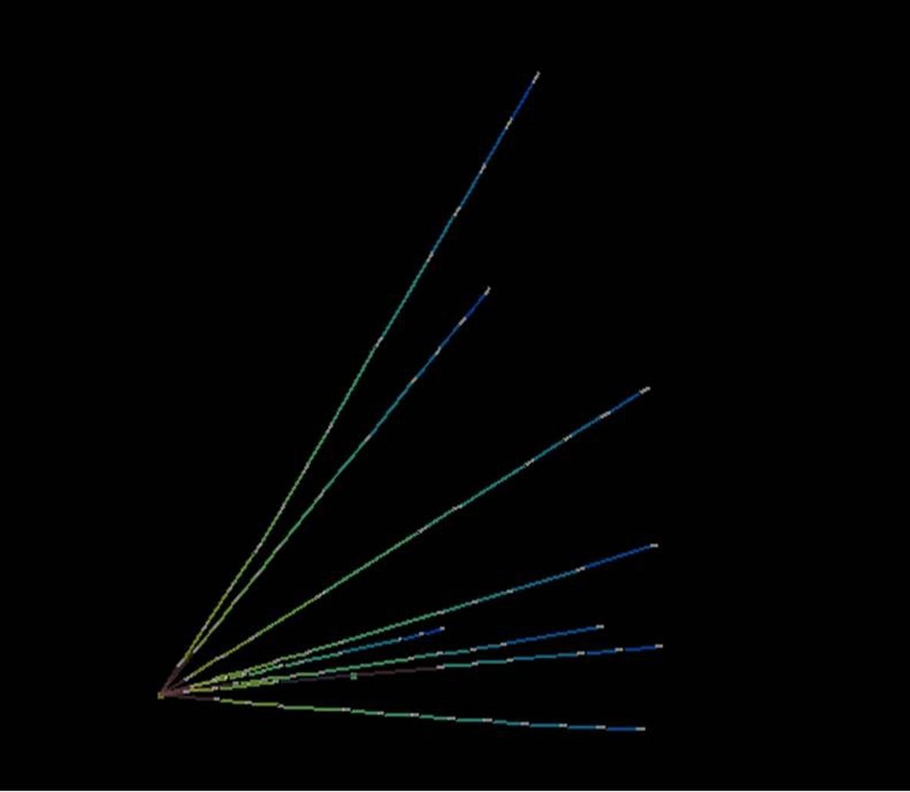
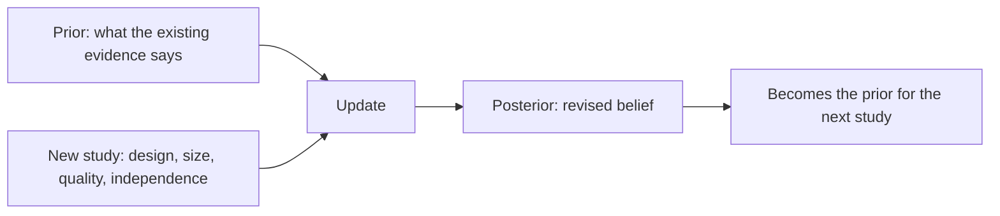

# Single studies and the weight of evidence

**Prerequisites:** [Meta-analysis](../03-study-designs/15-meta-analysis.md), [The replication crisis](../06-research-integrity/07-the-replication-crisis.md) and [Base rates and Bayes' theorem](../02-statistics/14-base-rates-and-bayes-theorem.md).

*The OPERA neutrino detector, whose apparent faster-than-light result was traced to equipment faults. Credit: CERN PhotoLab. License: [CC BY 4.0](https://creativecommons.org/licenses/by/4.0). Source: [File:OPERA neutrino.jpg](https://commons.wikimedia.org/wiki/File:OPERA_neutrino.jpg).*

"New study shows..." is the most common opening in science news. But a single study rarely settles anything. Its result is one data point in a larger body of evidence, and how much it should change your mind depends on its quality and on what was known before.

## Why single studies are fragile

- **Chance.** Even a well-conducted study can produce a false positive or false negative ([p-values](../02-statistics/08-hypothesis-tests-and-p-values.md), [power](../02-statistics/10-statistical-power.md)).
- **Bias.** Any study can have design flaws, confounding or selective reporting.
- **Specificity.** Results may depend on the particular population, setting, dose or measurement.
- **The winner's curse.** Studies that are published and publicised tend to be those with large, surprising effects, which are more likely to be overestimates.
- **Low prior probability.** As John Ioannidis argued in his 2005 *PLOS Medicine* essay "Why most published research findings are false", when hypotheses are unlikely to start with, studies are small and analyses flexible, most positive findings may be false.

## Evidence on how often single findings hold up

- Ioannidis's 2005 *JAMA* study of 49 highly cited clinical research studies found that, of the 45 claiming an effective intervention, 7 (16%) were contradicted by later research and 7 (16%) had found stronger effects than later studies; 20 (44%) were replicated and 11 (24%) remained largely unchallenged. Non-randomised studies were contradicted more often.
- The Open Science Collaboration's 2015 replication of 100 psychology studies found statistically significant results in 36% of replications, compared with 97% of originals, with effect sizes on average about half as large ([replication crisis](../06-research-integrity/07-the-replication-crisis.md)).
- Hackam and Redelmeier found that about a third of highly cited animal studies were replicated in humans ([animal studies](03-animal-and-in-vitro-studies.md)).

## Thinking in terms of updating

A Bayesian way to think about a new study ([Bayes' theorem](../02-statistics/14-base-rates-and-bayes-theorem.md)): start with your prior belief based on existing evidence, then ask how much the new study should shift it.

A new study should move you a lot when:

- it is large, well designed and preregistered;
- it is consistent with plausible mechanisms and other evidence;
- it is independent of previous work and of interested parties;
- the prior evidence was weak.

It should move you little when:

- it is small, observational or exploratory;
- it contradicts a large body of high-quality evidence without explaining why;
- the effect is implausibly large;
- it has a strong conflict of interest that could plausibly have shaped it;
- it has not been peer reviewed or replicated.

## Extraordinary claims

Carl Sagan popularised the maxim "extraordinary claims require extraordinary evidence". In Bayesian terms: if a claim has a low prior probability, it needs very strong evidence to become probable. When the OPERA experiment reported in 2011 that neutrinos appeared to travel faster than light, most physicists suspected an error; one was found in 2012 (a loose fibre-optic cable among other issues). The team itself had asked others to scrutinise the result.

## The weight of evidence

When you assess a question, consider the **totality of evidence**:

1. What do systematic reviews and meta-analyses say? ([systematic reviews](../03-study-designs/14-systematic-reviews.md))
2. How many independent studies are there, with what designs?
3. Do different methods converge? Observational studies, trials, mechanistic studies and natural experiments that agree are much more convincing than any one alone. This idea is sometimes called **triangulation**.
4. Is there evidence of publication bias or missing studies?
5. How does the new study fit?

## Avoiding the opposite error

Treating every new study as unreliable is also a mistake. Single large, well-conducted trials sometimes do change practice, especially when they test a clear question with a clinical outcome, such as the Women's Health Initiative ([HRT](../10-case-studies/04-hormone-replacement-therapy-and-the-whi.md)) or CAST ([CAST](../10-case-studies/03-the-cardiac-arrhythmia-suppression-trial.md)). The goal is calibration: weigh each study for what it is.

## Key ideas

- A single study is one data point; chance, bias and specificity make it fragile.
- Ioannidis, the Open Science Collaboration and others show many initial findings fail to hold up.
- Think in terms of updating prior beliefs by an amount that depends on study quality and independence.
- Extraordinary claims need extraordinary evidence.
- Judge questions by the totality and convergence of evidence, while recognising that some single trials are decisive.

## Where this leads

- Next section: [Case studies](../10-case-studies/README.md)
