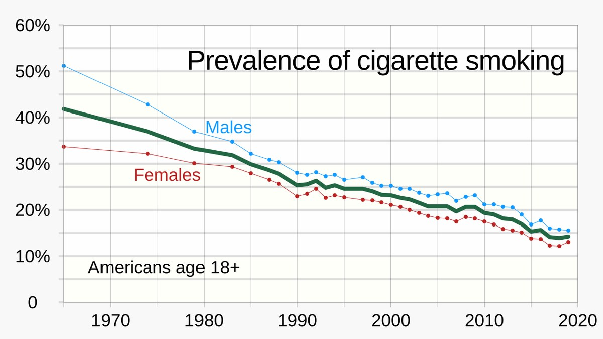
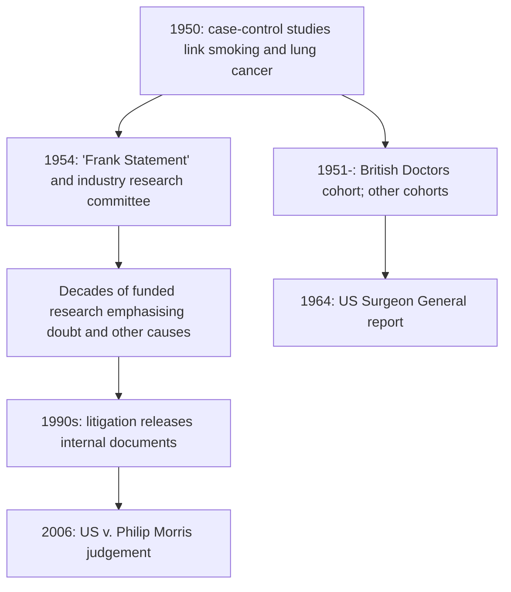

# Case study: tobacco industry research

**Prerequisites:** [Case-control studies](../03-study-designs/05-case-control-studies.md), [Bradford Hill criteria](../04-causation/09-bradford-hill-criteria.md) and [How funding shapes results](../08-funding-and-conflicts/03-how-funding-shapes-results.md).

*Cigarette smoking prevalence among US adults since 1965, the year after the Surgeon General's report. Credit: RCraig09. License: [CC BY-SA 4.0](https://creativecommons.org/licenses/by-sa/4.0). Source: [File:1965- Cigarette smoking prevalence in the US.svg](https://commons.wikimedia.org/wiki/File:1965-_Cigarette_smoking_prevalence_in_the_US.svg).*

The story of smoking and lung cancer is both a triumph of epidemiology and the textbook example of an industry manufacturing doubt. It shaped modern thinking about causation, conflicts of interest and the ethics of research funding.

## The science

In 1950 two landmark case-control studies were published: Ernst Wynder and Evarts Graham in *JAMA*, and Richard Doll and Austin Bradford Hill in the *BMJ*. Doll and Hill compared patients with lung cancer with patients without cancer in London hospitals. Of 649 men with lung cancer, 647 were smokers and only 2 were non-smokers, compared with 27 non-smokers among 649 matched controls ([worked example](../11-practice/07-worked-example-a-case-control-study.md)). Risk rose with the amount smoked.

Because case-control studies can be biased, Doll and Hill then began a prospective cohort study of British doctors in 1951, which confirmed the association and showed a dose-response relationship; it continued for 50 years. Other cohort studies, including American Cancer Society studies by E. Cuyler Hammond and Daniel Horn, agreed. Animal studies showed that tobacco tar caused tumours.

In 1964 the US Surgeon General's Advisory Committee report concluded that cigarette smoking was a cause of lung cancer in men. It used criteria similar to those Bradford Hill set out in 1965: strength, consistency, specificity, temporality, biological gradient, plausibility, coherence ([Bradford Hill criteria](../04-causation/09-bradford-hill-criteria.md)). Smoking was established as a cause without a randomised trial.

## The industry response

In December 1953 the heads of major US tobacco companies met at the Plaza Hotel in New York with the public relations firm Hill & Knowlton. The result was "A Frank Statement to Cigarette Smokers", published on 4 January 1954 in 448 newspapers. It said the companies accepted "an interest in people's health as a basic responsibility, paramount to every other consideration", that there was no proof smoking caused cancer, and that they would fund independent research through a new Tobacco Industry Research Committee (later the Council for Tobacco Research).

Internal documents, later made public through litigation, showed how the strategy worked. A 1969 Brown & Williamson memo, "Smoking and Health Proposal", stated: "Doubt is our product since it is the best means of competing with the 'body of fact' that exists in the mind of the general public." Industry-funded research tended to focus on other possible causes of disease (genetics, air pollution, stress) and on uncertainties, rather than on the harms of smoking.

## Passive smoking

The pattern recurred with secondhand smoke. Barnes and Bero found in 1998 that 94% of reviews by tobacco-affiliated authors concluded passive smoking was not harmful, compared with 13% by unaffiliated authors ([how funding shapes results](../08-funding-and-conflicts/03-how-funding-shapes-results.md)). Internal documents showed industry efforts to fund and promote research questioning the harms, sometimes without disclosing the industry's role.

## Litigation and documents

Lawsuits by US states in the 1990s led to the 1998 Master Settlement Agreement and the public release of millions of internal documents, now in the **Truth Tobacco Industry Documents** archive at the University of California, San Francisco. In 2006, in *United States v. Philip Morris*, Judge Gladys Kessler found that the major cigarette companies had violated the Racketeer Influenced and Corrupt Organizations Act (RICO) by deceiving the public about the health effects of smoking, including the addictiveness of nicotine and the harms of secondhand smoke.

## Lessons for readers

- **Causation can be established without trials** when observational evidence is strong, consistent, dose-dependent and plausible ([correlation and causation](../04-causation/01-correlation-and-causation.md)).
- **"More research is needed" can be a strategy**, not just a scientific judgement ([consensus and dissent](../09-from-lab-to-headline/05-consensus-dissent-and-experts.md)).
- **Funders can bias the research agenda** by choosing which questions to fund.
- **Undisclosed funding** is a serious problem, which is why many journals now refuse tobacco-funded research (the *BMJ* group and *PLOS* journals among them).
- **Litigation can expose hidden documents**, as it later did for pharmaceuticals.

## Key ideas

- Doll and Hill's 1950 case-control study and later cohort studies established smoking as a cause of lung cancer.
- The industry's 1954 "Frank Statement" launched decades of research and messaging emphasising doubt.
- Internal documents stated "Doubt is our product".
- Tobacco-affiliated reviews of passive smoking overwhelmingly concluded no harm.
- Litigation released documents, and a 2006 US court found the companies had deceived the public.

## Where this leads

- Next: [The Sugar Research Foundation](02-sugar-research-foundation.md)
