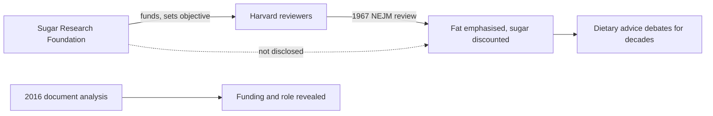

# Case study: the Sugar Research Foundation

**Prerequisites:** [[tobacco-industry-research|Tobacco industry research]] and [[disclosure-and-its-limits|Disclosure and its limits]].

@@IMG@@

In the 1960s scientists were debating whether dietary fat or sugar played a bigger role in heart disease. In 2016, researchers who examined historical documents reported that the sugar industry had funded an influential review that played down sugar and emphasised fat, without disclosure. The case is often cited, and also sometimes overstated, so it is worth getting the details right.

## The documents

In a 2016 paper in *JAMA Internal Medicine*, "Sugar industry and coronary heart disease research: a historical analysis of internal industry documents", Cristin Kearns, Laura Schmidt and Stanton Glantz of the University of California, San Francisco, analysed correspondence between the Sugar Research Foundation (SRF) and Harvard nutrition researchers. They reported that:

- In 1965 the SRF funded a literature review on sugars, fats and heart disease ("Project 226").
- The review was conducted by Harvard researchers Robert McGandy and D. Mark Hegsted, overseen by Fredrick Stare, chair of Harvard's nutrition department, who also had other industry ties.
- The SRF paid the researchers $6,500, equivalent to about $48,900 in 2016 dollars.
- The SRF set the review's objective, contributed articles for inclusion and received drafts.
- The review was published in two parts in the *New England Journal of Medicine* in 1967. It concluded that there was "no doubt" that the only dietary intervention needed to prevent coronary heart disease was to reduce dietary cholesterol and substitute polyunsaturated for saturated fat (as Kearns and colleagues summarised it), and discounted evidence implicating sucrose.
- The SRF's funding and role were not disclosed. (The journal did not require disclosure at the time.)

The authors concluded that the industry had sponsored research that cast doubt on the hazards of sugar while promoting fat as the culprit, and suggested that policy committees should give less weight to industry-funded studies.

## Caveats and criticism

Several points were raised in response:

- The documents did not show that the SRF wrote the review or dictated its conclusions; the authors were respected researchers who may have sincerely believed fat was the bigger risk.
- The relative roles of fat and sugar in heart disease were genuinely uncertain at the time, and the review was one of many influences on dietary advice.
- Kearns, Schmidt and Glantz have themselves long campaigned against sugar and tobacco industry influence; the paper should be judged on its documents, as the [[weighing-conflicts-without-ad-hominem|weighing conflicts]] lesson suggests.
- An accompanying *JAMA Internal Medicine* commentary by Marion Nestle supported the paper's broad conclusions, while others argued the case had been simplified into "sugar industry blamed fat" headlines.

What the documents do clearly show is that the review's funding and the funder's involvement were hidden from readers, which would be unacceptable today.

## Later developments

The pattern of food industry funding has continued in other forms. In 2015 *The New York Times* reported that Coca-Cola had funded the Global Energy Balance Network, a group of researchers who emphasised physical activity over diet in obesity; the network disbanded later that year. Bes-Rastrollo and colleagues found that systematic reviews with food-industry conflicts were much more likely to conclude there was insufficient evidence linking sugary drinks to weight gain ([[how-funding-shapes-results|how funding shapes results]]).

On the other hand, Cope and Allison's concept of [[non-financial-conflicts|white hat bias]] was illustrated partly using research on sugary drinks, where they argued that evidence of harm was sometimes overstated. The current scientific consensus, reflected for example in World Health Organization guidance on free sugars (2015), is that high intake of free sugars is harmful, while the debate about the relative roles of different nutrients continues.

## Lessons for readers

- **Undisclosed funding** distorts readers' ability to judge research.
- **Funders can shape the question and framing**, not just the data.
- **Historical documents** can reveal influence long after the fact.
- **Be careful with simplified stories**, even about industry misconduct; read what the documents actually show.

## Key ideas

- The SRF funded a 1965–67 Harvard review that discounted sugar and emphasised fat; the funding was not disclosed.
- Kearns, Schmidt and Glantz documented this in 2016 from internal correspondence.
- The documents show funding, objective-setting and involvement, not ghost-writing.
- Food industry funding of research has continued to raise concerns.
- The case shows the importance of disclosure and careful reading of historical claims.

## Where this leads

- Next: [[the-cardiac-arrhythmia-suppression-trial|The Cardiac Arrhythmia Suppression Trial]]
