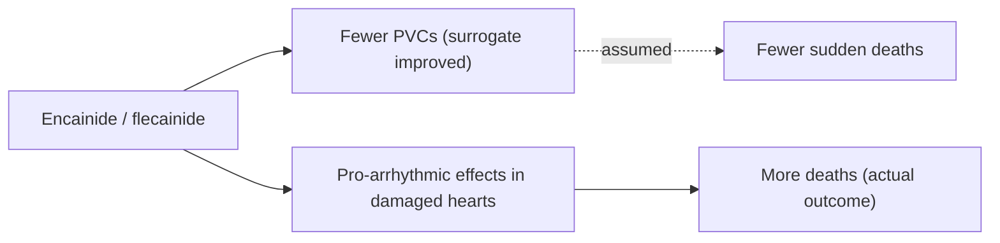

# Case study: the Cardiac Arrhythmia Suppression Trial

**Prerequisites:** [Surrogate endpoints](../09-from-lab-to-headline/02-surrogate-endpoints.md) and [Randomised controlled trials](../03-study-designs/07-randomised-controlled-trials.md).

@@IMG@@

The Cardiac Arrhythmia Suppression Trial (CAST) is the classic warning about surrogate endpoints. A treatment that fixed a worrying measurement turned out to kill patients.

## The reasoning

After a heart attack, some patients have frequent **premature ventricular contractions** (PVCs), extra heartbeats originating in the ventricles. Observational studies showed that patients with frequent PVCs had a higher risk of sudden cardiac death. The drugs encainide, flecainide and moricizine suppressed PVCs effectively. The chain of reasoning seemed compelling:

1. PVCs predict sudden death.
2. The drugs suppress PVCs.
3. Therefore the drugs should prevent sudden death.

These drugs were already widely prescribed on this reasoning. Flecainide and encainide had been approved by the FDA on the basis of their effect on arrhythmias.

## The trial

The US National Heart, Lung, and Blood Institute funded CAST to test whether suppressing PVCs after a heart attack reduced deaths. Patients whose PVCs were suppressed by one of the drugs in an open titration phase were randomised to continue that drug or switch to placebo, with double blinding.

In April 1989 the data and safety monitoring board recommended stopping the encainide and flecainide arms. The preliminary report, published in the *New England Journal of Medicine* in August 1989, showed:

| | Drug (encainide or flecainide) | Placebo |
|---|---|---|
| Patients | 730 | 725 |
| Deaths from any cause | 56 (7.7%) | 22 (3.0%) |
| Arrhythmic death or cardiac arrest | 33 | 9 |

The drugs more than doubled mortality. A follow-up trial of moricizine, CAST II, was also stopped early, in 1991, because of excess early deaths and little prospect of benefit.

## Why the surrogate failed

The drugs suppressed PVCs but also had **pro-arrhythmic** effects, making dangerous arrhythmias more likely in hearts damaged by infarction. The surrogate (PVC count) captured the intended effect but not the harm. This fits Fleming and DeMets's account of how surrogates fail ([surrogate endpoints](../09-from-lab-to-headline/02-surrogate-endpoints.md)).

## The scale of harm

Because these drugs had been widely used before CAST, the harm extended well beyond the trial. Thomas Moore's 1995 book *Deadly Medicine* argued that their use had caused large numbers of deaths in the United States; such estimates rely on assumptions about how many patients were treated and should be treated as rough.

## Why CAST matters

- **Plausible mechanisms are not enough.** The reasoning was logical, the surrogate was real, and the drugs did what they were supposed to do to it.
- **Randomised trials with clinical outcomes** are needed when the stakes are high and a surrogate has not been validated.
- **Data monitoring committees** can stop trials early when harm emerges, protecting participants.
- **Publicly funded trials** can test questions that companies have little incentive to test once a drug is already selling.

CAST changed regulatory thinking about surrogates and is still taught to medical students, regulators and trialists.

## Key ideas

- Antiarrhythmic drugs were used after heart attacks because they suppressed PVCs, a predictor of sudden death.
- CAST showed encainide and flecainide increased mortality: 7.7% versus 3.0%.
- The surrogate improved because of one effect; deaths rose because of another.
- Clinical outcome trials are essential when surrogates are not validated.
- Independent monitoring and public funding allowed the question to be answered.

## Where this leads

- Next: [Hormone replacement therapy and the WHI](04-hormone-replacement-therapy-and-the-whi.md)
