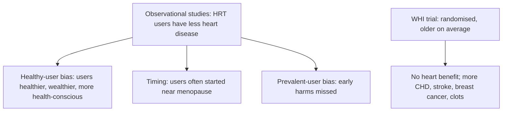

# Case study: hormone replacement therapy and the WHI

**Prerequisites:** [Healthy-user bias](../04-causation/06-healthy-user-bias.md), [Cohort studies](../03-study-designs/06-cohort-studies.md) and [Randomised controlled trials](../03-study-designs/07-randomised-controlled-trials.md).

@@IMG@@

For years, observational studies suggested that hormone replacement therapy (HRT, also called menopausal hormone therapy) protected women against heart disease. Many doctors recommended it partly for that reason. A large randomised trial found the opposite. The story is the standard example of how observational evidence can mislead, and also of how a trial result can itself be oversimplified.

## The observational evidence

Large cohort studies, most prominently the Nurses' Health Study, found that women taking postmenopausal oestrogen had substantially lower rates of coronary heart disease than women who did not, with relative risk reductions of around 40–50% reported in several analyses. Meta-analyses of observational studies agreed. There was a plausible mechanism: oestrogen improves cholesterol profiles. By the 1990s HRT was widely prescribed, and prevention of heart disease was part of the rationale.

## The trials

- **HERS** (Heart and Estrogen/progestin Replacement Study), published in *JAMA* in 1998 by Stephen Hulley and colleagues, randomised 2,763 women with existing coronary disease. It found no overall reduction in coronary events, with more events in the first year on hormones.
- **The Women's Health Initiative (WHI)** randomised 16,608 postmenopausal women aged 50–79 with an intact uterus to oestrogen plus progestin or placebo. In July 2002 the trial was stopped early, after an average of 5.2 years, because the risk of invasive breast cancer had crossed the prespecified boundary and overall risks exceeded benefits. The results, published in *JAMA* (Writing Group for the WHI Investigators, Rossouw and colleagues), showed hazard ratios of:

| Outcome | Hazard ratio | Absolute difference per 10,000 person-years |
|---|---|---|
| Coronary heart disease | 1.29 | 7 more |
| Stroke | 1.41 | 8 more |
| Invasive breast cancer | 1.26 | 8 more |
| Pulmonary embolism | 2.13 | 8 more |
| Colorectal cancer | 0.63 | 6 fewer |
| Hip fracture | 0.66 | 5 fewer |

A separate WHI arm of oestrogen alone in women who had had a hysterectomy was stopped in 2004; it showed an increased risk of stroke and no reduction in coronary heart disease.

## Why the observational studies differed

- **Healthy-user bias**: women who chose HRT tended to be wealthier, better educated, leaner and more health-conscious, and to see doctors regularly ([healthy-user bias](../04-causation/06-healthy-user-bias.md)). Adjustment could not fully remove this confounding.
- **Prevalent users**: cohorts often compared women already taking HRT, who had survived any early harms and stayed on it, with non-users. A 2008 reanalysis of Nurses' Health Study data by Miguel Hernán and colleagues in *Epidemiology* that emulated a trial by comparing women *starting* HRT with non-starters found results much closer to the WHI's ([time-related biases](../04-causation/08-time-related-biases.md)).
- **Timing**: women in observational studies usually began HRT near menopause; WHI participants averaged about 63 years old, many years past menopause.

## The aftermath, and a second lesson

After 2002, HRT use fell sharply worldwide. Later analyses suggested the picture was more nuanced. Analyses of WHI data by age and time since menopause (for example by Jacques Rossouw and colleagues in *JAMA* in 2007, and by JoAnn Manson and colleagues in 2013) found that absolute risks were lower in women aged 50–59 or within 10 years of menopause, supporting a "timing hypothesis". Many current guidelines, such as those of The Menopause Society (formerly the North American Menopause Society), consider HRT reasonable for bothersome symptoms in healthy women near menopause, but not for preventing chronic disease.

Some clinicians argue that the initial media coverage of the WHI exaggerated the risks to younger women, leading many to stop treatment unnecessarily. Others note that the trial correctly overturned the prevention rationale. Both lessons hold: observational studies misled on heart benefit, and simplified reporting of the trial missed nuance, especially about absolute risks ([relative and absolute risk](../02-statistics/12-relative-and-absolute-risk.md)).

## Key ideas

- Observational studies suggested HRT prevented heart disease; HERS and the WHI did not support this.
- WHI oestrogen plus progestin increased coronary disease, stroke, breast cancer and clots, and reduced fractures and colorectal cancer.
- Healthy-user bias, prevalent-user bias and differences in timing explain much of the discrepancy.
- Absolute risks were small for individual women and differ by age and time since menopause.
- The case teaches both the limits of observational studies and the need for nuance in reporting trials.

## Where this leads

- Next: [Vioxx](05-vioxx.md)
