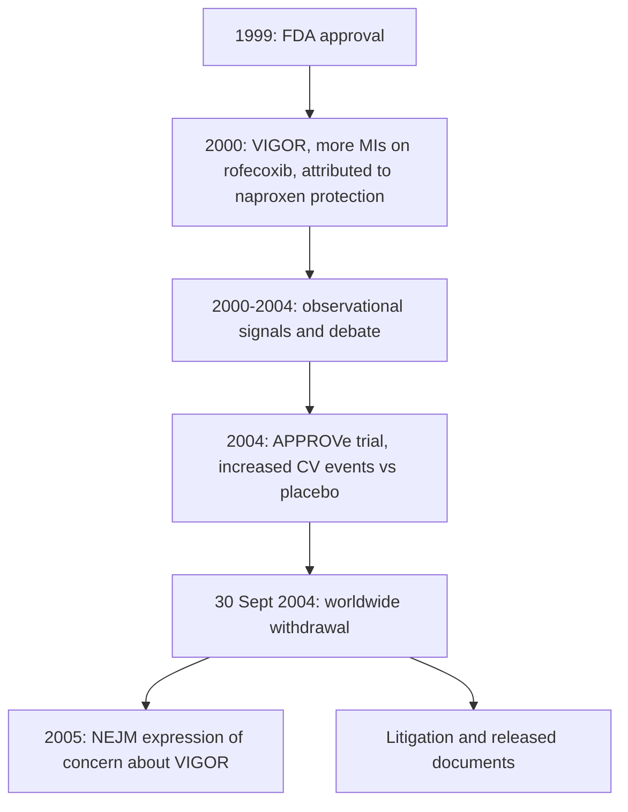

# Case study: Vioxx

**Prerequisites:** [[outcome-switching|Outcome switching]], [[how-funding-shapes-results|How funding shapes results]] and [[passive-surveillance-and-pharmacovigilance|Pharmacovigilance]].

@@IMG@@

Rofecoxib, sold by Merck as Vioxx, was a painkiller for arthritis approved by the US FDA in 1999. It was withdrawn worldwide in 2004 after a trial showed it increased the risk of heart attacks and strokes. The case raised questions about how cardiovascular risks were reported, how regulators monitored safety, and how journals handled data.

## The drug and the promise

Vioxx was a **COX-2 inhibitor**. Traditional non-steroidal anti-inflammatory drugs (NSAIDs) such as naproxen and ibuprofen block both COX-1 and COX-2 enzymes; blocking COX-1 contributes to stomach ulcers and bleeding. Selective COX-2 inhibitors were designed to relieve pain with fewer gastrointestinal side effects. Vioxx was heavily marketed and used by millions of people.

## VIGOR

The **VIGOR** trial (Vioxx Gastrointestinal Outcomes Research), published by Claire Bombardier and colleagues in the *New England Journal of Medicine* in November 2000, randomised about 8,000 patients with rheumatoid arthritis to rofecoxib 50 mg daily or naproxen. It found fewer serious gastrointestinal events with rofecoxib, as intended. It also found more heart attacks with rofecoxib: 0.4% versus 0.1%. The paper presented this mainly as a protective effect of naproxen rather than a harm of rofecoxib.

In December 2005 the *New England Journal of Medicine* published an "expression of concern", stating that the VIGOR paper had omitted three additional heart attacks in the rofecoxib group that were known to the authors before publication, and that this made some calculations and conclusions incorrect. The journal reaffirmed its concern in 2006 after the authors responded. The authors said the three events occurred after a prespecified cut-off date for cardiovascular events.

## APPROVe and withdrawal

**APPROVe** (Adenomatous Polyp Prevention on Vioxx) was a placebo-controlled trial testing whether rofecoxib 25 mg prevented colorectal polyps. In 2004 its monitoring board found an increased rate of confirmed thrombotic cardiovascular events, such as heart attacks and strokes, on rofecoxib compared with placebo, emerging after about 18 months. Merck withdrew Vioxx worldwide on 30 September 2004. Because the comparator was placebo, there was no naproxen explanation available.

## The safety signal

FDA epidemiologist David Graham and colleagues conducted a nested case-control study in Kaiser Permanente data, published in *The Lancet* in 2005, finding an increased risk of serious coronary heart disease with rofecoxib, especially at high doses. In testimony to the US Senate Finance Committee in November 2004, Graham estimated that Vioxx may have caused between 88,000 and 140,000 excess cases of serious coronary heart disease in the United States. That estimate was based on modelling and is disputed, but even lower estimates represent substantial harm.

An earlier meta-analysis by Peter Jüni and colleagues, published in *The Lancet* in 2004, argued that the cardiovascular risk could have been identified from available trial data by 2000.

## Documents and ghostwriting

Litigation produced internal documents. A 2008 *JAMA* study by Joseph Ross and colleagues analysed documents showing that Merck employees had drafted manuscripts later published under academic authors' names, and a companion paper by Bruce Psaty and Richard Kronmal described how Merck's analyses of mortality in trials in Alzheimer's disease had been presented to regulators. Merck settled tens of thousands of US personal injury claims for $4.85 billion in 2007, without admitting liability.

## Lessons for readers

- **Watch how harms are framed.** The VIGOR heart attack difference was interpreted as a benefit of the comparator.
- **Check the comparator.** An active comparator can hide harms that a placebo comparison reveals.
- **Look for complete data.** Cut-off dates and omitted events can change conclusions.
- **Harms emerge after approval.** Pre-approval trials are often too small and short ([[passive-surveillance-and-pharmacovigilance|pharmacovigilance]]).
- **Authorship may not reflect who wrote the paper.**

## Key ideas

- Vioxx was a COX-2 inhibitor marketed for fewer gastrointestinal side effects.
- VIGOR found more heart attacks on rofecoxib, attributed to naproxen protection; NEJM later said three heart attacks had been omitted.
- APPROVe's placebo comparison showed increased cardiovascular events, leading to withdrawal in 2004.
- Graham's studies and testimony estimated large numbers of excess cardiac events.
- Litigation revealed ghostwriting and other practices.

## Where this leads

- Next: [[paroxetine-study-329|Paroxetine Study 329]]
