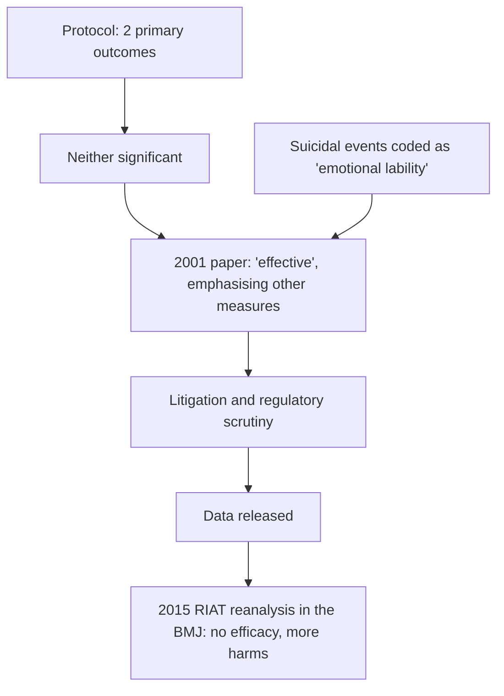

# Case study: paroxetine Study 329

**Prerequisites:** [[outcome-switching|Outcome switching]] and [[how-funding-shapes-results|How funding shapes results]].

@@IMG@@

Study 329 was a trial of the antidepressant paroxetine (Paxil in the US, Seroxat in the UK) in adolescents with depression, sponsored by SmithKline Beecham (later GlaxoSmithKline, GSK). Its 2001 publication presented the drug as effective and well tolerated. A 2015 independent reanalysis of the full data found it was neither. The case is a landmark for outcome switching, ghostwriting, under-reporting of harms and the value of access to raw trial data.

## The trial and the paper

The trial randomised 275 adolescents with major depression to paroxetine, the older antidepressant imipramine, or placebo for eight weeks. It was published in 2001 in the *Journal of the American Academy of Child and Adolescent Psychiatry* by Martin Keller and colleagues, with 22 academic authors. The abstract concluded that paroxetine was "generally well tolerated and effective for major depression in adolescents".

The protocol had specified two primary outcomes, and neither showed a statistically significant difference from placebo. The published paper emphasised positive results on other measures, some of which had not been among the protocol's prespecified outcomes ([[outcome-switching|outcome switching]]). Documents released later in litigation showed that the first draft had been written by a medical writer funded by the company, which raised questions about authorship ([[vioxx|Vioxx]] for a similar pattern).

## Harms

The paper reported serious adverse events, but classified several episodes of suicidal thinking and behaviour under terms such as "emotional lability". Concerns about suicidality with antidepressants in young people led to regulatory action: in 2003 the UK regulator advised against paroxetine for under-18s with depression, and in 2004 the US FDA required a "black box" warning about suicidality in children and adolescents taking antidepressants.

## Restoring the trial

In 2013 Peter Doshi and colleagues proposed the **RIAT** initiative (Restoring Invisible and Abandoned Trials) in the *BMJ*, calling on sponsors to correct or publish misreported and unpublished trials, and on others to do so if sponsors did not. Study 329 was one of the first RIAT reanalyses. Using clinical study reports and individual participant data released by GSK, Joanna Le Noury, Jon Jureidini, David Healy and colleagues published "Restoring Study 329" in the *BMJ* in 2015. They concluded that neither paroxetine nor high-dose imipramine was effective in adolescent depression, and that there were clinically significant increases in harms, including suicidal ideation and behaviour with paroxetine. GSK disputed aspects of the reanalysis.

The original journal has not retracted the 2001 paper, despite requests.

## Legal consequences

In 2004 the New York State Attorney General sued GSK for fraud over the concealment of negative paediatric data; GSK settled and agreed to post clinical trial results online. In July 2012 GSK agreed to plead guilty and pay $3 billion, the largest healthcare fraud settlement in US history at the time, to resolve criminal and civil liability, including for promoting Paxil for use in patients under 18, for which it was not approved. The US Department of Justice cited the company's promotion of the Study 329 article.

## Lessons for readers

- **Compare the paper with the protocol.** Were the reported primary outcomes the registered ones? ([[trial-registries|trial registries]])
- **Read the harms carefully.** How adverse events are coded can hide them.
- **Authorship can mislead.** Named authors may not have written the paper or seen all the data.
- **Access to full data changes conclusions.** Clinical study reports and individual participant data are far more complete than journal articles ([[supplementary-material-and-data|supplementary material and data]]).
- **Journals do not always correct the record.**

## Key ideas

- Study 329's 2001 paper called paroxetine effective in adolescents, although neither protocol-specified primary outcome was significant.
- Suicidal events were coded in ways that obscured them.
- The 2015 RIAT reanalysis found no efficacy and increased harms.
- GSK's 2012 $3 billion settlement included promotion of Paxil to under-18s.
- Comparing papers with protocols and data is essential.

## Where this leads

- Next: [[wakefield-1998|Wakefield 1998]]
