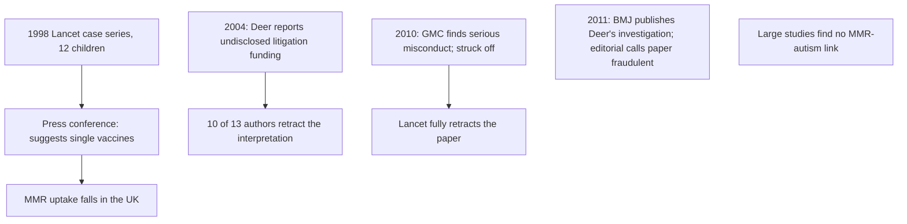

# Case study: Wakefield 1998

**Prerequisites:** [[case-reports-and-case-series|Case reports and case series]], [[activist-and-litigation-funded-research|Activist and litigation-funded research]] and [[fraud-and-misconduct|Fraud and misconduct]].

@@IMG@@

In February 1998 *The Lancet* published a paper by Andrew Wakefield and 12 co-authors describing 12 children with bowel inflammation and developmental regression, including autism. The parents of eight of the children were reported to associate the onset of symptoms with the measles, mumps and rubella (MMR) vaccine. The paper itself said it did not prove an association, but at a press conference Wakefield suggested that single vaccines might be safer than the combined MMR. The paper was later found to be fraudulent and retracted, but its effects on vaccine confidence lasted for decades.

## What kind of study it was

The paper was a **case series** of 12 children, with no comparison group ([[case-reports-and-case-series|case series]]). Even if accurately reported, such a study cannot establish that a vaccine causes a condition: MMR is given to most children at around the age when autism is often first recognised, so some children will develop symptoms soon after vaccination by coincidence ([[correlation-and-causation|correlation and causation]]).

## What was wrong

Investigative journalist Brian Deer reported in *The Sunday Times* from 2004, and in a series in the *BMJ* in 2011, that:

- Wakefield had been funded through the UK Legal Aid Board via a solicitor preparing litigation against vaccine manufacturers, and some of the children had been referred through that litigation; this was not disclosed to the journal ([[activist-and-litigation-funded-research|litigation-funded research]]).
- Wakefield had filed a patent application related to a possible single measles vaccine and other products.
- The children's medical records did not match the paper's descriptions in several cases, including timing of symptoms and diagnoses.

## The retraction and sanctions

- In March 2004, 10 of the 13 authors published a retraction of the paper's interpretation that there was a possible link between MMR and autism.
- In January 2010 the UK General Medical Council found Wakefield had acted dishonestly and irresponsibly, including by conducting invasive investigations on children without proper ethical approval. *The Lancet* fully retracted the paper on 2 February 2010. In May 2010 Wakefield was struck off the UK medical register.
- In January 2011 the *BMJ* published Deer's investigation with an editorial by Fiona Godlee and colleagues stating that the paper was fraudulent. Wakefield has denied wrongdoing.

## The evidence since

Many large studies have looked for a link between MMR and autism and not found one. Examples:

- A Danish cohort of 537,303 children by Kreesten Madsen and colleagues (*New England Journal of Medicine*, 2002).
- A 2014 meta-analysis by Luke Taylor and colleagues in *Vaccine* including over 1.2 million children in cohort studies.
- A Danish cohort of 657,461 children by Anders Hviid and colleagues (*Annals of Internal Medicine*, 2019), with an adjusted hazard ratio for autism of 0.93 (95% CI 0.85 to 1.02) ([[worked-example-a-cohort-study|worked example]]).

## The consequences

MMR uptake in England fell substantially in the years after 1998, and measles outbreaks followed in the UK and elsewhere. The episode is often cited as one of the most damaging cases of research misconduct in modern medicine.

## Lessons for readers

- **Case series cannot establish causation**, however compelling the stories.
- **Press conferences can amplify claims beyond the paper** ([[press-releases-and-science-journalism|press releases]]).
- **Undisclosed litigation interests matter** as much as industry interests.
- **Retraction does not undo public impact**; retracted claims continue to circulate ([[retractions-and-corrections|retractions]]).
- **Large, well-designed studies** are the way to test such claims.

## Key ideas

- Wakefield's 1998 paper was a 12-child case series that suggested an MMR-autism link.
- It had undisclosed litigation-related funding and misrepresented the children's records.
- Most co-authors retracted the interpretation in 2004; the paper was fully retracted in 2010.
- Large cohort studies and meta-analyses have found no link.
- The episode harmed vaccination rates and shows the limits of case series and the importance of disclosure.

## Where this leads

- Next: [[tamiflu-and-hidden-trial-data|Tamiflu and hidden trial data]]
