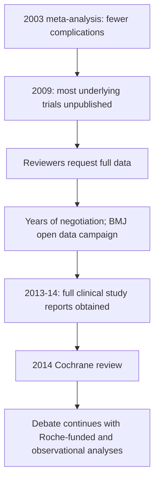

# Case study: Tamiflu and hidden trial data

**Prerequisites:** [[systematic-reviews|Systematic reviews]], [[publication-bias|Publication bias]] and [[cochrane-and-grade|Cochrane and GRADE]].

@@IMG@@

Oseltamivir, sold by Roche as Tamiflu, is an antiviral drug for influenza. Governments around the world stockpiled it for pandemic preparedness, spending large sums. A years-long effort by Cochrane reviewers to obtain the full trial data, and the debate over what those data showed, became a turning point in the movement for clinical trial transparency.

## How it started

Cochrane reviewers led by Tom Jefferson had included in an earlier review a meta-analysis of ten treatment trials, published in 2003 by Laurent Kaiser and colleagues and supported by Roche, which reported that oseltamivir reduced complications such as pneumonia and hospitalisation. In 2009, during the H1N1 pandemic, a Japanese paediatrician, Keiji Hayashi, pointed out in a comment on the Cochrane review that eight of those ten trials had never been fully published. The reviewers could not verify the claims.

## The fight for data

The reviewers asked Roche for the full data. What followed was a long campaign, supported by the *BMJ*, to obtain **clinical study reports** (CSRs): the detailed documents, often thousands of pages long, that companies submit to regulators and that contain far more information than journal articles. Roche initially offered limited data under conditions the reviewers did not accept. Some CSRs were eventually obtained from the European Medicines Agency, and in 2013 Roche committed to releasing full CSRs for its Tamiflu trials, which it did.

## What the 2014 Cochrane review found

The review by Jefferson and colleagues, published in April 2014 in the *Cochrane Database of Systematic Reviews* and summarised in the *BMJ*, was based on CSRs from 20 oseltamivir trials and 26 zanamivir trials. It reported that in adults oseltamivir shortened the time to first alleviation of symptoms by about 16.8 hours (from about 7 days to about 6.3 days). It found no evidence of a reduction in hospital admissions, and the evidence on reducing serious complications such as confirmed pneumonia was weak because of how complications were defined and diagnosed. Oseltamivir increased nausea and vomiting. The reviewers concluded that the evidence did not support claims that the drug reduced complications, and questioned the basis for stockpiling.

## The other side

The debate did not end there:

- A 2015 meta-analysis by Joanna Dobson and colleagues in *The Lancet*, using individual patient data from Roche-sponsored trials (with funding from Roche through an independent group, the Multiparty Group for Advice on Science), reported that among patients with confirmed influenza, oseltamivir reduced lower respiratory tract complications and hospital admissions, as well as shortening symptoms.
- Observational studies of hospitalised patients, such as a 2014 individual-patient meta-analysis by Stella Muthuri and colleagues in *The Lancet Respiratory Medicine* (funded by Roche through an unrestricted grant), suggested reduced mortality, though observational designs are open to confounding.
- Differences between analyses partly reflect different questions: all patients with influenza-like illness (as treated in practice) versus those with laboratory-confirmed influenza.

Health agencies continue to recommend antivirals for some groups, such as hospitalised and high-risk patients, while the size of the benefit remains debated.

## Why the case matters

- **Journal articles are not the full data.** CSRs contain information about methods, outcomes and harms that never reaches publications.
- **Unpublished trials undermine meta-analyses.** A review is only as good as the data it can access ([[publication-bias|publication bias]]).
- **Transparency policy changed.** The case contributed to the European Medicines Agency's 2014 policy on publishing clinical data and to the AllTrials campaign, launched in 2013, calling for all trials to be registered and reported.
- **Different analyses can reach different conclusions** depending on the question and population, and on who funds and conducts them ([[weighing-conflicts-without-ad-hominem|weighing conflicts]]).

## Key ideas

- A 2003 meta-analysis claiming fewer complications relied mostly on unpublished trials.
- Cochrane reviewers spent years obtaining full clinical study reports from Roche.
- The 2014 Cochrane review found symptom relief about 17 hours sooner in adults and no clear reduction in hospitalisations.
- Other analyses, some industry-funded, reported benefits in confirmed influenza.
- The case reshaped clinical trial transparency.

## Where this leads

- Next: [[power-posing|Power posing]]
