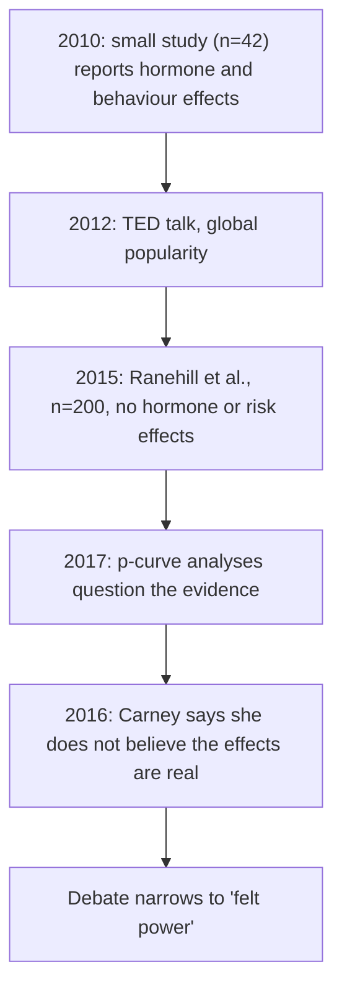

# Case study: power posing

**Prerequisites:** [[the-replication-crisis|The replication crisis]], [[p-hacking|P-hacking]] and [[statistical-power|Statistical power]].

@@IMG@@

In 2010 three researchers reported that adopting expansive "power poses" for two minutes changed people's hormones and behaviour. The idea became one of the most popular findings in psychology, thanks partly to a hugely popular TED talk. Then attempts to replicate it failed, and one of the original authors said she no longer believed the effects were real. The story illustrates the replication crisis, and also how a scientific debate can become a personal one.

## The original study

Dana Carney, Amy Cuddy and Andy Yap published "Power posing: brief nonverbal displays affect neuroendocrine levels and risk tolerance" in *Psychological Science* in 2010. In a study of 42 participants, those who held high-power poses (for example, leaning back with hands behind the head, or standing with hands on a desk) for two minutes reportedly showed increased testosterone, decreased cortisol, greater willingness to take a financial risk and greater feelings of power, compared with those who held low-power poses.

Cuddy's 2012 TED talk, "Your body language may shape who you are", became one of the most viewed TED talks ever, and power posing was widely recommended for job interviews and public speaking.

## The replication

In 2015 Eva Ranehill and colleagues published a replication in *Psychological Science* with 200 participants. They found that power poses increased self-reported feelings of power, but did not affect testosterone, cortisol or financial risk-taking.

Joseph Simmons and Uri Simonsohn then applied **p-curve analysis**, a method that examines the distribution of significant p-values to assess whether a set of studies contains evidential value. In a 2017 paper in *Psychological Science*, they concluded that the published power-posing literature did not show evidence of a real effect on the outcomes examined.

## The first author's statement

In September 2016 Dana Carney posted a statement on her website saying that she did not believe "power pose" effects were real. She described choices in the original study that she now regarded as problematic, including how the data were collected and analysed (for example, flexibility in excluding participants and choosing analyses), practices now recognised as forms of [[p-hacking|p-hacking]] and researcher degrees of freedom.

## The defence

Amy Cuddy has continued to argue that the evidence supports an effect of posture on **feelings** of power. In 2018 she and colleagues published a p-curve analysis in *Psychological Science* concluding that the literature showed evidential value for effects of expansive postures on self-reported feelings of power, while acknowledging weaker evidence for behavioural and hormonal effects.

## The human side

The case drew intense attention, and much of the criticism of Cuddy, especially online, was personal and harsh. A 2017 *New York Times Magazine* article by Susan Dominus, "When the revolution came for Amy Cuddy", explored how she became a focal point for the replication debate. Many researchers argued that the problems were common practices across the field at the time, not unique to one person, and that criticism should focus on the evidence ([[weighing-conflicts-without-ad-hominem|avoiding ad hominem]]).

## Lessons for readers

- **Small studies with surprising effects are fragile** ([[statistical-power|power]], [[single-studies-and-the-weight-of-evidence|single studies]]).
- **Popularity is not evidence.** A TED talk or bestseller does not validate a finding.
- **Replication with larger samples** is the test.
- **Flexible analyses** can generate significant results without real effects.
- **Self-reported outcomes** are more susceptible to expectation effects than objective outcomes such as hormone levels.
- **Criticise methods, not people.** The replication movement works best when it treats errors as systemic.

## Key ideas

- Carney, Cuddy and Yap's 2010 study (n=42) reported effects of power poses on hormones and risk-taking.
- Ranehill's replication (n=200) found only an effect on self-reported feelings of power.
- P-curve analyses questioned the evidence; Carney said she no longer believed the effects were real.
- Cuddy argues the evidence supports effects on felt power.
- The case illustrates small samples, flexible analyses, popularisation and the personal side of replication debates.

## Where this leads

- Next: [[surgisphere|Surgisphere]]
