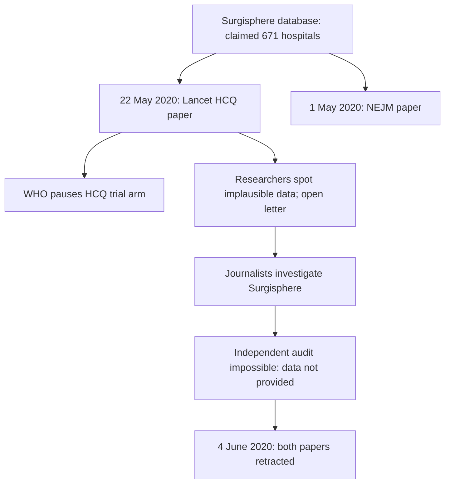

# Case study: Surgisphere

**Prerequisites:** [[peer-review|Peer review]], [[retractions-and-corrections|Retractions and corrections]] and [[supplementary-material-and-data|Supplementary material and data]].

@@IMG@@

In the first months of the COVID-19 pandemic, two of the world's most prestigious medical journals published papers based on a huge international database of hospital patients supplied by a small company called Surgisphere. Within weeks, both papers were retracted because the data could not be verified. The case is a warning about speed, prestige and data provenance.

## The papers

- On 1 May 2020 the *New England Journal of Medicine* published a study by Mandeep Mehra, Sapan Desai and colleagues on cardiovascular disease, drug therapy and mortality in COVID-19, using data said to come from 169 hospitals on three continents.
- On 22 May 2020 *The Lancet* published a study by Mehra, Desai, Frank Ruschitzka and Amit Patel reporting data on 96,032 hospitalised COVID-19 patients from 671 hospitals on six continents. It found that hydroxychloroquine and chloroquine, with or without a macrolide antibiotic, were associated with higher in-hospital mortality and more heart arrhythmias.

Sapan Desai was the founder of Surgisphere, which said it had compiled the data from electronic health records.

## Rapid impact

The *Lancet* paper had immediate effects. The World Health Organization temporarily paused the hydroxychloroquine arm of its Solidarity trial, and some other trials paused enrolment or national authorities changed their guidance.

## The doubts

Within days, researchers noticed problems:

- The number of COVID-19 deaths reported for Australian hospitals exceeded official national counts at the time.
- The data seemed implausibly uniform across continents, and it was unclear how a small company had obtained detailed records from hundreds of hospitals, including in countries with limited electronic records.
- Dosing patterns and patient characteristics seemed unlikely.

On 28 May 2020 an open letter coordinated by James Watson and signed by over 100 researchers and clinicians raised these concerns with *The Lancet* and the authors. Investigations by *The Guardian* and others questioned Surgisphere's staff, history and data sources.

## The retraction

Mehra, Ruschitzka and Patel commissioned an independent audit. Surgisphere declined to provide the full dataset to the auditors, citing client agreements and confidentiality. On 4 June 2020 the three authors other than Desai retracted the *Lancet* paper, saying they could no longer vouch for the veracity of the primary data sources. The *NEJM* paper was retracted the same day. The WHO resumed its hydroxychloroquine trial arm; later large randomised trials, including RECOVERY in the UK, found that hydroxychloroquine did not reduce mortality in hospitalised patients, so the overall conclusion that it did not help was correct even though these papers were not trustworthy.

## How it happened

- **Pressure for speed** during a pandemic led to fast review and publication.
- **Peer reviewers did not see raw data**, as is normal; review cannot easily detect fabricated datasets ([[peer-review|peer review]]).
- **Most authors had not accessed the data themselves** and relied on the company.
- **Prestige** gave the results immediate credibility.

After the retractions, *The Lancet* announced changes requiring, for example, that more than one author has directly accessed and verified the data reported, and that reviewers include someone with expertise in the dataset where large real-world datasets are used.

## Lessons for readers

- **Ask where the data came from.** Is the source credible, documented and accessible?
- **Prestigious journals make mistakes.**
- **Large numbers are not a guarantee.** A huge database can be fabricated or flawed.
- **Speed and quality trade off.**
- **Open scrutiny works.** Independent researchers exposed the problems within weeks ([[open-science|open science]]).

## Key ideas

- Surgisphere supplied data for high-profile COVID-19 papers in *The Lancet* and *NEJM* in 2020.
- The *Lancet* paper reported harms from hydroxychloroquine and led WHO to pause a trial arm.
- Researchers found implausible numbers; Surgisphere would not provide data for an audit.
- Both papers were retracted on 4 June 2020.
- The case shows the importance of data provenance and the limits of peer review.

## Where this leads

- Next section: [[sec:11-practice|Practice]]
