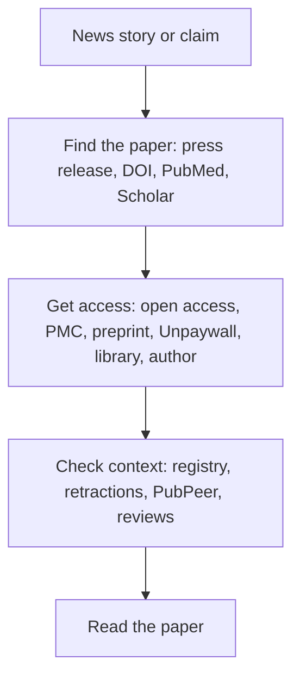

# Finding and accessing papers

**Prerequisites:** [[the-shape-of-a-paper|The shape of a paper]].

@@IMG@@

Before you can read a study, you have to find it, and often get past a paywall. This lesson is a practical guide to the main tools, most of them free.

## Finding the original study from a news story

News stories often do not link the paper. To find it:

1. Look for the **journal name, authors and date** in the story.
2. Search the university's or journal's **press release**, which usually links to the paper.
3. Search **Google Scholar** or **PubMed** with the lead author's surname and key terms.
4. Use the **DOI** (digital object identifier), a permanent identifier like `10.1371/journal.pmed.0020124`; put `https://doi.org/` in front to reach the paper.

## Search tools

- **PubMed** (pubmed.ncbi.nlm.nih.gov), run by the US National Library of Medicine, indexes the biomedical literature (MEDLINE and more). It shows abstracts, links to full text, and flags retractions and comments.
- **PubMed Central (PMC)** holds free full texts, including papers funded by the NIH and many other funders that require open access.
- **Google Scholar** covers all disciplines and shows citation counts and "All versions", which often include free copies.
- **The Cochrane Library** contains Cochrane systematic reviews ([[cochrane-and-grade|Cochrane and GRADE]]) and the CENTRAL register of trials.
- **Trial registries**: ClinicalTrials.gov and the WHO International Clinical Trials Registry Platform (ICTRP) ([[trial-registries|trial registries]]).
- **Preprint servers**: arXiv (physics, mathematics, computer science), bioRxiv (biology), medRxiv (health sciences), PsyArXiv, SSRN (social sciences and law) ([[preprints|preprints]]).
- **Semantic Scholar** and **OpenAlex** are free scholarly search engines with citation data.
- **Epistemonikos** is a database of systematic reviews in health.

## Getting past paywalls legally

- Check whether the paper is **open access** at the journal.
- Look in **PubMed Central** or **Europe PMC**.
- Install **Unpaywall**, a free browser extension that finds legal free copies in repositories.
- Look for the **preprint** or **author's accepted manuscript** in a university repository.
- Use a **public or university library**; many public libraries provide access to journal databases.
- **Email the author.** Most researchers are glad to send a copy of their paper.

Sci-Hub, a site that provides unauthorised copies of paywalled papers, is widely used, but its legal status is contested and publishers have won court judgements against it in several countries.

## Checking a paper's status and context

- **Retractions and corrections**: PubMed flags retractions; the **Retraction Watch Database**, now owned by Crossref and openly available, lists retractions, and tools such as reference managers can flag retracted papers ([[retractions-and-corrections|retractions]]).
- **PubPeer** is a site for post-publication comment where researchers often point out problems, including image duplication.
- **Registry entries** show the planned outcomes ([[outcome-switching|outcome switching]]).
- **Citing papers and later reviews** (via "Cited by" in Google Scholar) show whether the finding has been replicated or challenged.
- **Supplementary material** and data repositories may contain the protocol, statistical analysis plan and data ([[supplementary-material-and-data|supplementary material]]).
- **The journal**: check whether it is a legitimate journal, for example via the Directory of Open Access Journals (DOAJ) for open-access journals ([[predatory-journals|predatory journals]]).

## Reading strategy

Rather than reading a paper start to finish, use a structured approach ([[a-step-by-step-checklist|the checklist]]):

1. Read the title and abstract to see the claim.
2. Go to the methods: design, participants, outcomes.
3. Look at the main results table and figures.
4. Check the registration and funding.
5. Then read the discussion critically.

## Keeping track

A free reference manager such as **Zotero** stores papers, captures citations from web pages and can flag retracted papers.

## Key ideas

- Use press releases, DOIs, PubMed and Google Scholar to find the original study.
- PubMed Central, preprints, Unpaywall, libraries and authors provide legal free access.
- Check retractions, PubPeer comments, registry entries and later citations.
- Verify the journal's legitimacy.
- Read strategically: claim, methods, results, registration and funding, then discussion.

## Where this leads

- Next: [[a-step-by-step-checklist|A step-by-step checklist]]
