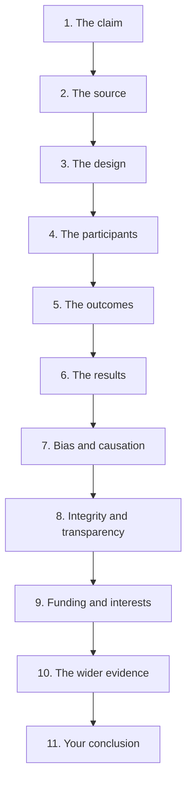

# A step-by-step checklist

**Prerequisites:** All previous sections; this lesson pulls them together.

@@IMG@@

This checklist brings the course together into a sequence of questions you can apply to any study or claim. You will not need every question every time; the point is to have a routine that catches the common problems. Each item links to the lesson that explains it.

## 1. The claim

- What exactly is being claimed? A cause, an association, a prediction, a description?
- Does the headline or press release match the paper's own conclusion? ([[press-releases-and-science-journalism|press releases]])
- Is it in humans? ([[animal-and-in-vitro-studies|animal and in vitro studies]])

## 2. The source

- Is it a peer-reviewed paper, a preprint, a conference abstract, a press release? ([[preprints|preprints]], [[peer-review|peer review]])
- Is the journal legitimate? ([[predatory-journals|predatory journals]])
- Has it been retracted, corrected or criticised? ([[retractions-and-corrections|retractions]])

## 3. The design

- What type of study is it? ([[the-evidence-hierarchy|evidence hierarchy]])
- If a trial: was allocation randomised and concealed? Was it blinded? ([[blinding-placebos-and-allocation-concealment|blinding]])
- If observational: cohort, case-control, cross-sectional, ecological? ([[sec:03-study-designs|study designs]])
- Is the design appropriate to the question?

## 4. The participants

- Who was studied, and how were they recruited? ([[selection-bias|selection bias]])
- How many? Was the study powered for the main outcome? ([[statistical-power|power]])
- Are they like the people the claim is about?
- How many dropped out, and were they accounted for? ([[intention-to-treat-and-per-protocol|intention to treat]])

## 5. The outcomes

- What was the primary outcome? Was it prespecified and registered? ([[outcome-switching|outcome switching]])
- Is it a clinical outcome or a surrogate? ([[surrogate-endpoints|surrogate endpoints]])
- How was it measured? Objectively or by self-report? ([[measurement-and-recall-bias|measurement bias]])

## 6. The results

- What is the effect size, with its confidence interval? ([[effect-sizes|effect sizes]], [[standard-error-and-confidence-intervals|confidence intervals]])
- What are the absolute numbers, not just relative risks? NNT or NNH? ([[relative-and-absolute-risk|absolute risk]], [[number-needed-to-treat|NNT]])
- How is the p-value being interpreted? ([[misreading-p-values|misreading p-values]])
- How many comparisons were made? Are the highlighted results subgroups or secondary outcomes? ([[multiple-comparisons|multiple comparisons]], [[subgroups-and-secondary-analyses|subgroups]])
- Do the tables and figures support the text? ([[results-and-table-one|Table 1]], [[reading-graphs|graphs]])

## 7. Bias and causation

- Could confounding explain the result? What was adjusted for? ([[confounding|confounding]], [[regression-and-adjustment|adjustment]])
- Could the causation run the other way? ([[reverse-causation|reverse causation]])
- Healthy users, survivors, immortal time? ([[healthy-user-bias|healthy-user bias]], [[survivorship-bias|survivorship bias]], [[time-related-biases|time-related biases]])
- Could regression to the mean explain an improvement? ([[regression-to-the-mean|regression to the mean]])
- How do the Bradford Hill considerations look? ([[bradford-hill-criteria|Bradford Hill]])

## 8. Integrity and transparency

- Was the study preregistered? Do results match the registration? ([[preregistration|preregistration]])
- Are protocol, analysis plan and data available? ([[open-science|open science]])
- Are there signs of p-hacking, such as many p-values just under 0.05? ([[p-hacking|p-hacking]])

## 9. Funding and interests

- Who funded it, and what was the funder's role? ([[who-pays-for-research|who pays]])
- What do the authors declare? Any undeclared interests you can find? ([[disclosure-and-its-limits|disclosure]])
- How could those interests have influenced the question, design, analysis or reporting, and were those routes closed? ([[weighing-conflicts-without-ad-hominem|weighing conflicts]])
- Apply the same scrutiny to non-financial and non-industry interests. ([[non-financial-conflicts|non-financial conflicts]], [[activist-and-litigation-funded-research|activist and litigation funding]])

## 10. The wider evidence

- What do systematic reviews say? ([[systematic-reviews|systematic reviews]])
- Has it been replicated? ([[the-replication-crisis|replication]])
- Is it plausible given what else is known? Is it extraordinary? ([[single-studies-and-the-weight-of-evidence|weight of evidence]])
- What does the expert consensus say, and is there substantive dissent? ([[consensus-dissent-and-experts|consensus]])

## 11. Your conclusion

- What does this study add, and how much should it change your view?
- What would change your mind?
- Would you reach the same judgement if the result had gone the other way?

## Key ideas

- A routine checklist catches common problems in claims and studies.
- Work from the claim through source, design, participants, outcomes and results.
- Then consider bias, transparency, funding and the wider evidence.
- End with a calibrated conclusion and a symmetry check.

## Where this leads

- Next: [[worked-example-a-randomised-trial|Worked example: a randomised trial]]
