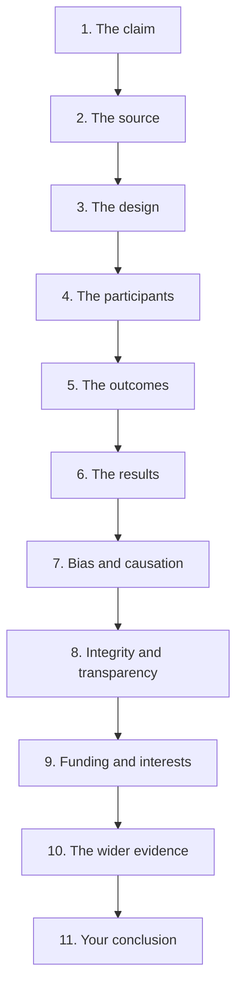

# A step-by-step checklist

**Prerequisites:** All previous sections; this lesson pulls them together.

@@IMG@@

This checklist brings the course together into a sequence of questions you can apply to any study or claim. You will not need every question every time; the point is to have a routine that catches the common problems. Each item links to the lesson that explains it.

## 1. The claim

- What exactly is being claimed? A cause, an association, a prediction, a description?
- Does the headline or press release match the paper's own conclusion? ([press releases](../09-from-lab-to-headline/01-press-releases-and-science-journalism.md))
- Is it in humans? ([animal and in vitro studies](../09-from-lab-to-headline/03-animal-and-in-vitro-studies.md))

## 2. The source

- Is it a peer-reviewed paper, a preprint, a conference abstract, a press release? ([preprints](../07-publishing/04-preprints.md), [peer review](../07-publishing/02-peer-review.md))
- Is the journal legitimate? ([predatory journals](../07-publishing/05-predatory-journals.md))
- Has it been retracted, corrected or criticised? ([retractions](../07-publishing/06-retractions-and-corrections.md))

## 3. The design

- What type of study is it? ([evidence hierarchy](../03-study-designs/01-the-evidence-hierarchy.md))
- If a trial: was allocation randomised and concealed? Was it blinded? ([blinding](../03-study-designs/08-blinding-placebos-and-allocation-concealment.md))
- If observational: cohort, case-control, cross-sectional, ecological? ([study designs](../03-study-designs/README.md))
- Is the design appropriate to the question?

## 4. The participants

- Who was studied, and how were they recruited? ([selection bias](../04-causation/04-selection-bias.md))
- How many? Was the study powered for the main outcome? ([power](../02-statistics/10-statistical-power.md))
- Are they like the people the claim is about?
- How many dropped out, and were they accounted for? ([intention to treat](../03-study-designs/09-intention-to-treat-and-per-protocol.md))

## 5. The outcomes

- What was the primary outcome? Was it prespecified and registered? ([outcome switching](../06-research-integrity/03-outcome-switching.md))
- Is it a clinical outcome or a surrogate? ([surrogate endpoints](../09-from-lab-to-headline/02-surrogate-endpoints.md))
- How was it measured? Objectively or by self-report? ([measurement bias](../04-causation/07-measurement-and-recall-bias.md))

## 6. The results

- What is the effect size, with its confidence interval? ([effect sizes](../02-statistics/11-effect-sizes.md), [confidence intervals](../02-statistics/07-standard-error-and-confidence-intervals.md))
- What are the absolute numbers, not just relative risks? NNT or NNH? ([absolute risk](../02-statistics/12-relative-and-absolute-risk.md), [NNT](../02-statistics/13-number-needed-to-treat.md))
- How is the p-value being interpreted? ([misreading p-values](../02-statistics/09-misreading-p-values.md))
- How many comparisons were made? Are the highlighted results subgroups or secondary outcomes? ([multiple comparisons](../02-statistics/16-multiple-comparisons.md), [subgroups](../09-from-lab-to-headline/04-subgroups-and-secondary-analyses.md))
- Do the tables and figures support the text? ([Table 1](../05-anatomy-of-a-paper/05-results-and-table-one.md), [graphs](../05-anatomy-of-a-paper/06-reading-graphs.md))

## 7. Bias and causation

- Could confounding explain the result? What was adjusted for? ([confounding](../04-causation/02-confounding.md), [adjustment](../02-statistics/18-regression-and-adjustment.md))
- Could the causation run the other way? ([reverse causation](../04-causation/03-reverse-causation.md))
- Healthy users, survivors, immortal time? ([healthy-user bias](../04-causation/06-healthy-user-bias.md), [survivorship bias](../04-causation/05-survivorship-bias.md), [time-related biases](../04-causation/08-time-related-biases.md))
- Could regression to the mean explain an improvement? ([regression to the mean](../02-statistics/17-regression-to-the-mean.md))
- How do the Bradford Hill considerations look? ([Bradford Hill](../04-causation/09-bradford-hill-criteria.md))

## 8. Integrity and transparency

- Was the study preregistered? Do results match the registration? ([preregistration](../06-research-integrity/01-preregistration.md))
- Are protocol, analysis plan and data available? ([open science](../06-research-integrity/09-open-science.md))
- Are there signs of p-hacking, such as many p-values just under 0.05? ([p-hacking](../06-research-integrity/04-p-hacking.md))

## 9. Funding and interests

- Who funded it, and what was the funder's role? ([who pays](../08-funding-and-conflicts/01-who-pays-for-research.md))
- What do the authors declare? Any undeclared interests you can find? ([disclosure](../08-funding-and-conflicts/04-disclosure-and-its-limits.md))
- How could those interests have influenced the question, design, analysis or reporting, and were those routes closed? ([weighing conflicts](../08-funding-and-conflicts/05-weighing-conflicts-without-ad-hominem.md))
- Apply the same scrutiny to non-financial and non-industry interests. ([non-financial conflicts](../08-funding-and-conflicts/06-non-financial-conflicts.md), [activist and litigation funding](../08-funding-and-conflicts/07-activist-and-litigation-funded-research.md))

## 10. The wider evidence

- What do systematic reviews say? ([systematic reviews](../03-study-designs/14-systematic-reviews.md))
- Has it been replicated? ([replication](../06-research-integrity/07-the-replication-crisis.md))
- Is it plausible given what else is known? Is it extraordinary? ([weight of evidence](../09-from-lab-to-headline/06-single-studies-and-the-weight-of-evidence.md))
- What does the expert consensus say, and is there substantive dissent? ([consensus](../09-from-lab-to-headline/05-consensus-dissent-and-experts.md))

## 11. Your conclusion

- What does this study add, and how much should it change your view?
- What would change your mind?
- Would you reach the same judgement if the result had gone the other way?

## Key ideas

- A routine checklist catches common problems in claims and studies.
- Work from the claim through source, design, participants, outcomes and results.
- Then consider bias, transparency, funding and the wider evidence.
- End with a calibrated conclusion and a symmetry check.

## Where this leads

- Next: [Worked example: a randomised trial](03-worked-example-a-randomised-trial.md)
