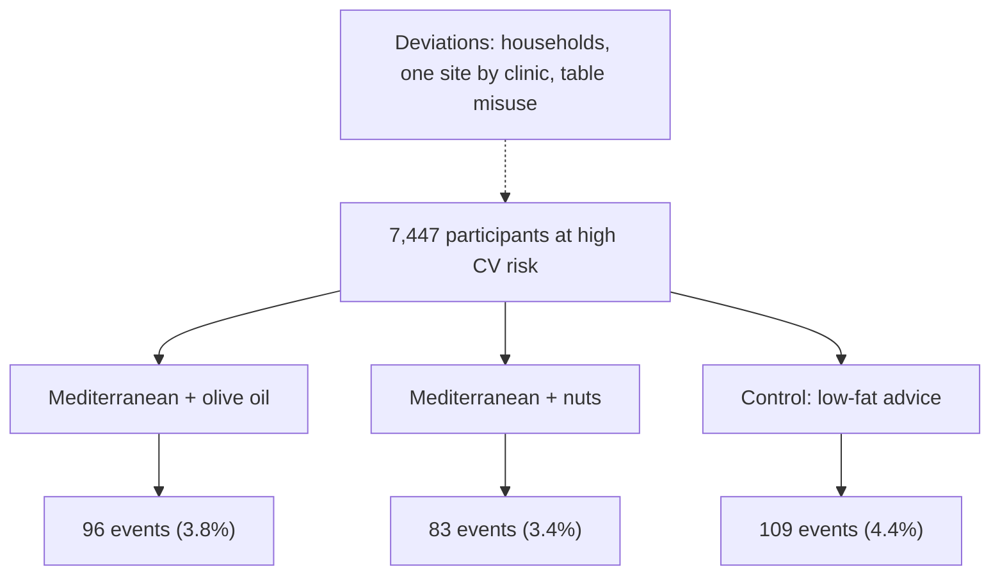

# Worked example: a randomised trial (PREDIMED)

**Prerequisites:** [[a-step-by-step-checklist|A step-by-step checklist]], [[randomised-controlled-trials|Randomised controlled trials]] and [[retractions-and-corrections|Retractions and corrections]].

@@IMG@@

PREDIMED (Prevención con Dieta Mediterránea) is one of the best-known nutrition trials ever conducted. It is a good worked example because it was retracted and republished, which shows how randomisation problems are detected and handled. We apply the [[a-step-by-step-checklist|checklist]] to the 2018 republished paper: Estruch and colleagues, "Primary prevention of cardiovascular disease with a Mediterranean diet supplemented with extra-virgin olive oil or nuts", *New England Journal of Medicine* 2018;378:e34.

## 1. The claim

A Mediterranean diet supplemented with extra-virgin olive oil or nuts reduced major cardiovascular events (heart attack, stroke or cardiovascular death) compared with a control diet in people at high cardiovascular risk.

## 2. The source

A peer-reviewed paper in a leading journal. Importantly, it **replaces** the original 2013 paper, which the authors withdrew. Why? In 2017 the anaesthetist John Carlisle published an analysis in *Anaesthesia* of baseline data in 5,087 trials, looking for distributions of baseline variables that were unlikely under true randomisation. PREDIMED was among the trials flagged. The investigators then audited the trial and found protocol deviations ([[fraud-and-misconduct|misconduct and error]]).

## 3. The design

A multicentre randomised trial in Spain with three arms: Mediterranean diet plus extra-virgin olive oil, Mediterranean diet plus mixed nuts, and a control diet (advice to reduce dietary fat). It was not blinded to participants, which is hard in diet trials, though outcome adjudication was blinded.

The republished paper reports the deviations:

- household members of participants were enrolled and given the same assignment **without randomisation**;
- at 1 of 11 sites, some participants were assigned by clinic rather than individually randomised;
- at another site, randomisation tables appeared to have been used inconsistently.

So the trial is **partly not randomised**. The authors re-analysed with adjustment for baseline characteristics and propensity scores, and also excluded 1,588 participants whose assignments were known or suspected to have departed from the protocol.

## 4. The participants

7,447 people aged 55 to 80 (57% women) at high cardiovascular risk but without cardiovascular disease. Results apply to this population, Spanish adults at high risk, not necessarily to young or low-risk people elsewhere.

## 5. The outcomes

The primary end point was a clinical composite: heart attack, stroke or cardiovascular death ([[surrogate-endpoints|clinical, not surrogate]]). Good.

## 6. The results

- Events: 96 (3.8%) with olive oil, 83 (3.4%) with nuts, 109 (4.4%) control.
- Hazard ratios: 0.69 (95% CI 0.53 to 0.91) for olive oil and 0.72 (0.54 to 0.95) for nuts, versus control.
- Absolute differences: roughly 0.6 to 1 percentage point over a median 4.8 years ([[relative-and-absolute-risk|absolute risk]]). A relative reduction of about 30% sounds large; the absolute difference is about 1 in 100 over five years.
- Results were similar after excluding the 1,588 participants with deviations.
- The trial was **stopped early** on the basis of an interim analysis. Trials stopped early for benefit tend to overestimate effects.

## 7. Bias and causation

Because randomisation was compromised for part of the sample, confounding is possible, though the sensitivity analysis excluding those participants is reassuring. The control group received less intensive dietary support in the early years, so some difference may reflect attention. Much of the stroke effect drove the composite result in the original analyses.

## 8. Integrity and transparency

The trial was registered (ISRCTN35739639). The investigators audited the trial, withdrew and republished, which is a model of correcting the record, but the deviations should not have happened. Critics argued the republished paper should be described as partly observational and its claims softened; the republished conclusion is worded more cautiously, saying the incidence of events was "lower among those assigned to" the Mediterranean diets rather than that the diets reduced it.

## 9. Funding and interests

Funded mainly by the Spanish government's Instituto de Salud Carlos III. The olive oil and nuts were donated by producers, and several authors reported fees or grants from food industry or nut and olive oil organisations. These interests could plausibly favour positive results; the main protection is that the primary outcome was clinical, prespecified and adjudicated blind ([[weighing-conflicts-without-ad-hominem|weighing conflicts]]).

## 10. The wider evidence

Observational studies consistently associate Mediterranean-style diets with lower cardiovascular risk, and the Lyon Diet Heart Study (a secondary prevention trial) also reported benefit. PREDIMED is the main primary-prevention trial.

## 11. Conclusion

A reasonably strong but imperfect trial suggesting that a Mediterranean diet with olive oil or nuts reduces cardiovascular events in high-risk people, with a modest absolute benefit. The randomisation problems, early stopping and lack of blinding mean the true effect may be smaller.

## Key ideas

- PREDIMED tested Mediterranean diets on clinical outcomes in 7,447 high-risk Spaniards.
- Statistical screening of baseline data flagged problems; the 2013 paper was withdrawn and republished in 2018.
- Hazard ratios about 0.7, absolute risk differences about 1 percentage point.
- Randomisation deviations, early stopping and lack of blinding limit certainty.
- The case shows both the value and the fragility of large trials.

## Where this leads

- Next: [[worked-example-a-cohort-study|Worked example: a cohort study]]
