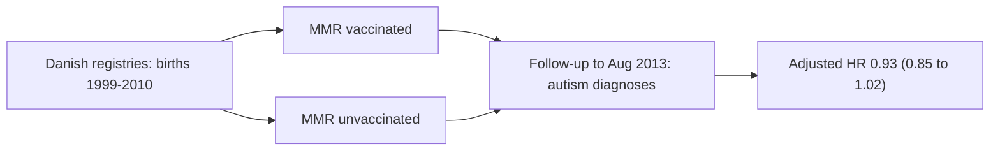

# Worked example: a cohort study (MMR and autism)

**Prerequisites:** [[a-step-by-step-checklist|A step-by-step checklist]], [[cohort-studies|Cohort studies]] and [[wakefield-1998|Wakefield 1998]].

@@IMG@@

This worked example applies the checklist to a large registry-based cohort study: Anders Hviid, Jørgen Vinsløv Hansen, Morten Frisch and Mads Melbye, "Measles, mumps, rubella vaccination and autism: a nationwide cohort study", *Annals of Internal Medicine* 2019;170(8):513–520.

## 1. The claim

MMR vaccination does not increase the risk of autism, does not trigger autism in susceptible subgroups, and is not associated with clusters of autism cases after vaccination.

## 2. The source

A peer-reviewed paper in a major general medical journal. It follows an earlier Danish cohort by Madsen and colleagues (2002) and was designed partly to address remaining hypotheses about susceptible subgroups.

## 3. The design

A **nationwide cohort study** using Danish population registries, which link each person's vaccination records, diagnoses and family relationships through a personal identification number. Children were followed from age one, and the time to autism diagnosis was compared between vaccinated and unvaccinated children using Cox proportional hazards regression, giving **hazard ratios** ([[odds-ratios-and-hazard-ratios|hazard ratios]]).

## 4. The participants

657,461 children born in Denmark from 1999 to the end of 2010, essentially the whole birth cohort, followed through 31 August 2013. Registry-based design avoids most [[selection-bias|selection bias]]: there is no recruitment and little loss to follow-up. About 5% of children were unvaccinated, which is a small group but still tens of thousands of children.

## 5. The outcomes

Autism diagnoses recorded in the Danish psychiatric registry. The authors note that they did not review individual medical charts, so some misclassification is possible, though Danish registry autism diagnoses have been validated in earlier work.

## 6. The results

- 6,517 children were diagnosed with autism during 5,025,754 person-years of follow-up (129.7 per 100,000 person-years).
- Comparing vaccinated with unvaccinated children, the fully adjusted hazard ratio was **0.93 (95% CI 0.85 to 1.02)**.
- No increased risk was consistently found in subgroups defined by sibling history of autism, autism risk factors or other vaccinations, or in specific time periods after vaccination.

The confidence interval matters: the upper limit of 1.02 means the data are compatible with at most about a 2% increase in risk and rule out any large increase ([[standard-error-and-confidence-intervals|confidence intervals]]). A hazard ratio below 1 does not mean MMR prevents autism; it is most likely explained by residual confounding, for example if parents of children with early signs of developmental problems are more likely to delay or skip vaccination ([[reverse-causation|reverse causation]], [[healthy-user-bias|healthy-user effects]]).

## 7. Bias and causation

The authors adjusted for age, birth year, sex, other childhood vaccines, sibling history of autism and a disease risk score combining autism risk factors ([[regression-and-adjustment|adjustment]]). Residual confounding remains possible in any observational study, but the key point is that confounding would have to *hide* a real harm, which would require unvaccinated children to have a systematically higher underlying risk. Some critics have argued exactly that, while others note that the most plausible biases (such as parents of children with early signs avoiding vaccination) would push toward an apparent harm, not hide one.

## 8. Integrity and transparency

The study used national registries, which other researchers can access under Danish rules. It is not a trial, so preregistration norms differ.

## 9. Funding and interests

Funded by the Novo Nordisk Foundation and the Danish Ministry of Health. The authors work at Statens Serum Institut, a Danish government institute that has historically produced vaccines and runs Denmark's vaccine surveillance, which some critics cite as a conflict of interest. Applying [[weighing-conflicts-without-ad-hominem|the framework]]: the main routes for bias (registry data, prespecified outcome, standard methods) are fairly transparent, and similar results have been found by independent groups in other countries.

## 10. The wider evidence

The result is consistent with Madsen 2002, with Taylor and colleagues' 2014 meta-analysis, and with many other studies in multiple countries using different designs ([[single-studies-and-the-weight-of-evidence|weight of evidence]]). The original hypothesis came from a retracted, fraudulent case series ([[wakefield-1998|Wakefield]]).

## 11. Conclusion

A very large, well-conducted cohort study that strongly supports the absence of any meaningful increase in autism risk from MMR, consistent with the wider evidence.

## Key ideas

- Nationwide registries allow very large cohorts with little selection bias.
- 657,461 children; adjusted HR 0.93 (0.85 to 1.02).
- Upper confidence limits help rule out large harms.
- Residual confounding is possible but would have to hide a harm, and results agree with independent studies.
- Institutional interests should be weighed by checking routes for bias, not used to dismiss.

## Where this leads

- Next: [[worked-example-a-meta-analysis|Worked example: a meta-analysis]]
