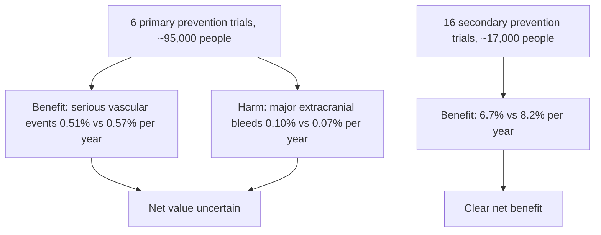

# Worked example: a meta-analysis (aspirin for primary prevention)

**Prerequisites:** [A step-by-step checklist](02-a-step-by-step-checklist.md), [Meta-analysis](../03-study-designs/15-meta-analysis.md) and [Number needed to treat](../02-statistics/13-number-needed-to-treat.md).

@@IMG@@

Should healthy people take a daily low-dose aspirin to prevent heart attacks? This worked example uses an influential individual participant data meta-analysis: Antithrombotic Trialists' (ATT) Collaboration, "Aspirin in the primary and secondary prevention of vascular disease: collaborative meta-analysis of individual participant data from randomised trials", *The Lancet* 2009;373:1849–1860.

## 1. The claim

In people **without** previous cardiovascular disease (primary prevention), aspirin reduces serious vascular events modestly but increases major bleeding, so its net value is uncertain. In people **with** previous disease (secondary prevention), the benefit is clearly larger.

## 2. The source

A peer-reviewed meta-analysis by an established international collaboration, published in *The Lancet*. It used **individual participant data** (IPD) rather than published summary results, which allows consistent definitions and analyses across trials and is regarded as the gold standard for meta-analysis ([meta-analysis](../03-study-designs/15-meta-analysis.md)).

## 3. The design

- **Primary prevention**: six randomised trials, about 95,000 people at low average risk, 660,000 person-years and 3,554 serious vascular events.
- **Secondary prevention**: 16 trials, about 17,000 people at high average risk.
- Outcomes: serious vascular events (heart attack, stroke or vascular death) and major bleeds, analysed by intention to treat ([intention to treat](../03-study-designs/09-intention-to-treat-and-per-protocol.md)).

## 4. The participants

The primary prevention trials enrolled mostly middle-aged people, including the large US Physicians' Health Study and Women's Health Study. Results apply to people at similar risk; those at higher risk would gain more benefit but also often have higher bleeding risk.

## 5. The outcomes

Clinical outcomes, not surrogates: heart attacks, strokes, deaths and bleeds.

## 6. The results (primary prevention)

- Serious vascular events: **0.51% per year with aspirin versus 0.57% with control**, a 12% proportional reduction (p = 0.0001), mainly from fewer non-fatal heart attacks.
- Stroke: no significant net effect; haemorrhagic stroke 0.04% versus 0.03% per year.
- Vascular mortality: no difference (0.19% versus 0.19% per year).
- Major gastrointestinal and extracranial bleeds: **0.10% versus 0.07% per year** (p < 0.0001).

Now translate into absolute terms ([relative and absolute risk](../02-statistics/12-relative-and-absolute-risk.md), [NNT](../02-statistics/13-number-needed-to-treat.md)):

- Absolute reduction in serious vascular events: 0.06 percentage points per year, so about **1,700 people would need to take aspirin for a year** to prevent one event.
- Absolute increase in major bleeds: 0.03 percentage points per year, so about **one extra major bleed per 3,300 people per year**.

A "12% reduction" sounds worthwhile; the absolute numbers show a small benefit roughly balanced by a small harm. The authors also noted that the risk factors for heart disease were also risk factors for bleeding.

## 7. Bias and causation

Because all included studies were randomised trials, confounding is not a major concern. Heterogeneity between trials, differences in doses and populations, and the age of some trials (some started in the 1980s, before statins were widely used) affect how well results apply today.

## 8. Integrity and transparency

Using IPD from all known eligible trials reduces [publication bias](../06-research-integrity/06-publication-bias.md) and selective reporting. The collaboration's methods were prespecified.

## 9. Funding and interests

Funded by the UK Medical Research Council, British Heart Foundation, Cancer Research UK and the European Community Biomed Programme. Aspirin is cheap and off-patent, so commercial interests are limited, though some individual trials had industry support.

## 10. The wider evidence

The authors wrote that further trials were in progress. Three large trials published in 2018 (ASPREE in older adults, ARRIVE in people at moderate risk and ASCEND in people with diabetes) found little or no net benefit for primary prevention, with increased bleeding. Guidelines changed accordingly: for example, the US Preventive Services Task Force in 2022 recommended against starting aspirin for primary prevention in adults aged 60 or older, and an individual decision for some adults aged 40 to 59 at higher risk.

## 11. Conclusion

A high-quality meta-analysis showing why relative risk reductions can mislead: aspirin works, but for low-risk people the absolute benefit is small and offset by bleeding. Later trials reinforced the conclusion.

## Key ideas

- Individual participant data meta-analyses are the strongest form of evidence synthesis.
- Aspirin reduced serious vascular events by 12% in primary prevention, but by only 0.06 percentage points per year.
- Major bleeds increased by 0.03 percentage points per year.
- Translating to NNT and NNH shows a close balance of benefits and harms.
- Later trials and guidelines moved against routine primary-prevention aspirin.

## Where this leads

- Next: [Worked example: a news story](06-worked-example-a-news-story.md)
