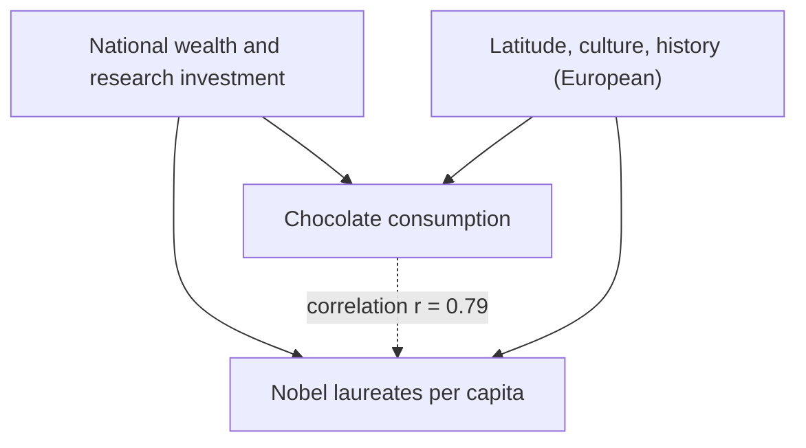

# Worked example: a news story (chocolate and Nobel prizes)

**Prerequisites:** [[a-step-by-step-checklist|A step-by-step checklist]], [[ecological-studies|Ecological studies]] and [[press-releases-and-science-journalism|Press releases and science journalism]].

@@IMG@@

In October 2012 headlines around the world suggested that eating chocolate might make you smarter, or even help your country win Nobel prizes. They were based on a short article in one of the most prestigious medical journals. This worked example traces a news story back to its source.

## The source

Franz Messerli, a cardiologist, published "Chocolate consumption, cognitive function, and Nobel laureates" as an "Occasional Notes" article in the *New England Journal of Medicine* (2012;367:1562–1564). He noted that flavanols in cocoa had been reported to improve cognitive function in some studies, and asked whether a country's chocolate consumption might be related to its population's cognitive function, using Nobel laureates per capita as a stand-in.

He plotted per capita chocolate consumption against Nobel laureates per 10 million people for 23 countries, and found a strong correlation: **r = 0.791** (p < 0.0001). Switzerland topped both. He estimated that an increase of about 0.4 kg of chocolate per person per year would be associated with one more Nobel laureate in a country. In his disclosure he reported regular daily chocolate intake.

## 1. The claim, as reported

Many news reports, some with obvious humour, suggested that chocolate might boost brainpower or Nobel success. Some treated the correlation as evidence of benefit.

## 2. The source

A real article in a top journal, but in an informal section, not a research report. Its tone was partly tongue-in-cheek, though it did not say so explicitly. The correlation is not peer-reviewed research in the usual sense.

## 3. The design

An **ecological study**: it compares countries, not people ([[ecological-studies|ecological studies]]). It cannot tell us whether the people who eat more chocolate are the ones who win Nobel prizes. Drawing individual conclusions from group data is the **ecological fallacy**.

## 4. The participants

Twenty-three countries, chosen partly by data availability. Different choices of countries or years could change the result.

## 5. The outcomes

Nobel laureates per capita is a very indirect proxy for "cognitive function" of a population. Laureates are a tiny, unusual group, often working in countries other than where they were born.

## 6. The results

A correlation of 0.79 is strong, but strength is not causation ([[correlation-and-causation|correlation and causation]]).

## 7. Bias and causation

The obvious explanation is **confounding** ([[confounding|confounding]]): wealthy European countries tend both to consume a lot of chocolate and to invest heavily in research and education. Many other variables correlate with Nobel prizes for similar reasons. In a 2013 paper in *The Journal of Nutrition*, Pierre Maurage, Alexandre Heeren and Mauro Pesenti pointed out that per capita numbers of IKEA stores also correlated with Nobel laureates, and argued that the chocolate correlation illustrated the danger of over-interpreting correlations. **Reverse causation** is also conceivable: rich, successful countries can afford more chocolate.

## 8. Integrity and transparency

The data sources (chocolate consumption and laureate counts) were public. There was no preregistration, and the choice of countries and data years was flexible.

## 9. Funding and interests

Messerli disclosed no funding. His chocolate disclosure was light-hearted. There is no evidence of commercial influence.

## 10. The wider evidence

Small randomised trials have examined cocoa flavanols and cognitive measures, with mixed and mostly modest results on surrogate tests. No evidence links chocolate to Nobel prizes, and none could easily be gathered.

## 11. Conclusion

An amusing illustration of ecological correlation and confounding, published in a respectable venue and widely reported as if it might be meaningful. The lessons: check the study type, think about confounders, and notice when a journal section is not a research report.

## A quick routine for news stories

1. Find the original source.
2. Identify the design: is it in individuals? Humans? Randomised?
3. Ask what else could explain the association.
4. Compare the headline with the paper's own words.
5. Look for independent comment and later responses.

## Key ideas

- Messerli's 2012 *NEJM* note correlated national chocolate consumption with Nobel laureates (r = 0.79, 23 countries).
- It was an ecological comparison, vulnerable to the ecological fallacy and confounding by wealth.
- News coverage often treated it as suggestive of benefit.
- Spurious correlations (such as IKEA stores) make the point.
- Always trace news stories to the source and check the design.

## Where this leads

- Next: [[worked-example-a-case-control-study|Worked example: a case-control study]]
