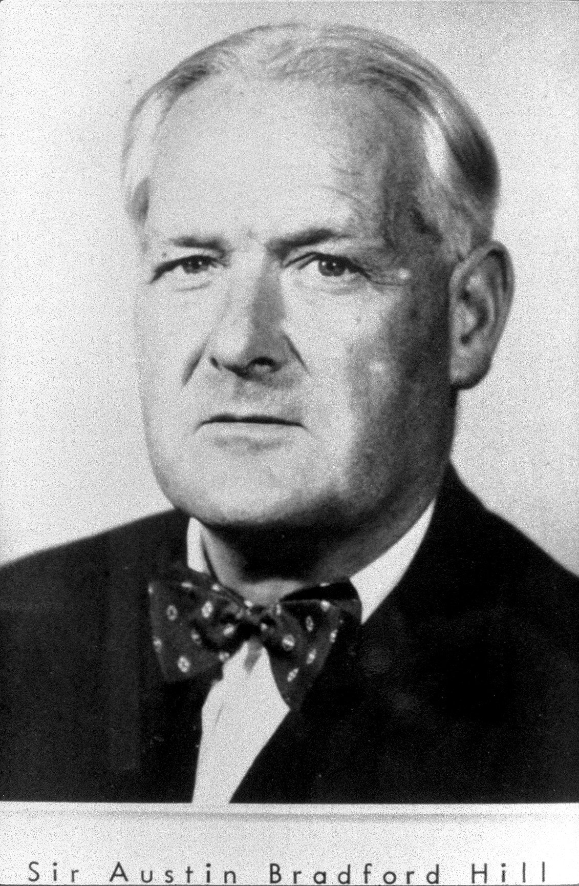
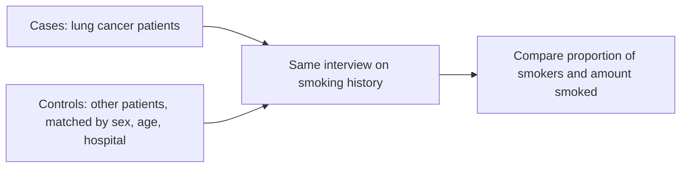

# Worked example: a case-control study (Doll and Hill, 1950)

**Prerequisites:** [A step-by-step checklist](02-a-step-by-step-checklist.md), [Case-control studies](../03-study-designs/05-case-control-studies.md) and [Odds ratios and hazard ratios](../02-statistics/19-odds-ratios-and-hazard-ratios.md).

*Sir Austin Bradford Hill, co-author of the 1950 smoking and lung cancer study. Credit: https://wellcomeimages.org/indexplus/obf_images/cf/e6/eb098ec1a4bb203785230ec6114b.jpg Gallery: https://wellcomeimages.org/indexplus/image/L. License: [CC BY 4.0](https://creativecommons.org/licenses/by/4.0). Source: [File:Sir Austin Bradford Hill, portrait Wellcome L0027006.jpg](https://commons.wikimedia.org/wiki/File:Sir_Austin_Bradford_Hill,_portrait_Wellcome_L0027006.jpg).*

Richard Doll and Austin Bradford Hill's 1950 paper "Smoking and carcinoma of the lung: preliminary report" (*BMJ* 1950;2:739–748) is one of the most important papers in epidemiology. This example applies the checklist to show why a well-designed case-control study can be so persuasive, and what its weaknesses are.

## 1. The claim

Smoking is a factor, and an important factor, in the production of carcinoma of the lung.

## 2. The source

A peer-reviewed paper in the *BMJ* by researchers at the Medical Research Council's Statistical Research Unit and the London School of Hygiene and Tropical Medicine.

## 3. The design

A hospital-based **case-control study** ([case-control studies](../03-study-designs/05-case-control-studies.md)). Patients with lung cancer (cases) in London hospitals were compared with patients without cancer (controls), matched by sex, age group and hospital. Trained interviewers (almoners) asked all patients the same questions about smoking history.

## 4. The participants

The study included 709 lung cancer patients and 709 controls. Among men, there were 649 cases and 649 controls.

## 5. The outcome and exposure

The outcome was a diagnosis of lung cancer; the exposure was smoking history (whether, how much, how long).

## 6. The results

| Men | Smokers | Non-smokers |
|---|---|---|
| Lung cancer cases | 647 | 2 |
| Controls | 622 | 27 |

The **odds ratio** for having smoked is (647 × 27) / (2 × 622) ≈ **14** ([odds ratios](../02-statistics/19-odds-ratios-and-hazard-ratios.md)). Because almost all men in 1950s Britain smoked, the more informative comparison was the **amount** smoked: the proportion of heavy smokers was much higher among cases than among controls, showing a **dose-response relationship** ([biological gradient](../04-causation/09-bradford-hill-criteria.md)).

## 7. Bias and causation

Doll and Hill considered several alternative explanations carefully:

- **Selection bias**: were controls representative? They were hospital patients, who might smoke more than the general population; if anything, that would make the difference *smaller*.
- **Interviewer and recall bias** ([recall bias](../04-causation/07-measurement-and-recall-bias.md)): interviewers knew which patients had cancer. Doll and Hill reported a natural check: some patients interviewed as lung cancer cases were later found not to have lung cancer, and their smoking histories resembled those of controls, not of cases. That suggests the interviews were not biased by knowledge of the diagnosis.
- **Confounding**: they considered other factors such as air pollution and social class, which did not explain the association.

Strength (odds ratio about 14), dose-response and consistency with the US study by Wynder and Graham published the same year made a causal interpretation compelling, though Doll and Hill themselves went on to start the British Doctors cohort study in 1951 to test it prospectively ([tobacco case study](../10-case-studies/01-tobacco-industry-research.md)).

## 8. Integrity and transparency

The data tables were published in detail, allowing readers to check the calculations.

## 9. Funding and interests

The study was supported by the Medical Research Council. Neither author had a stake in the result; Doll was reported to have expected the cause of the rising lung cancer rate to be something else, such as road tar or car exhaust, and he gave up smoking during the study.

## 10. The wider evidence

The finding has been confirmed by cohort studies (including the British Doctors Study, which followed participants for 50 years), by many other case-control studies, by animal and mechanistic research, and by population trends: lung cancer rates fell in groups that quit smoking.

## 11. Conclusion

A classic case-control study whose design, analysis and attention to bias made a strong case for causation, later confirmed by prospective evidence. It shows that observational studies can be decisive when effects are large, consistent and dose-dependent.

## Key ideas

- Doll and Hill compared lung cancer patients with matched controls on smoking.
- Among men, 647 of 649 cases and 622 of 649 controls smoked; odds ratio about 14.
- Dose-response was the key finding when nearly everyone smoked.
- They considered selection, interviewer bias and confounding, and found natural checks.
- The finding was confirmed by cohort studies and much other evidence.

## Where this leads

- Back to the course overview: [Reading research](../README.md)
